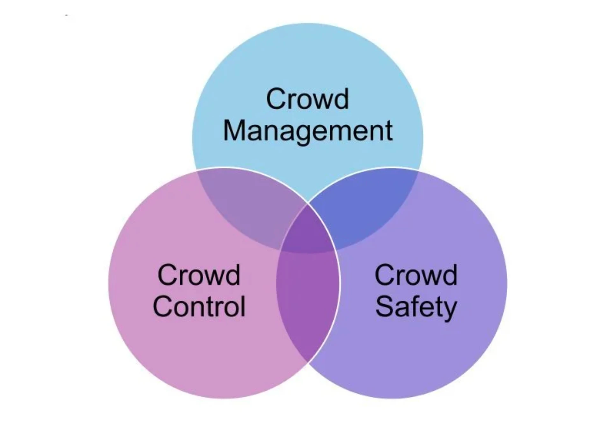

An event safety plan sets how many people fit and how they get out, but it does not say how to know, during the event, how many are in each area. This guide explains what the rules ask for, why one capacity figure for the whole site is not enough and which methods exist to measure real occupancy, with their limits. It is written for people who organise events or run venues, not for lawyers, and it does not replace local rules or the advice of the licensing authority.

## 1. What an event safety plan is and who needs one

Most countries ask large events for a written plan, under different names. Two examples:

- **Spain:** the *plan de autoprotección* (self-protection plan), regulated by **Royal Decree 393/2007**. Writing, implementing, maintaining and reviewing it is the responsibility of the **activity holder**, who must also submit it to the licensing authority ([BOE](https://www.boe.es/buscar/act.php?id=BOE-A-2007-6237)).
- **United Kingdom:** organisers must assess crowd safety risks by law and write a **crowd management plan** from that assessment, with how to respond to accidents and emergencies ([HSE](https://hse.gov.uk/event-safety/crowd-management-assess.htm)).

In Spain the plan is mandatory for public shows and recreational activities from these capacities:

| Type of space | Mandatory from |
| --- | --- |
| Closed building | 2,000 people (or an evacuation height of 28 m) |
| Closed temporary or seasonal installation | 2,500 people |
| Open-air activity | 20,000 people |

These are national minimums. Regions and city councils can lower them: Zaragoza, for example, requires a plan from 10,000 attendees ([Zaragoza City Council](https://www.zaragoza.es/sede/servicio/tramite/4032)). Before organising an event, ask the local authority what applies there.

The Spanish rule also sets how the plan is kept up to date: a **drill at least once a year** and a **review at least every three years** ([BOE](https://www.boe.es/buscar/act.php?id=BOE-A-2007-6237)). The UK guidance asks for periodic reviews and a debrief after each event, especially after an incident ([HSE](https://hse.gov.uk/event-safety/crowd-management-assess.htm)).

## 2. What the plan says about capacity and evacuation

In the Spanish model, three of the plan's nine chapters deal directly with how many people there are and how they get out ([BOE](https://www.boe.es/buscar/act.php?id=BOE-A-2007-6237)):

- **Risk analysis:** identify, quantify and classify the people who come in, staff and public.
- **Measures and resources:** evacuation routes and shelter areas, with the number of people to evacuate or shelter in each area.
- **Emergency action plan:** detection and alert, alarm, evacuation or sheltering, and who does what.

In buildings, capacity is usually calculated from a floor area per person. Spain's building code (DB-SI 3) uses these values ([DB-SI 3](https://normatia.com/es/normativa/cte-db-si/2025/seccion-si-3-evacuacion-de-ocupantes)):

| Use | Area per person | Equals |
| --- | --- | --- |
| Standing spectators | 0.25 m² | 4 people/m² |
| Nightclubs | 0.5 m² | 2 people/m² |
| Standing customers in bars and cafés | 1 m² | 1 person/m² |
| Seated public with defined seats | 1 person per seat | — |

The UK Green Guide for sports grounds uses a similar figure for standing terraces, 4.7 people/m² ([G. Keith Still](https://www.gkstill.com/Support/crowd-density/CrowdDensity-1.html)).

Exits are then sized from that occupancy. In the Spanish code, for example, a door needs at least 1 m of width for every 200 people who leave through it (A ≥ P/200, minimum 0.80 m) ([DB-SI 3](https://normatia.com/es/normativa/cte-db-si/2025/seccion-si-3-evacuacion-de-ocupantes)). These codes are written for buildings; for open-air events, capacity criteria come from regional or local authorities.

## 3. Why the plan's figure is not enough

The plan's capacity is a figure for **the whole site** and assumes people spread out evenly. During the event they do not: the crowd gathers in front of the stage, at entrances, at bars and at bottlenecks.

An illustrative example: a 5,000 m² standing area has, at 4 people/m², a capacity of 20,000. If 20,000 people attend and a quarter of them gather in the 1,000 m² in front of the stage, that area holds 5 people/m², while the rest stands at 3.75. The total is within capacity, but the stage area is at the upper limit accepted for a standing crowd.

Design values are also high compared with those crowd science uses for everyday operation:

- **2 people/m²** is the usual limit for assessing events, and **5 people/m²** the maximum for a standing crowd in viewing areas ([G. Keith Still](https://www.gkstill.com/Support/crowd-density/CrowdDensity-1.html)).
- When people **walk**, flow becomes unstable above about 0.8 people/m² and congestion is almost certain above 1.6 ([Gerlach and Seyfried, University of Wuppertal](https://svpt.uni-wuppertal.de/fileadmin/bauing/svpt/Publikationen/LoPa_EVC_Beitrag_english.pdf)).

A figure meant to size exits does not work as an alert threshold. We explain this in more detail, with real cases, in [From counting to predicting congestion](/en/research/from-counting-to-predicting-congestion).

## 4. How to measure occupancy during the event

The UK regulator's event safety guidance suggests monitoring three things: the **total** number of people, how they are **spread out** and how they **move in and out** of each area, with special attention to entrances, stage fronts, queues, stairs and bottlenecks ([HSE](https://www.hse.gov.uk/Event-Safety/crowd-management-monitoring.htm)). No single method covers everything:

| Method | What it measures | Works best at | Limits |
| --- | --- | --- | --- |
| Hand counters (clickers) | Entries and exits at one point | Controlled entrances, small events | Depends on each person's attention; says nothing about how the crowd spreads inside |
| Turnstiles, tickets or chipped wristbands | Total entries (and exits, if scanned) | Closed venues with controlled access | Does not work on public streets; cannot see concentrations inside the site |
| Stewards observing | Mood, pushing, people in distress | Every event; spots what a sensor cannot | Gives no figures; covers large or low-visibility areas poorly |
| Cameras (CCTV) | Image of the area; with software, counts and density | Critical points with good light | Capture identifiable people, which is personal data under the GDPR in Europe: signage, limited purpose and deletion after a month as a rule in Spain ([AEPD](https://www.aepd.es/guias/guia-videovigilancia.pdf)) |
| Mobile phone or wifi signals | Devices detected in an area | City-scale trends and movement | Counts devices, not people: someone may carry two or none ([arXiv 2401.09014](https://arxiv.org/pdf/2401.09014)) |
| People counting sensors (LiDAR, thermal) | People and density per area, minute by minute | Specific critical areas, day and night | Need installing and validating at each site; LiDAR captures no faces but is not anonymous by nature ([LiDAR in 10 questions](/en/research/lidar-in-10-questions)) |

At open events, without fences or turnstiles, HSE recommends sampling flow rates at entrances and making rough counts over small marked areas ([HSE](https://www.hse.gov.uk/Event-Safety/crowd-management-monitoring.htm)). Combining methods usually works better than relying on one: counting gives the figure, while stewards and cameras give the context.

## 5. What to add to the plan

The rules do not require measuring occupancy during the event, but the plan is the natural place to write it down. A checklist:

- **Areas and critical points.** Divide the site into areas and mark where people gather: entrances, stage front, bars, stairs and bottlenecks. HSE suggests this for outdoor sites with unclear boundaries ([HSE](https://hse.gov.uk/event-safety/crowd-management-assess.htm)).
- **Thresholds per area**, different for standing and walking crowds, instead of one figure for the whole site.
- **A measuring method** for each area, who runs it and how often it is checked.
- **Who looks at the data and who decides**, and what they do at each threshold: open another exit, close an entrance, make an announcement.
- **Test it in the drill** together with the rest of the plan.
- **What data is kept and for how long**, especially with cameras.

International guidance points the same way. **ISO 22353:2026**, published in August 2026, gives crowd management guidelines for organisers, venues and emergency services, including capacity assessment and the management of arrival, circulation and departure ([ISO](https://www.iso.org/standard/50259.html)).

## Limits of this guide

- **It is not legal advice.** It summarises Spanish national rules and UK guidance as examples; regions, cities and other countries add their own requirements.
- **Building codes apply to buildings.** The densities in the table need not be the ones a local authority requires for an open-air event.
- **The example in section 3 is illustrative**, not a real calculation for any venue.
- **We have not read the full text of ISO 22353**, only its official summary.

## Sources

**Regulations and standards**

- [Royal Decree 393/2007, Basic Self-Protection Standard](https://www.boe.es/buscar/act.php?id=BOE-A-2007-6237) (BOE, Spain, in Spanish)
- Spanish building code: [DB-SI 3, evacuation of occupants](https://normatia.com/es/normativa/cte-db-si/2025/seccion-si-3-evacuacion-de-ocupantes) (in Spanish)
- Zaragoza City Council: [self-protection plan procedure](https://www.zaragoza.es/sede/servicio/tramite/4032) (in Spanish)
- AEPD (Spanish Data Protection Agency): [guide on the use of video cameras](https://www.aepd.es/guias/guia-videovigilancia.pdf) (in Spanish)
- ISO: [ISO 22353:2026, Security and resilience — Guidelines for crowd management](https://www.iso.org/standard/50259.html)

**Guidance and studies**

- HSE: [Monitor the crowd](https://www.hse.gov.uk/Event-Safety/crowd-management-monitoring.htm) and [Assess crowd safety risks and identify hazards](https://hse.gov.uk/event-safety/crowd-management-assess.htm)
- G. Keith Still: [Crowd density](https://www.gkstill.com/Support/crowd-density/CrowdDensity-1.html)
- Gerlach and Seyfried, [University of Wuppertal](https://svpt.uni-wuppertal.de/fileadmin/bauing/svpt/Publikationen/LoPa_EVC_Beitrag_english.pdf): density thresholds in pedestrian flows
- [Counting pedestrian flows with different sensors](https://arxiv.org/pdf/2401.09014) (arXiv 2401.09014)

*Draft of 1 November 2026. Publication date pending.*
