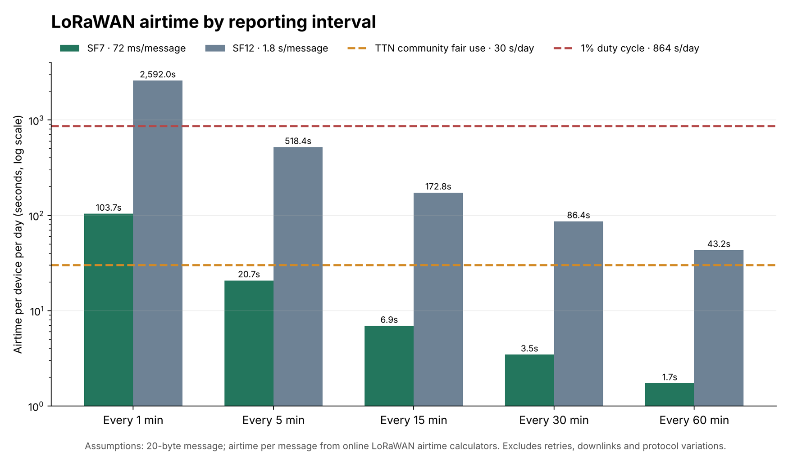

Most writing about smart-city sensing assumes a fixed installation: sensors on buildings, fibre in the street, mains power and months to tune the system. Street events, festivals, parades and marathons are the opposite. The equipment arrives on a truck, goes up in hours, runs for a day or a weekend and comes down again. And the moment the system matters most, when the crowd peaks, is the moment the shared mobile network is least able to carry its data. This article looks at what that means for the architecture as a whole: networks, power, deployment, data sources, standards and security.

*A reference architecture for temporary sites. Sensors feed edge nodes that process data locally; a local MQTT broker collects their metrics, buffers them and sends them over two independent paths, a high-capacity primary link (private 4G/5G or temporary fibre) and a low-bandwidth secondary one (satellite or LoRaWAN), to a city platform with standard interfaces (NGSI-LD or SensorThings API). Own diagram.*

## What makes an environment “dynamic”

Four properties rarely coincide in fixed deployments but are normal at temporary sites:

1. **Temporary installation.** Sensors are mounted in hours on lighting towers, fences, trusses or trailers, often by crews who did not design the system.
2. **No fixed power or network.** Power comes from generators, batteries or temporary distribution boards; backhaul from whatever exists: public cellular, a temporary fibre run, satellite.
3. **A layout that changes.** Stages, barriers, closed streets and one-way systems move during the day, so counting lines and zones defined at setup can stop being valid.
4. **Peak load at the worst moment.** Arrival, departure and incidents are when monitoring matters most, and also when shared networks are saturated.

Researchers at Osaka University and NAIST have argued for years that this calls for processing near the source and exchanging higher-level information instead of raw data. Their *Information Flow of Things* framework distributes processing among the devices themselves ([Yasumoto et al., 2016](https://www.jstage.jst.go.jp/article/ipsjjip/24/2/24_195/_pdf)), and Higashino and colleagues extended the idea to disaster-resilient cities, where cloud-centric designs limit communication capacity and complicate privacy ([Higashino et al., ICDCS 2017](https://www.researchgate.net/publication/318476653_Edge_Computing_and_IoT_Based_Research_for_Building_Safe_Smart_Cities_Resistant_to_Disasters)). What happens inside a single processing node is covered in our article on edge processing; here we look at how many nodes work together when nothing around them is permanent.

## The network is the binding constraint

In a temporary deployment, the sensor is rarely what limits the system. The network is.

The evidence that public mobile networks degrade at mass events is consistent across a decade of studies:

- **US operator logs, 2012.** Shafiq and colleagues analysed radio-access and core-network logs from a tier-1 US operator during two high-profile crowded events and found clear performance degradation (*A First Look at Cellular Network Performance during Crowded Events*, ACM SIGMETRICS).
- **A German music festival.** A crowdsourced study with more than 1,000 participants, at a festival with over 110,000 visitors a day, measured significant increases in DNS and HTTP failures and in page-load times (PAM 2016).
- **A football stadium, 2026.** At Notre Dame Stadium, with 77,622 spectators, game-day load caused what the authors call a severe cellular “uplink gap”: image uploads failed up to 46% of the time ([arXiv 2607.16008](https://arxiv.org/abs/2607.16008)). A companion study compared uplink inside the stadium bowl with a cell-on-wheels in the car park ([arXiv 2604.04371](https://arxiv.org/abs/2604.04371)).
- **Operator blind spots.** Operator logs can miss incidents such as “sleeping cells” during crowded events, which is why Baena and colleagues proposed virtual user-equipment probes to measure what users actually experience ([Sensors, 2021](https://pmc.ncbi.nlm.nih.gov/articles/PMC8153328/)).

*Measuring what a network really delivers during a crowded event is a research field of its own. The figure maps the challenges (red), research lines (green) and applications of virtual user-equipment probes, which test the network from the user’s side. Source: Baena et al., Sensors 21(10):3404, 2021, figure 14 ([PMC](https://pmc.ncbi.nlm.nih.gov/articles/PMC8153328/)), CC BY 4.0.*

**Why uplink is the problem.** Public networks are built for people downloading. A BBC and University of Strathclyde paper notes that around 75% of a public network’s resources go to downlink, and that public TDD networks in the UK must share a fixed 3:1 downlink-to-uplink pattern to avoid interfering with each other ([Yoffe et al., NAB 2024](https://strathprints.strath.ac.uk/88699/1/Yoffe-etal-NAB2024-Using-a-private-5G-network-to-support-the-international-broadcast-of-the-coronation-of-HM-King-Charles-III.pdf)). Sensor networks do the opposite: they mostly send. They compete for exactly the direction that runs out first.

The practical consequence: a crowd-monitoring system that depends on the public network to raise an alert should be assumed unavailable at peak. The architecture has to count at the edge, send small metrics instead of raw data, and bring its own backhaul, or several.

## Communications options for temporary sites

| Option | Figures | Under crowd load | Setup |
| --- | --- | --- | --- |
| Public 4G/5G, shared | Notre Dame Stadium: up to 46% failed image uploads at 77,622 spectators | Uplink degrades first | Nothing to install, nothing guaranteed |
| Pop-up private 5G | 2023 Coronation, London: 7 cells on 4 sites, about 160 Mbit/s uplink per cell and over 1 Gbit/s in total | Not shared with the public, so capacity holds | About three months of planning, spectrum licence, radio surveys |
| Operator network slice | Reserved share of a public 5G standalone network; used by a broadcaster at the same Coronation | Operator claims no competition with subscribers (vendor claim) | SIM-based, no spectrum licence for the user |
| Temporary fibre or copper | The Coronation network used fibre between radios and base stations and a 10 Gbit/s fibre backhaul | Unaffected by radio congestion | Needs cable routes, crossings and protection |
| LoRaWAN (EU 868 MHz) | Legal limit of 1% airtime in most sub-bands, i.e. 864 s a day per device | Unlicensed band, independent of phone traffic, but limited by collisions | Gateways in hours, battery-powered nodes |
| Satellite (low Earth orbit) | Performance competitive with cellular in a global study, with short dips every 15 s | Independent of ground congestion | Minutes, needs a clear view of the sky |

Sources: [arXiv 2607.16008](https://arxiv.org/abs/2607.16008); [Yoffe et al., NAB 2024](https://strathprints.strath.ac.uk/88699/1/Yoffe-etal-NAB2024-Using-a-private-5G-network-to-support-the-international-broadcast-of-the-coronation-of-HM-King-Charles-III.pdf); [Vodafone UK](https://www.vodafone.co.uk/newscentre/our-network/itn-to-broadcast-king-charles-coronation-using-5g-standalone/); [The Things Network, duty cycle](https://www.thethingsnetwork.org/docs/lorawan/duty-cycle/); Mohan et al., ACM Web Conference 2024.

**Private 5G: the best-documented case.** For the coronation of King Charles III on 6 May 2023, the BBC and partners ran a standalone private 5G network along The Mall in London, on licensed shared spectrum around 3.8–3.9 GHz. Because it was private, it could use an uplink-heavy frame instead of the public 3:1 pattern. The paper reports a round-trip time of 37 ms from London to France and capacity that held while public networks were saturated. A single test cell had earlier carried 20 simultaneous HD video streams ([Yoffe et al., NAB 2024](https://strathprints.strath.ac.uk/88699/1/Yoffe-etal-NAB2024-Using-a-private-5G-network-to-support-the-international-broadcast-of-the-coronation-of-HM-King-Charles-III.pdf)). For crowd sensing the takeaway is simple: a private cell sized for broadcast video can carry hundreds of sensors that only send metrics. The real costs are the licence, the radio planning and access to masts.

**LoRaWAN: only for small, infrequent messages.** In Europe the 868 MHz band limits each device to 1% airtime in most sub-bands (0.1% or 10% in others), a rule that comes from the ETSI EN 300 220 standard. Community networks can be stricter: The Things Network allows 30 seconds of uplink airtime per device per day ([TTN](https://www.thethingsnetwork.org/docs/lorawan/duty-cycle/)). Airtime depends heavily on the spreading factor: online calculators give about 72 ms for a 20-byte message at SF7 and about 1.8 s at SF12. Our own arithmetic from those figures: a counter reporting every 5 minutes at SF7 uses about 21 s a day and fits the community limit; reporting every minute uses about 104 s, legal under the 1% rule but over the community allowance. LoRaWAN suits people counters that send an aggregated number every few minutes, not tracks or images.

*Daily airtime of one device sending a 20-byte message at different intervals, at SF7 (about 72 ms per message) and SF12 (about 1.8 s). Dashed lines: The Things Network’s 30 s/day fair-use limit and the 1% legal duty cycle (864 s/day). At SF12, even one message an hour exceeds the community limit, and one a minute exceeds the legal limit. Our own calculation; excludes retries and downlinks.*

**Satellite: a backup with variable performance.** A global analysis of Starlink measurements found performance competitive with cellular, but latency rises noticeably under load, and periodic satellite reconfigurations every 15 seconds cause brief drops (Mohan et al., ACM Web Conference 2024). A longer study with three terminals in different countries found large throughput swings over short time scales (*Vivisecting Starlink Throughput*, ACM CoNEXT 2025). It is a sensible second path for metrics, not a guaranteed primary link.

**NB-IoT and LTE-M** run on the public operator’s network, so they share its capacity problems at peak. We found no measurements of their behaviour at crowded events.

## Power and autonomy

At a temporary site, every watt has to be carried in, generated or borrowed from the event’s own distribution. Some reference figures:

| Item | Figure | Source |
| --- | --- | --- |
| Power over Ethernet (IEEE 802.3af / at / bt) | Guaranteed at the device: 12.95 / 25.5 / 51 / 71.3 W | Vendor technical notes (IEEE text is paywalled) |
| Edge computer in an outdoor enclosure (Jetson AGX Orin with LTE module) | 19.1 W average running a YOLOv8s detector at 108.8 frames/s; 36.5 W under stress | [Krišlauks et al., Electronics 2026](https://www.mdpi.com/2079-9292/15/11/2467) |
| Satellite terminal, standard size | 75–100 W average, 20 W idle | Starlink specifications (vendor) |
| Satellite terminal, compact | 20–40 W average according to Starlink’s help centre, 25–40 W according to its own spec sheet | Starlink (vendor; the two documents disagree) |
| Satellite terminal on a moving vehicle | 113 W average, 48–191 W range, higher below 0 °C because of the heater | [Starlink on the Road, arXiv 2403.13497](https://arxiv.org/abs/2403.13497) |
| Lithium iron phosphate (LiFePO4) cells | Charge between 0 and 55 °C, discharge between −20 and 55 °C | Manufacturer datasheet |

**A rough sizing, our own estimate.** Energy needed is roughly the sum of each load times its hours, divided by the usable share of the battery and the conversion efficiency. For 24 hours, a standard-size satellite terminal alone needs 1.8–2.4 kWh before losses, a compact one 0.5–1 kWh, and a counting node with a Jetson-class computer at about 19 W adds about 0.46 kWh. Two conclusions follow. Satellite backhaul should be shared by a cluster of sensors, not fitted to each one. And low-rate counters on LoRaWAN, running on small batteries, are orders of magnitude cheaper to keep alive than anything with a modem and a GPU.

**Published guidance is thin.** The British standard BS 7909:2023 covers the safety of temporary electrical systems for events and adds a section on battery storage, but it is not a sizing method. The UK Health and Safety Executive’s guidance on crowds asks organisers to consider back-up power and a contingency plan for system failure, without numbers. We found no published, quantitative guide to sizing power for a 12–24 hour event sensor kit.

**Heat is the other enemy.** In the enclosure study above, the computer throttled at +40 °C ambient under a stress load, though not under a realistic detection workload ([Krišlauks et al., 2026](https://www.mdpi.com/2079-9292/15/11/2467)). In direct summer sun an enclosure runs well above air temperature, and battery charging limits can be reached inside a dark box. Shade, light-coloured housings and keeping batteries away from the computer are the simple fixes.

## Deploying in hours, not weeks

The most detailed public account of a temporary network build is, again, the Coronation ([Yoffe et al., NAB 2024](https://strathprints.strath.ac.uk/88699/1/Yoffe-etal-NAB2024-Using-a-private-5G-network-to-support-the-international-broadcast-of-the-coronation-of-HM-King-Charles-III.pdf)). The steps are worth copying:

- **Rehearse off site.** The team tested with the real end devices at a remote test bed, including a tree-lined drive chosen to imitate The Mall.
- **Survey on site.** Spectrum surveys, a test licence and two on-site test days with external users two months before the event.
- **Use what is already there.** Antennas went on existing event infrastructure, such as camera platforms, radio booths and a trailer mast, with allowance for tree canopy growth and for the crowd itself absorbing signal.
- **Model, then measure.** Radio propagation was modelled for the regulator and then checked by walking and driving the route with logging devices; measured coverage beat the prediction.
- **Build in spare capacity.** Extra computing and an extra channel at one site, in case something failed.

Planning started in February for a 6 May event. A crowd-sensing deployment is usually smaller, but the same logic applies. Drawing on that account and on the practice of the SAIL and CityFlows projects (below), a commissioning checklist could look like this:

1. **Pre-stage every kit off site** with the same firmware, credentials and broker addresses it will use on the day.
2. **On arrival, check time sync, both network paths and message publication** before mounting anything at height.
3. **Treat counting lines and zones as versioned configuration**, not code, so a layout change becomes a logged configuration push.
4. **Compare each sensor with a manual count** for a few minutes before the doors open, and record the bias.
5. **Rehearse failure:** unplug the main link and confirm that data is buffered and rerouted.

Commissioning also includes the software. At SAIL Amsterdam 2025 there was no historical data for the event, so the forecasting team used an adaptive model that learns from live sensor, weather and event data as the event runs ([AiMTT](https://aimtt.nl/use-cases/use-case-1-crowd-management-during-events/)).

## Combining data sources

No single source sees a crowd fully. Large events increasingly combine several, and each comes with its own errors:

| Source | Strengths | Known errors and biases |
| --- | --- | --- |
| LiDAR, 3D counting | Anonymous geometry, works at night | Occlusion in dense crowds; only sees its installed field of view |
| Cameras with AI density estimation | Wide area, density per m² | Thresholds depend on context; how many cameras actually run AI is often unclear |
| Wi-Fi probe counting | Cheap, passive, wide area | Phones randomise their MAC address, inflating counts; not everyone carries an active phone |
| Mobile network data | Citywide coverage, no field hardware | An operator-side estimate scaled by market share; cell-level resolution; minutes of delay |
| Ticketing and turnstiles | Exact at the gates | Only at controlled entrances; nothing for open street events |

**Wi-Fi counting after MAC randomisation.** Since around 2014 phones have used random addresses when searching for networks, so counting unique addresses overcounts. Newer methods partly recover accuracy: RateCount counts devices from how often they probe rather than from their addresses, and reports 66% lower counting error than earlier approaches ([arXiv 2507.03873](https://arxiv.org/abs/2507.03873)). Older studies reporting 90–96% accuracy may predate randomisation and no longer hold ([arXiv 2010.10370](https://arxiv.org/abs/2010.10370)). Wi-Fi counts are best used for trends and flows, calibrated on site against a reference, not as absolute headcounts.

**Mobile network data: Seoul.** Seoul launched a real-time urban data service in September 2022 and in June 2023 expanded it from 50 to 113 sites, with an open API. Its English portal now gives population for 116 key locations, updated every 5 minutes, and a city press release cites 121 locations, with density measured against the highest daily population of the previous 28 days. The figures are estimates from telecom data, and the number of sites changes over time, so any citation needs a date. According to press reports, the city’s mobile-data crowd system existed on the night of the Itaewon crush in October 2022 but was not used to raise an alarm. A data feed does not make a crowd safer unless someone is watching it, with thresholds and the authority to act.

**Many sources, one picture: SAIL Amsterdam 2025.** For the five-day maritime festival in August 2025, around 20 partners led by the Amsterdam-Amstelland safety region built a digital twin that combined 180 data sources: ship positions, cameras, mobile-device crowd sensors, road traffic, heat sensors and drone detection, according to the Dutch security cluster Security Delta (other accounts give different partner counts). A TU Delft forecasting model predicted pedestrian crowd levels up to about four hours ahead. The lesson is as much organisational as technical: the shared operating picture across agencies mattered as much as any sensor.

**How to avoid double counting.** A few rules, our own synthesis:

1. Treat **flows across lines** and **occupancy of zones** as different quantities, and fuse them separately.
2. Give each zone a **reference source**, and use the others only to correct or fill gaps.
3. **Never add up counts** from sensors whose fields of view overlap; reconcile them at zone level using a map of lines and zones.
4. Keep **timestamps and an uncertainty per source**, so a state estimator (a Kalman-type filter or a pedestrian model with data assimilation) can weight them.
5. **Log the calibration factor** of each source at each event, so the next event starts from evidence.

## Open standards: making sources talk to each other

At a temporary site, equipment from different vendors and city systems has to work together within hours. Open standards make that possible without custom integration each time:

| Standard | Status (October 2026) | What it is for |
| --- | --- | --- |
| MQTT | ISO/IEC 20922 | Lightweight publish/subscribe messaging from nodes |
| Sparkplug | [ISO/IEC 20237:2023](https://www.iso.org/standard/86204.html) | Topic names, payloads and session state on top of MQTT; “birth” and “death” messages suit nodes that appear and disappear |
| OGC SensorThings API | [Version 1.1](https://docs.ogc.org/is/18-088/18-088.html) (2021), with MQTT support; version 2.0 proposed | An observation-centred API with locations; a good fit for counters |
| ETSI NGSI-LD | GS CIM 009 v1.9.1, July 2025 | The context-information API used by FIWARE platforms |
| FIWARE Smart Data Models | [CrowdFlowObserved](https://github.com/smart-data-models/dataModel.Transportation/blob/master/CrowdFlowObserved/README.md), still at version 0.0.3 | A ready-made data schema for people-flow observations |
| OASC Minimal Interoperability Mechanisms | [MIM1 and MIM2](https://oascities.org/wp-content/uploads/2019/06/OASC-MIMs.pdf) adopted in 2019; approved by ITU-T as [Y.MIM](https://oascities.org/united-nations-approves-y-mim-standard-for-minimal-interoperability/) in July 2024 | Procurement language for cities |

A minimal stack that follows from this, as a suggestion: nodes publish small metric messages over MQTT, optionally with Sparkplug for state, to a local broker at the event. A bridge exposes them as NGSI-LD entities using the crowd-flow model, or as SensorThings observations, so city platforms and data spaces can use them. Cities can ask for MIM1 and MIM2 conformance when they buy.

The standards still have gaps. Crowd density, zone occupancy and layout changes are not yet fully described in the current data models, and CrowdFlowObserved is still an early version.

## Security and lifecycle

Temporary kits are physically exposed, move between sites and clients, and are often set up by people who did not build them. In the EU they are also now covered by binding cybersecurity rules:

- **Radio Equipment Directive, delegated act.** [Delegated Regulation (EU) 2022/30](https://eur-lex.europa.eu/eli/reg_del/2022/30/oj) applies cybersecurity requirements to internet-connected radio equipment: protecting the network, personal data and against fraud. It has applied since **1 August 2025**. The harmonised standards EN 18031-1/-2/-3 were published in the Official Journal in January 2025 with restrictions, including on default-password options. Wi-Fi, LTE, 5G and LoRaWAN nodes that can reach the internet are generally in scope, and people counters that handle location data fall under the personal-data requirement.
- **Cyber Resilience Act.** Under [Regulation (EU) 2024/2847](https://eur-lex.europa.eu/eli/reg/2024/2847/oj), manufacturers have had to report actively exploited vulnerabilities and severe incidents since **11 September 2026**, through ENISA’s single reporting platform: an early warning within 24 hours and a notification within 72 hours. This also covers products already on the market. The full requirements and CE marking apply from **11 December 2027**.

Good practice for temporary kits, our own synthesis:

- unique credentials per device, never shared or default passwords;
- mutual TLS between nodes and the broker;
- signed over-the-air updates installed before deployment, with updates frozen during the event;
- tamper-evident seals and an alert when an enclosure is opened;
- local logs kept for post-event review;
- a tested “wipe and re-provision” step at teardown, because kits move between events and clients.

## Lessons from real deployments

| Case | What was deployed | Architectural lesson |
| --- | --- | --- |
| SAIL Amsterdam 2015 | A TU Delft crowd-monitoring system combining people-counting cameras, Wi-Fi sensors and social-media analysis | Early multi-source fusion; public worry about surveillance showed that explaining privacy is part of the job |
| SAIL Amsterdam 2025 | A digital twin for the safety region combining 180 data sources; forecasts up to about four hours ahead | A shared picture across some 20 agencies mattered as much as the sensors; forecasting with no history needs adaptive models |
| [CityFlows](https://www.eiturbanmobility.eu/projects/cityflows-2/) (EIT Urban Mobility) | Living labs in Amsterdam, Milan (Milano Centrale, 5G and computer vision) and Barcelona (Park Güell); the Amsterdam lab was turned to COVID-19 monitoring when SAIL 2020 was cancelled | Crowd decision-support systems must be easy to repurpose |
| Coronation, London 2023 | Pop-up private 5G with fibre backhaul | A dedicated uplink survives peak crowds; planning took about three months |
| Maha Kumbh Mela, Prayagraj 2025 | Integrated command centres and thousands of cameras, some with AI. Official, press and vendor figures disagree, from around 300 to over 2,700 cameras ([Drishti IAS](https://www.drishtiias.com/state-pcs-current-affairs/ai-in-maha-kumbh-2025), [Gulf News/AFP](https://gulfnews.com/amp/story/world%2Fasia%2Findia%2Findia-uses-ai-to-stop-stampedes-at-kumbh-mela-1.500020756), [L&T](https://www.businesswire.com/news/home/20250306456928/en)) | A crowd crush on 29 January 2025 happened despite the technology; press reported gaps due to poor connectivity. Inconsistent public figures make independent evaluation impossible |
| Seoul, after Itaewon | Real-time population estimates from telecom data for more than 100 locations | Data has to be wired to thresholds, alerts and someone accountable |

## Open problems

- **No benchmark for deployment.** There is no peer-reviewed study of how long it takes to commission a temporary crowd-sensing kit, how accurate it is on day one, or how much it drifts.
- **No power-sizing guide** for 12–24 hour event sensor kits.
- **No shared ground truth.** Nobody has published a comparison of Wi-Fi, mobile network, camera and LiDAR counts at the same event against an independent count.
- **Data models lag behind.** Density, occupancy and changing layouts are not yet well described in open data models.
- **Governance.** How to share live crowd data across agencies and data spaces while meeting data-protection law and the EU AI Act’s rules on video analytics.
- **Transparency.** Inconsistent public reporting at mega-events, such as camera counts at the Kumbh Mela, prevents anyone from learning what worked.

## Conclusion

In a dynamic environment, the sensor is the easy part. A robust system counts at the edge, sends only small metrics, brings at least two independent ways of getting them out, carries its own power budget, treats every data source as a biased estimate to be calibrated on the day, speaks open standards, and is secured and wiped like the travelling equipment it is. Above all, it connects data to people who can act on it: the cases above show that data no one is watching protects no one.

## Sources

**Architectures and dynamic environments**

- Yasumoto, Yamaguchi and Shigeno (2016). Survey of real-time processing technologies of IoT data streams. *Journal of Information Processing* 24(2): https://www.jstage.jst.go.jp/article/ipsjjip/24/2/24_195/_pdf
- Higashino et al. (2017). Edge computing and IoT based research for building safe smart cities resistant to disasters. IEEE ICDCS: https://www.researchgate.net/publication/318476653_Edge_Computing_and_IoT_Based_Research_for_Building_Safe_Smart_Cities_Resistant_to_Disasters

**Networks at mass events**

- Notre Dame Stadium cellular study, 2026: https://arxiv.org/abs/2607.16008
- Stadium uplink vs cell-on-wheels, 2026: https://arxiv.org/abs/2604.04371
- Baena et al. (2021). Virtual UE probes for crowded events. *Sensors* 21(10):3404: https://pmc.ncbi.nlm.nih.gov/articles/PMC8153328/
- Shafiq et al. A first look at cellular network performance during crowded events. ACM SIGMETRICS.
- Crowdsourced measurements at a German music festival. PAM 2016, Springer LNCS.
- Yoffe et al. (2024). Using a private 5G network to support the international broadcast of the coronation of HM King Charles III. NAB BEIT: https://strathprints.strath.ac.uk/88699/1/Yoffe-etal-NAB2024-Using-a-private-5G-network-to-support-the-international-broadcast-of-the-coronation-of-HM-King-Charles-III.pdf
- Vodafone UK, 5G standalone slice at the Coronation (vendor): https://www.vodafone.co.uk/newscentre/our-network/itn-to-broadcast-king-charles-coronation-using-5g-standalone/
- The Things Network, LoRaWAN duty cycle: https://www.thethingsnetwork.org/docs/lorawan/duty-cycle/
- Mohan et al. (2024). Starlink performance, global analysis. ACM Web Conference 2024.
- *Vivisecting Starlink Throughput*. ACM CoNEXT 2025.

**Power and heat**

- Krišlauks et al. (2026). Edge computer in an outdoor enclosure. *Electronics* 15(11):2467: https://www.mdpi.com/2079-9292/15/11/2467
- Starlink on the Road: https://arxiv.org/abs/2403.13497

**Data sources**

- RateCount, Wi-Fi counting under MAC randomisation: https://arxiv.org/abs/2507.03873
- Privacy-preserving large-crowd counting: https://arxiv.org/abs/2010.10370
- SAIL 2025 forecasting use case (AiMTT): https://aimtt.nl/use-cases/use-case-1-crowd-management-during-events/
- CityFlows, EIT Urban Mobility: https://www.eiturbanmobility.eu/projects/cityflows-2/ · https://www.cityflows-project.eu/news/

**Standards**

- Sparkplug, ISO/IEC 20237:2023: https://www.iso.org/standard/86204.html
- OGC SensorThings API 1.1: https://docs.ogc.org/is/18-088/18-088.html
- FIWARE Smart Data Models, CrowdFlowObserved: https://github.com/smart-data-models/dataModel.Transportation/blob/master/CrowdFlowObserved/README.md
- OASC MIMs: https://oascities.org/wp-content/uploads/2019/06/OASC-MIMs.pdf · ITU-T Y.MIM: https://oascities.org/united-nations-approves-y-mim-standard-for-minimal-interoperability/

**Regulation**

- Delegated Regulation (EU) 2022/30 (Radio Equipment Directive): https://eur-lex.europa.eu/eli/reg_del/2022/30/oj
- Cyber Resilience Act, Regulation (EU) 2024/2847: https://eur-lex.europa.eu/eli/reg/2024/2847/oj

**Cases**

- Maha Kumbh 2025: https://www.drishtiias.com/state-pcs-current-affairs/ai-in-maha-kumbh-2025 · https://gulfnews.com/amp/story/world%2Fasia%2Findia%2Findia-uses-ai-to-stop-stampedes-at-kumbh-mela-1.500020756 · https://www.businesswire.com/news/home/20250306456928/en

*Review carried out on 30 October 2026. Figures marked as vendor claims or our own estimates are labelled as such in the text.*
