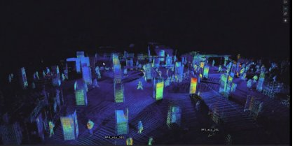
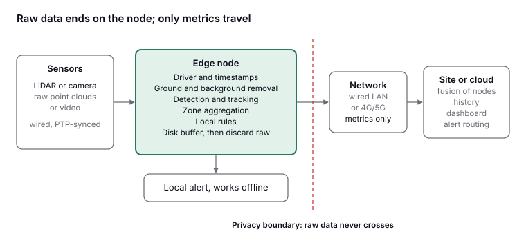
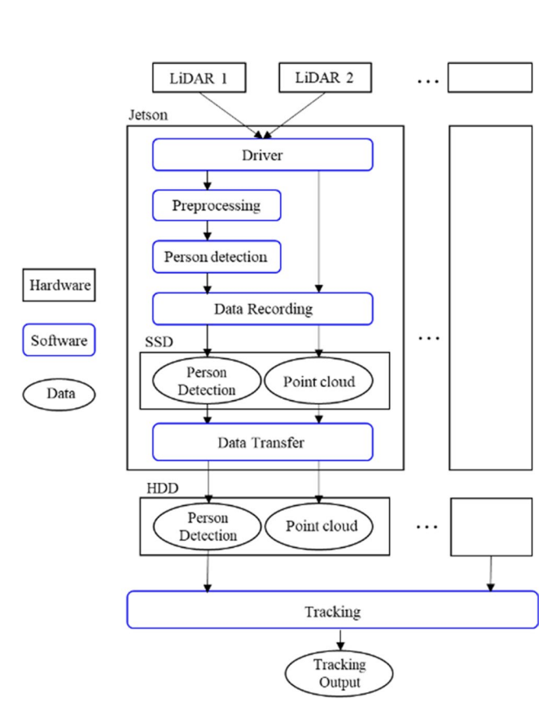
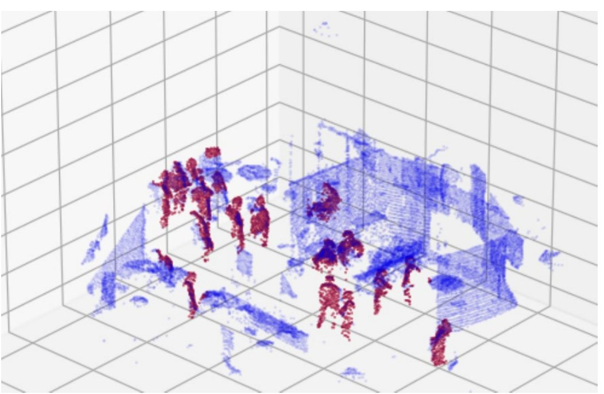

*Point clouds from twenty LiDARs merged into one scene of the central concourse of Nagoya Station, with people as coloured columns of points. Source: [Hishida et al., 2026](https://link.springer.com/article/10.1007/s13177-025-00610-9), Fig. 4, Int. J. ITS Research, CC BY 4.0.*

Processing sensor data on the device that captures it, and sending out only counts, densities and tracks, is the right default for crowd monitoring. It is the simplest way to meet data-protection duties, it takes the network out of the alert path, it cuts upstream traffic by roughly three orders of magnitude, and it keeps the system working when mobile networks saturate, which is exactly when crowds are largest. Deployed LiDAR systems in a Japanese railway concourse, on university light poles and across a 70-sensor building show that today's embedded hardware is up to the task. The hard problems now are calibration, time synchronisation, handover between sensors and running devices safely in public space.

## What "edge" means in crowd monitoring

Edge computing means processing data at the edge of the network, close to where it is generated, to reduce response time and bandwidth cost and to protect privacy ([Shi et al., 2016](https://ui.adsabs.harvard.edu/abs/2016IITJ....3..637S/abstract)). In crowd monitoring it helps to think in three tiers:

- **Sensor tier:** LiDAR, stereo or RGB cameras, radar. Produces raw frames or point clouds.
- **Node tier (the edge):** an embedded computer next to, or inside the housing of, one or a few sensors. It filters, detects, tracks and aggregates. This is where raw data should end its life.
- **Site or cloud tier:** a local server, a telecom edge host or a cloud service that combines metrics from many nodes, stores history and serves dashboards.

The design question is not "edge or cloud" but where to draw the line beyond which only anonymous, aggregated data travels. For crowd safety, the defensible line is at the node.

## Four reasons to process at the node

### 1. Privacy and data minimisation

The GDPR requires personal data to be limited to what is necessary (Art. 5(1)(c)) and requires data protection by design, decided when the system is designed (Art. 25) ([Art. 5](https://gdprfine.com/articles/article-5-data-minimisation), [Art. 25](https://www.dsgvo-portal.de/gdpr_article_25.php)). A system whose purpose is density and flow does not need raw video or point clouds to leave the device.

LiDAR is often presented as anonymous because it captures no faces or colours ([Ohno et al.](https://arxiv.org/pdf/2303.09915)). That is true but incomplete. LidarGait built a dataset of 25,239 sequences from 1,050 people and showed that 3D gait features from point clouds can recognise individuals, outdoors better than camera silhouettes ([Shen et al., CVPR 2023](https://arxiv.org/abs/2211.10598)). Sequences of point clouds can therefore be biometric. The practical rule: process raw point clouds on the node and discard them there, so that only aggregated metrics leave it.

### 2. Latency

At 10 Hz a LiDAR frame arrives every 100 ms. Detection on the node uses only part of that budget: 17.42 ms per sample in Arizona State University's pole-mounted counter ([Chen et al.](https://visa.lab.asu.edu/web/wp-content/uploads/2026/01/ICDCSa.pdf)) and 12 ms per frame for a CPU-only Random Forest detector at NORCE ([Belbachir et al., 2025](https://pmc.ncbi.nlm.nih.gov/articles/PMC12304050/)). A local rule, such as density above a set level in a zone, can then fire within one or two frames, with no network round trip. No published study was found that measures capture-to-alert time for crowd systems on the edge versus the cloud head to head; the argument rests on frame budgets and measured network behaviour.

### 3. Bandwidth

| Data stream | Rate | Source |
| --- | --- | --- |
| Ouster OS0-32, raw | 655,360 points/s; 66 Mbit/s | Specification table in [Chen et al.](https://arxiv.org/pdf/2311.18077) |
| Livox Mid-360, raw | 200,000 points/s at 10 Hz | [Livox user manual](https://terra-1-g.djicdn.com/65c028cd298f4669a7f0e40e50ba1131/Mid360/Livox_Mid-360_User_Manual_EN.pdf) |
| Livox Mid-360, raw | ≈ 22 Mbit/s | Estimate: 200,000 points/s × about 14 bytes per point |
| Twenty LiDARs at one site, raw | ≈ 0.4–1.3 Gbit/s | Estimate from the rows above |
| Zone metrics (40 zones, count, density and speed once a second) | ≈ 10–25 kbit/s | Estimate |

The ratio is roughly 1,000 to 5,000 to one per sensor. Even inside a station, raw LiDAR at scale strains the network: the Nagoya team reports that bandwidth limits made it hard to connect all its equipment to one network, which is why processing was split across several computers ([Hishida et al., 2026](https://link.springer.com/article/10.1007/s13177-025-00610-9)).

### 4. Resilience

Networks fail under exactly the conditions crowd monitoring exists for. A 2026 measurement study in a stadium with 77,622 spectators found that 46 % of image uploads over the cellular network failed on game day ([arXiv 2607.16008](https://arxiv.org/pdf/2607.16008)). Upload capacity is precisely what a cloud-dependent sensor needs.

At the 2010 Love Parade in Duisburg, mobile phones did not work between about 15:30 and 18:00 because the network was overloaded, and radio contact was poor ([Helbing and Mukerji, 2012](https://arxiv.org/pdf/1206.5856)). Those failures concerned human communication, not sensor systems, and nothing here suggests any technology would have prevented the disaster. The engineering lesson is narrower: a monitoring system that needs a public mobile network to raise an alert should be assumed unavailable at peak crowding. Nodes must be able to compute, alert locally and buffer data on their own.

## A reference architecture

*Sensors send raw data over a dedicated wired link to the edge node, which detects, tracks and aggregates people per zone and can raise a local alert on its own. Only metrics cross the privacy boundary to the network and on to a site server or the cloud, which combines nodes, keeps history and serves dashboards. Original diagram.*

## What an edge node looks like

### Hardware

| Component | Typical choice | Figures and design notes |
| --- | --- | --- |
| Sensor | 3D LiDAR, stereo or depth camera | Livox Mid-360: 360° × (−7° to 52°) field of view, 200,000 points/s, 10 Hz, 6.5 W, IP67, Ethernet, PTPv2 time sync ([specs](https://www.livoxtech.com/mid-360/specs)) |
| Compute | NVIDIA Jetson Orin NX or Orin Nano; older Jetson Nano; Google Coral | Orin NX: up to 100 TOPS at 10–25 W ([NVIDIA](https://www.nvidia.com/en-us/autonomous-machines/embedded-systems/jetson-orin/)). Nagoya used two Orin NX per five LiDARs; ASU used a Jetson Nano and a Coral board |
| Storage | Industrial SSD | For buffering when the network is down, and for logs |
| Connectivity | Wired Ethernet between sensor and computer; 4G/5G or Wi-Fi only for metrics | The sensor link carries raw data and should be a dedicated wired segment |
| Power | Power over Ethernet, mains or event power with a UPS | Roughly 6.5 W for the sensor plus 10–25 W for compute plus networking |
| Enclosure | Weatherproof, ventilated, tamper-resistant | ASU housed its devices inside the light pole and monitored internal temperature |

### Software, step by step

1. **Driver and timestamps:** receive packets and stamp them with a synchronised clock.
2. **Region of interest and ground removal:** keep only the walkable area and remove the floor.
3. **Background subtraction:** remove static structure using a stored map of the site.
4. **Clustering and detection:** group nearby points and classify which groups are people, with a simple classifier or a 3D neural detector.
5. **Tracking:** link each person across frames, usually with a Kalman filter.
6. **Aggregation:** counts, density per m², speed, direction and line crossings per zone.
7. **Local rules:** thresholds and rate-of-change alerts evaluated on the node.
8. **Publish and buffer:** send metrics with sequence numbers; queue them to disk when the uplink is down.
9. **Discard raw data:** keep raw frames, if at all, only in a short memory buffer.

*Software configuration of the 20-LiDAR system at Nagoya Station: each Jetson runs the driver, preprocessing and person detection for its LiDARs; tracking runs afterwards on the combined detections. Source: [Hishida et al., 2026](https://link.springer.com/article/10.1007/s13177-025-00610-9), Int. J. ITS Research, CC BY 4.0.*

Research systems often record raw point clouds for validation, as this one does: they are stored on each Jetson's SSD and later copied to a hard drive, and tracking is done offline. An operational system would discard raw data on the node and keep only detections and metrics.

## Evidence from real systems

All the systems below ran people detection on embedded or CPU-only hardware within the 100 ms budget of a 10 Hz sensor.

| Study | Setup | Edge hardware | Result |
| --- | --- | --- | --- |
| [Hishida et al., Nagoya University and JR Central, 2026](https://link.springer.com/article/10.1007/s13177-025-00610-9) | 20 LiDARs at 10 Hz in the central concourse of Nagoya Station | 8 Jetson Orin NX, two per group of five LiDARs; IA-SSD detector optimised with TensorRT | HOTA above 90 % in a 900 m² area covered by two or more LiDARs; tracking done offline |
| [Chen et al., Arizona State University](https://visa.lab.asu.edu/web/wp-content/uploads/2026/01/ICDCSa.pdf) | Ouster OS0-32 on campus emergency light poles, over a 5 m walkway | Jetson Nano and Coral board inside the pole; 8-bit quantised model | 17.42 ms per sample; 97.64 % accuracy in high-density settings |
| [Belbachir et al., NORCE, 2025](https://pmc.ncbi.nlm.nih.gov/articles/PMC12304050/) | Ouster OS1-128 at a conference venue | CPU-only Random Forest on 15 geometric and intensity features | 12 ms per frame; same F1 as PointNet, 2.5 times faster |
| [Ohno et al., Osaka University](https://arxiv.org/pdf/2303.09915) | 70 LiDARs over six floors of a campus building, without overlapping views | Per-LiDAR processing: background subtraction, clustering, Kalman tracking | 0.98 F-measure matching 32 people across sensors, without images |

*LiDAR point cloud from a conference venue, with the people found by the detector highlighted in red. Source: [Belbachir et al., 2025](https://pmc.ncbi.nlm.nih.gov/articles/PMC12304050/), Fig. 6, SN Computer Science, CC BY 4.0.*

The NORCE result matters for edge design: a classical classifier with hand-picked features matched a deep network at a fraction of the cost. Commercial platforms with an edge processor also exist, but their published accuracy and latency figures are marketing claims without independent evaluation.

## Designing for failure

- **Local-first alerting.** Evaluate safety rules on the node or on a site server reachable over a private wired network, with a local output (a relay, a display, a control-room feed) that does not depend on the public network.
- **Store and forward.** Give every message a node ID, a sequence number and a synchronised timestamp; queue to disk when the uplink fails and replay on reconnect. At about 20 kbit/s, buffering 2.5 hours of metrics (the length of the Love Parade outage) takes about 22 MB.
- **Explicit degraded modes.** Uplink lost: keep computing and alerting locally. One sensor lost: show its zones as "no data", not "zero people". Clock sync lost: keep running but mark data as unsynchronised. Compute overloaded: lower the frame rate or shrink the region before dropping zones.
- **Health monitoring.** Publish heartbeats with temperature, throttling, frame rate, dropped packets, clock offset, disk use and model version. Heat inside sealed enclosures is a first-order risk.
- **Never confuse silence with safety.** A dashboard must tell "0 people/m²" apart from "node offline".

## From one node to many

### Calibration between sensors

To combine data, each sensor's position and orientation must be known in a common site frame. Nagoya built a 3D map of the site, aligned each sensor roughly by hand and refined it automatically with ICP ([Hishida et al., 2026](https://link.springer.com/article/10.1007/s13177-025-00610-9)). Calibration methods without targets are improving: one recent method kept errors within 5 cm and 1° in hard cases across 16 LiDAR types, but it relies on motion from moving platforms, so it must be tested before use with fixed, widely spaced sensors ([Duan et al., 2024](https://arxiv.org/abs/2405.05589)). For fixed installations, a good site map plus ICP per sensor remains the practical baseline; repeat it whenever a mount is touched.

### Time synchronisation

At walking speed (about 1.3 m/s), a 100 ms clock offset between two sensors shifts a person by about 13 cm, enough to create duplicate or broken tracks where views overlap. Sensors such as the Livox Mid-360 support the Precision Time Protocol (IEEE 1588, PTPv2) and timestamp each point in nanoseconds ([Livox manual](https://terra-1-g.djicdn.com/65c028cd298f4669a7f0e40e50ba1131/Mid360/Livox_Mid-360_User_Manual_EN.pdf)). Use PTP on the sensor network; NTP is enough for metric messages and logs, not for fusing points.

### Handing tracks over between sensors

Where fields of view overlap, handover is geometric: tracks are matched by position and velocity. Where they do not, it becomes re-identification. The Osaka system matches trajectory segments across sensors using point-cloud shape features and a model of travel times, reaching 0.98 F-measure ([Ohno et al.](https://arxiv.org/pdf/2303.09915)). That creates a privacy tension: linking one person's movements across a site is exactly what LidarGait warns about. If the goal is flow, prefer counts between zones and short-lived track IDs reset at zone boundaries.

### Flows from a few observation points

Full coverage is rarely affordable. Osaka University researchers estimate pedestrian flows across an area from counts at a few observation points, solving for the routes that best fit the counts; in front of JR Osaka Station the estimation errors stayed below about 8 % ([Higashino et al., 2017](https://ieeexplore.ieee.org/document/7980110/)). A few well-placed nodes at entrances, bottlenecks and junctions, combined with a model of the street network, can rebuild the overall flows; dense tracking is needed only where local dynamics matter.

## Open-source building blocks

Most of the pipeline can be built from open-source parts with licences that allow commercial use. Check each repository's licence at the version you deploy, especially for model weights.

| Component | Purpose | Licence |
| --- | --- | --- |
| [livox_ros_driver2](https://github.com/Livox-SDK/livox_ros_driver2/blob/master/LICENSE.txt) and Livox-SDK2 | Drivers for Livox sensors; ROS 2 publishing | MIT |
| Autoware Universe | Ground segmentation, clustering, CenterPoint detection, multi-object tracking as ROS 2 nodes; built for vehicles, reusable for static sensors | Apache-2.0 |
| [Autoware lidar_transfusion](https://huggingface.co/AutowareFoundation/lidar_transfusion) | 3D detector as an ONNX model, built into a TensorRT engine on the device; trained on vehicle data, so expect to retrain for overhead views | Apache-2.0 |
| [OpenPCDet](https://github.com/open-mmlab/openPCDet) | Training 3D LiDAR detectors (PointPillars, PV-RCNN and others) | Apache-2.0 |
| mmdetection3d | OpenMMLab 3D detection toolbox | Apache-2.0 |
| PCL (Point Cloud Library) | Filtering, segmentation, registration (ICP) | BSD |
| [Open3D](https://github.com/isl-org/Open3D/blob/main/LICENSE) | Point-cloud processing, registration, visualisation | MIT |
| ROS 2 | Middleware, recording, tooling | Apache-2.0 (core) |
| MQTT (for example, Eclipse Mosquitto) | Lightweight publish/subscribe for metrics; "last will" messages help with node health | Open standard |
| NVIDIA JetPack and TensorRT | Board support and optimised inference | Proprietary (some parts open); creates vendor lock-in |

## Limits and trade-offs

- **Compute, power and heat.** Jetson-class modules draw 10–25 W and slow down when hot; sealed outdoor boxes in summer sun are the usual weak point. Classical pipelines cost far less than deep 3D detectors and may be enough for counting.
- **Generalisation.** Deep detectors are sensitive to sensor height, density and occlusion. Nagoya trained on just 312 labelled frames, which shows targeted labelling can work, but every new site needs validation.
- **High density is still hard.** Above a few people per m², clusters merge and occlusion dominates. Overlapping sensors are the main remedy.
- **Security.** Nodes in public space can be physically reached. Use secure boot, encrypted storage, signed updates with rollback, no default passwords and outbound-only connections. Because raw data never leaves the node, a compromised link exposes metrics, not images.
- **Fleet operations.** Different model versions on different nodes quietly break comparisons; record the model version in every message.
- **Cost.** Edge moves cost from bandwidth and cloud compute to hardware per sensor and to field maintenance. NVIDIA lists the Jetson Orin NX 16 GB module at 999 dollars in volume, before carrier board, storage and power.
- **Offline versus real time.** Some of the best results, including Nagoya's tracking, use future frames and run offline. Real-time alerting needs trackers that only look backwards and usually accepts lower accuracy.

## Conclusion

Edge processing is not an optimisation for crowd monitoring; it is the architecture that best fits data-protection law, keeps alerts independent of congested networks and makes systems with many sensors feasible on real infrastructure. Detecting people in LiDAR data at 10 Hz on embedded hardware is largely solved. The remaining work is systems engineering: calibration, synchronisation, handover, failure handling and keeping devices secure over their life.

## Caveats

- Bandwidth figures marked as estimates are calculations, not measurements.
- The Love Parade communication timings come from Helbing and Mukerji's compilation of public sources and press reports, not from an official technical report.
- Some figures from the Nagoya and ASU papers come from the versions that could be read online; check them against the final published papers before quoting them elsewhere.
- Licences change; confirm each one at the version you use.

## References

- Shi, W. et al. (2016). [Edge Computing: Vision and Challenges](https://ui.adsabs.harvard.edu/abs/2016IITJ....3..637S/abstract). *IEEE Internet of Things Journal* 3(5).
- Hishida, R., Iryo, M. et al. (2026). [Development of Methods for High-Density Crowd Measurement and Tracking in Railway Station Concourses](https://link.springer.com/article/10.1007/s13177-025-00610-9). *International Journal of Intelligent Transportation Systems Research*.
- Chen et al., Arizona State University. [LiDAR-based people counting on light poles](https://arxiv.org/pdf/2311.18077) and [HAWC-CC](https://visa.lab.asu.edu/web/wp-content/uploads/2026/01/ICDCSa.pdf).
- Belbachir et al. (2025). [Human detection in LiDAR point clouds](https://pmc.ncbi.nlm.nih.gov/articles/PMC12304050/). *SN Computer Science*.
- Ohno et al. (2023). [Privacy-preserving Pedestrian Tracking using Distributed 3D LiDARs](https://arxiv.org/pdf/2303.09915).
- Higashino, T., Yamaguchi, H., Hiromori, A., Uchiyama, A. and Yasumoto, K. (2017). [Edge Computing and IoT Based Research for Building Safe Smart Cities Resistant to Disasters](https://ieeexplore.ieee.org/document/7980110/). IEEE ICDCS.
- Shen, C. et al. (2023). [LidarGait](https://arxiv.org/abs/2211.10598). CVPR.
- Duan et al. (2024). [Rotation Initialization and Stepwise Refinement for Universal LiDAR Calibration](https://arxiv.org/abs/2405.05589).
- Helbing, D. and Mukerji, P. (2012). [Crowd disasters as systemic failures: analysis of the Love Parade disaster](https://arxiv.org/pdf/1206.5856). *EPJ Data Science*.
- [Cellular network performance at a sold-out stadium](https://arxiv.org/pdf/2607.16008) (2026).
- GDPR [Article 5](https://gdprfine.com/articles/article-5-data-minimisation) and [Article 25](https://www.dsgvo-portal.de/gdpr_article_25.php).
- [Livox Mid-360 specifications](https://www.livoxtech.com/mid-360/specs) and [user manual](https://terra-1-g.djicdn.com/65c028cd298f4669a7f0e40e50ba1131/Mid360/Livox_Mid-360_User_Manual_EN.pdf); [NVIDIA Jetson Orin](https://www.nvidia.com/en-us/autonomous-machines/embedded-systems/jetson-orin/).
