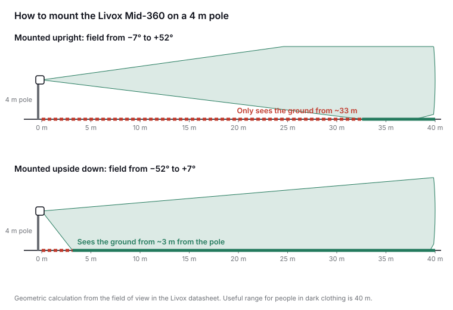

This guide is for people who organise events or manage public spaces, not for engineers. We answer with figures from manufacturers, standards and published studies, and we say what we could not verify.

## 1. What is a LiDAR and what does it "see"?

A LiDAR emits pulses of infrared light, invisible to the eye, and measures how long they take to come back after bouncing off whatever is in front of it. Repeating the measurement hundreds of thousands of times per second, it builds a **point cloud**: a set of 3D coordinates, each with the strength of the reflection. There are no colours and no faces, only shapes and distances.

A compact sensor such as the Livox Mid-360 sees 360° horizontally and from −7° to +52° vertically ([Livox](https://www.livoxtech.com/mid-360/specs)).

## 2. How is it different from a camera or from counting phones?

**Compared with a camera**, LiDAR captures no images of people and does not depend on lighting, because it brings its own light. A study on recognising people by their gait illustrates this: at night, the best camera method was right 25.92 % of the time and the LiDAR method 90.41 % ([Shen et al., CVPR 2023](https://arxiv.org/pdf/2211.10598)).

**Compared with counting phones or Wi-Fi**, LiDAR counts bodies, not devices: one person may carry two phones or none. In return, phone counting shows where people come from and go to across a city, which a fixed LiDAR does not. The two are complementary ([arXiv 2401.09014](https://arxiv.org/pdf/2401.09014)).

## 3. Does it work at night, in direct sunlight or in the rain?

- **At night:** yes, just as by day, because it emits its own light.
- **In direct sunlight:** manufacturers measure range under 100 klx of ambient light, the equivalent of full sun. Under those conditions the Mid-360 reaches 40 m on objects that reflect 10 % of the light and 70 m on those that reflect 80 % ([Livox](https://www.livoxtech.com/mid-360/specs)).
- **In rain or fog:** we found no independent measurements for sensors of this type. That is why every installation should be validated in real conditions.

## 4. Can it see someone dressed in black?

Dark clothing reflects less light, which is why datasheets give the range for objects that reflect only 10 %: 40 m for both the Livox Mid-360 and the Hesai JT128 ([Livox](https://www.livoxtech.com/mid-360/specs), [Hesai](https://www.hesaitech.com/wp-content/uploads/2025/09/JT128_User_Manual_J01-en-250920.pdf)). At an event, with the sensor a few metres up and people within 20–25 m, there is plenty of margin.

## 5. Can it recognise who someone is?

It does not see faces, but **it is not anonymous by nature**. Research has shown that a person can be recognised by their gait or 3D silhouette:

- **LidarGait** (CVPR 2023): 1,050 people, 86.77 % correct at the first attempt ([Shen et al.](https://arxiv.org/pdf/2211.10598)).
- **ReID3D** (CVPR 2024): 320 people recorded with four Livox LiDARs, 94.0 % ([Guo et al.](https://arxiv.org/abs/2312.03033)).
- **MultiGait** (KIT, 2026): 199 people. Within one session accuracy is close to 100 %, but across different sessions it drops to 74.3–78.4 %, and the authors conclude that reliable identification across sessions is not yet possible ([Todt et al.](https://arxiv.org/pdf/2609.01036)).

That is why, at NODES, the point cloud is processed on the node itself and only aggregated figures leave it (see question 10).

## 6. Is it safe for people's eyes?

**Yes.** All the sensors we reviewed are **Class 1 laser products** under IEC/EN 60825-1:2014, the standard for laser product safety. Class 1 means the device cannot exceed the eye's exposure limits under any intended condition of use ([Kent State University](https://www.kent.edu/compliance/laser-safety-practice-manual-pdf)). In practice: **you can look straight at it, up close, for as long as you like.** A child on someone's shoulders next to the pole is at no risk.

| Sensor | Class | Wavelength | Source |
| --- | --- | --- | --- |
| Livox Mid-360 | Class 1 | 905 nm | [Livox manual](https://terra-1-g.djicdn.com/65c028cd298f4669a7f0e40e50ba1131/Mid360/Livox_Mid-360_User_Manual_EN.pdf) |
| Blickfeld Qb2 | Class 1 | 905 nm | [Blickfeld manual](https://www.blickfeld.com/wp-content/uploads/2023/08/Qb2-Quick-start-manual-and-safety-information.pdf) |
| Ouster OS1 | Class 1 | 865 nm | [Ouster datasheet](https://data.ouster.io/downloads/datasheets/datasheet-rev7-v3p1-os1.pdf) |
| Hesai JT128 | Class 1 | 905 nm | [Hesai manual](https://www.hesaitech.com/wp-content/uploads/2025/09/JT128_User_Manual_J01-en-250920.pdf) |
| Hesai OT128 | Class 1 | 905 nm | [Hesai manual](https://www.hesaitech.com/wp-content/uploads/2025/03/OT128_User_Manual_O01-en-250310.pdf) |
| Velodyne VLP-16 | Class 1 | 903 nm | [Velodyne datasheet](https://www.hypertech.co.il/wp-content/uploads/2015/12/63-9229_Rev-F_Puck__Spec_Sheet_Web.pdf) |

Each manufacturer declares the class in its documentation, as the rules require for selling in the EU.

**What about Class 1M?** It is safe to the naked eye but can be hazardous when viewed through binoculars, telescopes or magnifiers ([University of Virginia](https://ehs.virginia.edu/Laser-Safety/Classification)). None of the sensors in the table is 1M.

**Three sensible precautions:**

1. **Do not look at the sensor through magnifiers or binoculars.** Hesai recommends this in its manual even though the device is Class 1 ([Hesai](https://www.hesaitech.com/wp-content/uploads/2025/03/OT128_User_Manual_O01-en-250310.pdf)).
2. **Remove any node with a damaged housing.** Inside are more powerful lasers that are only safe while the housing is closed: Livox states that the Mid-360's internal laser can exceed 70 W peak, and Blickfeld that the Qb2 contains an embedded Class 3B laser. Neither should be opened.
3. **Do not take zoomed photos right up against the sensor.** Cameras are more sensitive than eyes. The known case is an AEye automotive LiDAR at 1550 nm that damaged a camera sensor at CES 2019 ([PetaPixel](https://petapixel.com/2019/01/12/mans-1998-mirrorless-camera-fried-by-self-driving-car-laser/), [Fstoppers](https://fstoppers.com/news/laser-self-driving-car-destroys-photographers-sony-a7r-ii-sensor-328460)). We found no cases with compact 905 nm sensors like those in the table.

**Why does wavelength matter?** At 905 nm the light reaches the retina, like visible light, so the standard strictly limits these sensors' power. At 1550 nm the eye absorbs it before it reaches the retina, which allows more power. In both cases, what guarantees safety is Class 1.

**Is any permit needed because it is a laser?** For the workers who install it, Spain's Royal Decree 486/2010 on artificial optical radiation applies; it requires assessing the risk according to the laser class ([BOE](https://www.boe.es/buscar/act.php?id=BOE-A-2010-6485), in Spanish), and for Class 1 documenting it is enough. In the Spanish regulations we reviewed, we found no specific permit for using a Class 1 laser in a public space. The permit that is needed is for occupying the space (question 9).

## 7. How much area does one node cover, and how many are needed?

It depends on height and tilt. Blickfeld gives these figures for its Qb2: mounted at 3 m and tilted 30°, it covers about **15 × 12 m**; at 5 m and 30°, about **28 × 22 m** ([Blickfeld](https://www.blickfeld.com/wp-content/uploads/2023/11/Blickfeld_Qb2_product_information_sheet.pdf)).

In dense crowds, the limit is not range but people blocking each other. In the concourse of Nagoya Station, 20 LiDARs were used for about 900 m², and the authors found that with a single sensor tracking is often interrupted, while with two or more it clearly improves ([Hishida et al., 2026](https://link.springer.com/article/10.1007/s13177-025-00610-9)). The rule of thumb: **every critical zone seen from at least two angles.**

## 8. How accurate is it in a dense crowd?

It depends a lot on the scenario and on what is measured:

- At **Nagoya**, with 20 sensors, tracking exceeded 90 % on the HOTA metric. The authors warn that their variant of the metric is not comparable with other studies and that the result comes from after-the-fact processing, not real time ([Hishida et al.](https://link.springer.com/article/10.1007/s13177-025-00610-9)).
- With **tightly packed pedestrians**, a 2025 study with LiDAR and cameras on a vehicle achieved only 0.17–0.35 on the MOTA metric ([Li et al.](https://arxiv.org/abs/2505.16029)).

The practical reading: **counting people per zone is far more robust than tracking each individual.** That is why NODES measures density and flow per zone, and must validate its error margin for each type of event.

## 9. What does it take to install it at an event?

### A pole

The usual approach is to mount the sensor **between 3 and 8 m high** ([Senstar](https://senstar.com/wp-content/uploads/LiDAR-Datasheet-EN-1.pdf)), on a lamp post or a temporary mast, tilted towards the area to be measured. The higher and more tilted, the more area it covers and the less people block each other.

Orientation matters as much as height. The Livox Mid-360 is designed for robots and looks mostly upwards (−7° to +52°): mounted upright at 4 m, it would only see the ground from about 33 m away, by our calculation. Mounted upside down, that field becomes −52°/+7° and covers the area close to the pole.

*Our own geometric calculation from the field of view in the Livox datasheet. Original diagram.*

### Power

| Device | Consumption | Source |
| --- | --- | --- |
| Livox Mid-360 sensor | 6.5 W (18 W for a few seconds at start-up) | [Livox manual](https://terra-1-g.djicdn.com/65c028cd298f4669a7f0e40e50ba1131/Mid360/Livox_Mid-360_User_Manual_EN.pdf) |
| Blickfeld Qb2 sensor | 10 W typical, 13 W maximum, over Power over Ethernet | [Blickfeld](https://www.blickfeld.com/wp-content/uploads/2023/11/Blickfeld_Qb2_product_information_sheet.pdf) |
| NVIDIA Jetson Orin Nano computer | 7 to 25 W depending on mode | [NVIDIA](https://docs.nvidia.com/jetson/archives/r36.4.4/DeveloperGuide/SD/PlatformPowerAndPerformance/JetsonOrinNanoSeriesJetsonOrinNxSeriesAndJetsonAgxOrinSeries.html) |

A Mid-360 with a Jetson Orin Nano at full power adds up to about 31.5 W. Over a 12-hour event that is about **380 Wh**, plus whatever the data router draws. A portable battery covers a full day; event power with a small UPS also works.

### Network

- **From sensor to computer, a short Ethernet cable.** Raw data is heavy: a 128-channel Ouster OS1 generates up to 43 Mbit/s even in its lowest-rate mode ([Ouster](https://data.ouster.io/downloads/datasheets/datasheet-rev7-v3p1-os1.pdf)), and a Hesai JT128, 82.3 Mbit/s ([Hesai](https://www.hesaitech.com/wp-content/uploads/2025/09/JT128_User_Manual_J01-en-250920.pdf)).
- **From the node outwards, only aggregated figures** over 4G or 5G. This matters because the mobile network degrades exactly when crowds are largest: at crowded events in the US, failures in nearby cells rose by 100 to 1,000 times ([Shafiq et al., SIGMETRICS 2013](https://web.cs.ucdavis.edu/~zubair/files/crowded_sigmetrics.pdf)), and at a German festival with more than 110,000 visitors a day, significant performance degradation was measured ([Frömmgen et al., PAM 2016](https://www.researchgate.net/publication/312737334_Crowdsourcing_Measurements_of_Mobile_Network_Performance_and_Mobility_During_a_Large_Scale_Event)). The node stores data locally and resends it when the network is available.

### Weather and synchronisation

The sensors reviewed are built for outdoor use: the Mid-360, Qb2 and VLP-16 are rated IP67, and the Hesai JT128 IP6K7. The weak point is usually the box for the computer and battery, which needs shade and ventilation. To combine several nodes, their clocks are synchronised with the PTP protocol (IEEE 1588), supported by the Mid-360 and the JT128.

### Permits in València

Installing equipment on public roads requires authorisation under the city's [bylaw on occupation of municipal public space](https://sede.valencia.es/sede/descarga/doc/DOCUMENT_1_ORD0170_C) (in Spanish). In the city's online procedures:

- For information or charity activities, applications must be filed at least **30 days** in advance, with a description, set-up times and a scaled plan ([VP.OC.75](https://sede.valencia.es/sede/registro/procedimiento/VP.OC.75?lang=1), in Spanish).
- For festive and cultural activities, the maximum decision time is **3 months**, and no answer means refusal ([VP.OC.85](https://sede.valencia.es/sede/registro/procedimiento/VP.OC.85?lang=1), in Spanish).
- For sports events such as the Half Marathon, the file is handled by the city's Sports Service ([FDM València](https://www.fdmvalencia.es/es/solicitud-de-eventos/), in Spanish).

We found no published procedure for attaching third-party equipment to municipal lamp posts. The simplest route is for the organiser to include the nodes in its own application.

### Data protection

Even without images, measuring people in the street is processing that must be assessed. The GDPR requires an impact assessment for "systematic monitoring of a publicly accessible area on a large scale" (Art. 35(3)(c)), and the Spanish data protection authority (AEPD) includes systematic observation in publicly accessible areas on its list ([AEPD](https://www.aepd.es/documento/listas-dpia-es-35-4.pdf), in Spanish). Our recommendation: carry out that assessment, inform people with signs in the measured area, process on the node and keep only aggregated figures.

## 10. What data is stored and who sees it?

At NODES, the point cloud is processed on the node's own computer and **never leaves it**. Only aggregated figures are sent: people per zone, density in people per m² and flow per section and minute. The organiser's or city's control room sees them on the dashboard.

The honest way to put it is not "LiDAR never captures personal data" but: **we capture no images or faces, we process on the node itself and we keep only aggregated figures.**

## Sources

**Sensors and standards**

- Livox: [Mid-360 specifications](https://www.livoxtech.com/mid-360/specs) and [user manual](https://terra-1-g.djicdn.com/65c028cd298f4669a7f0e40e50ba1131/Mid360/Livox_Mid-360_User_Manual_EN.pdf)
- Blickfeld: [Qb2 manual](https://www.blickfeld.com/wp-content/uploads/2023/08/Qb2-Quick-start-manual-and-safety-information.pdf) and [product sheet](https://www.blickfeld.com/wp-content/uploads/2023/11/Blickfeld_Qb2_product_information_sheet.pdf)
- Ouster: [OS1 datasheet](https://data.ouster.io/downloads/datasheets/datasheet-rev7-v3p1-os1.pdf)
- Hesai: [JT128 manual](https://www.hesaitech.com/wp-content/uploads/2025/09/JT128_User_Manual_J01-en-250920.pdf) and [OT128 manual](https://www.hesaitech.com/wp-content/uploads/2025/03/OT128_User_Manual_O01-en-250310.pdf)
- Velodyne: [VLP-16 datasheet](https://www.hypertech.co.il/wp-content/uploads/2015/12/63-9229_Rev-F_Puck__Spec_Sheet_Web.pdf)
- Senstar: [LiDAR datasheet](https://senstar.com/wp-content/uploads/LiDAR-Datasheet-EN-1.pdf)
- NVIDIA: [Jetson Orin power modes](https://docs.nvidia.com/jetson/archives/r36.4.4/DeveloperGuide/SD/PlatformPowerAndPerformance/JetsonOrinNanoSeriesJetsonOrinNxSeriesAndJetsonAgxOrinSeries.html)
- Kent State University: [laser safety manual](https://www.kent.edu/compliance/laser-safety-practice-manual-pdf)
- University of Virginia: [laser classes](https://ehs.virginia.edu/Laser-Safety/Classification)

**Studies**

- Shen et al. (2023). [LidarGait](https://arxiv.org/pdf/2211.10598). CVPR.
- Guo et al. (2024). [ReID3D](https://arxiv.org/abs/2312.03033). CVPR.
- Todt et al. (2026). [MultiGait](https://arxiv.org/pdf/2609.01036). KIT.
- Hishida et al. (2026). [Crowd measurement and tracking at Nagoya Station](https://link.springer.com/article/10.1007/s13177-025-00610-9). *Int. J. ITS Research*.
- Li et al. (2025). [Tightly packed pedestrians with LiDAR and cameras](https://arxiv.org/abs/2505.16029).
- [People-flow counting with different sensors](https://arxiv.org/pdf/2401.09014) (arXiv 2401.09014).
- Shafiq et al. (2013). [A First Look at Cellular Network Performance during Crowded Events](https://web.cs.ucdavis.edu/~zubair/files/crowded_sigmetrics.pdf). ACM SIGMETRICS.
- Frömmgen et al. (2016). [Crowdsourced mobile network measurements at a festival](https://www.researchgate.net/publication/312737334_Crowdsourcing_Measurements_of_Mobile_Network_Performance_and_Mobility_During_a_Large_Scale_Event). PAM.
- [PetaPixel](https://petapixel.com/2019/01/12/mans-1998-mirrorless-camera-fried-by-self-driving-car-laser/) and [Fstoppers](https://fstoppers.com/news/laser-self-driving-car-destroys-photographers-sony-a7r-ii-sensor-328460): camera damaged by a LiDAR at CES 2019.

**Regulation**

- [Royal Decree 486/2010](https://www.boe.es/buscar/act.php?id=BOE-A-2010-6485), artificial optical radiation (BOE, in Spanish)
- AEPD: [list of processing that requires an impact assessment](https://www.aepd.es/documento/listas-dpia-es-35-4.pdf) (in Spanish)
- València City Council: [bylaw on occupation of municipal public space](https://sede.valencia.es/sede/descarga/doc/DOCUMENT_1_ORD0170_C), procedures [VP.OC.75](https://sede.valencia.es/sede/registro/procedimiento/VP.OC.75?lang=1) and [VP.OC.85](https://sede.valencia.es/sede/registro/procedimiento/VP.OC.85?lang=1) (in Spanish)
- Municipal Sports Foundation: [event applications](https://www.fdmvalencia.es/es/solicitud-de-eventos/) (in Spanish)

*Review carried out on 30 October 2026. Power and mounting-geometry figures marked as our own calculation are derived from the datasheets cited.*
