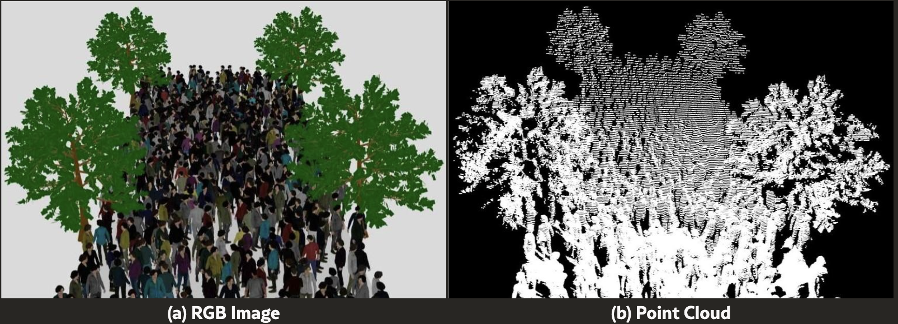
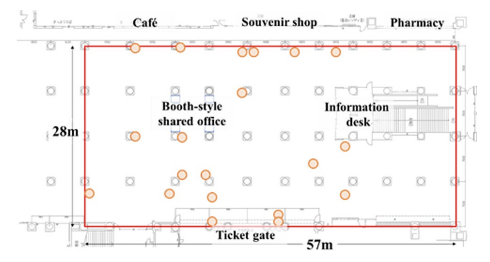
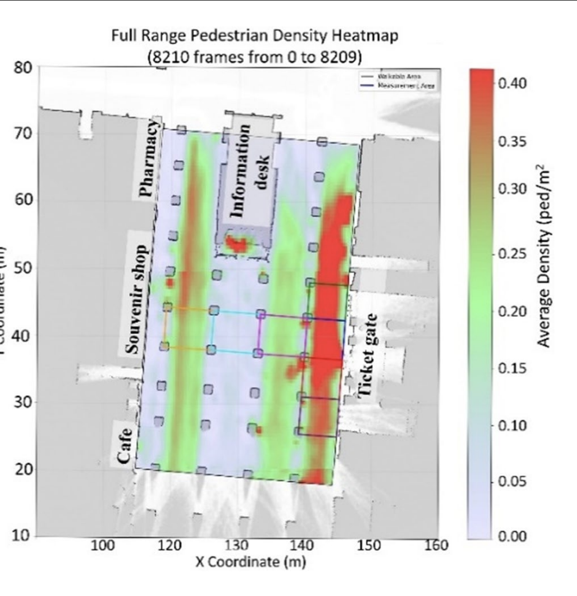
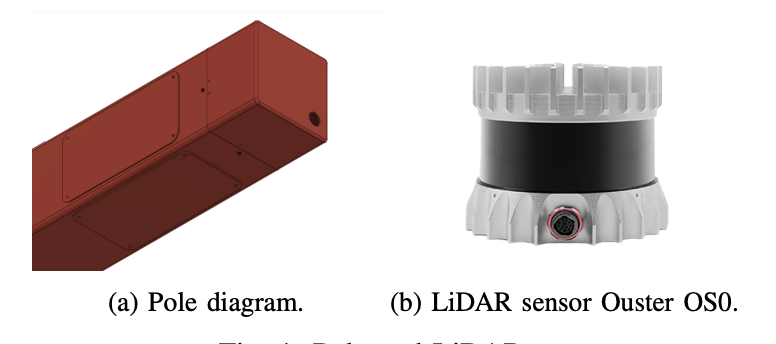
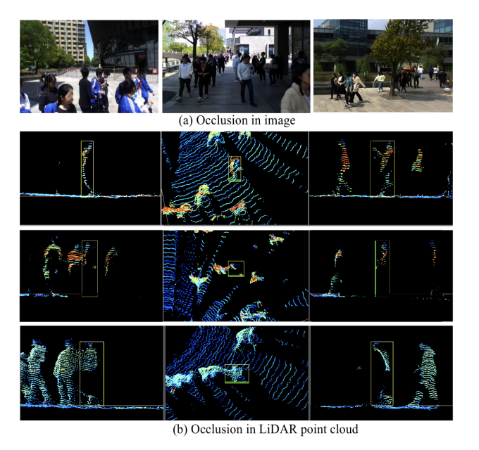
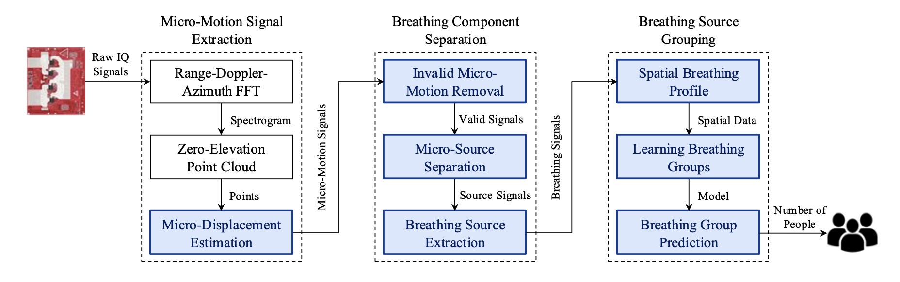

Cities and event organisers increasingly want to know how many people are in a place, where and how they move, without filming faces. Five families of sensors promise to do that: 3D LiDAR, thermal infrared, millimetre-wave radar, Wi-Fi and Bluetooth sniffing, and cameras that count on the device and never store images. Each has strengths, and each has been tested somewhere. The surprise comes when you ask *at what density*. Across the literature we reviewed, **no sensor has a published accuracy figure checked against ground truth at 4–5 people per m² outdoors**, the range where crowds stop being merely dense and start being dangerous.

*The same simulated crowd as a camera image (left) and as a LiDAR point cloud (right): shapes without faces. Source: Khanfor et al., LiDAR for Crowd Management, IEEE Internet of Things Magazine, 2026, figure 2 ([arXiv 2603.27663](https://arxiv.org/abs/2603.27663)).*

## How dense do real crowds get?

| Reference point | Density | Source |
| --- | --- | --- |
| Fruin’s level of service: threshold for a “dense” crowd, as used by the Lyon dataset authors | above 1.5–2 p/m² | [Scientific Data, 2025](https://www.nature.com/articles/s41597-025-04732-3) |
| Fête des Lumières, Lyon 2022: about 7,000 trajectories recorded with cameras | up to 4 p/m² | [Scientific Data, 2025](https://www.nature.com/articles/s41597-025-04732-3) |
| Love Parade 2010, expert analysis: congestion builds quickly | 4–5 p/m² | [Helbing and Mukerji, 2012](https://arxiv.org/abs/1206.5856) |
| Itaewon 2022, Korean medical-response lessons: “crowd packing” and “crowd floating” stages | 6 and 8 p/m² | [WADEM presentation](https://wadem.org/wp-content/uploads/2023/11/Itaewon-Crowd-Crush.pdf) |

The band where decisions matter most, roughly 4 to 6 people per m², when a crowd moves from dense to at risk, lies entirely above the range where any sensor has been validated. Even the peak density at Itaewon is quoted differently by different sources, which is itself a sign of how little trusted measurement exists at extreme densities.

## 3D LiDAR

**How it works.** A LiDAR fires laser pulses and times their return, building a 3D point cloud of the scene. People appear as clusters of points that software separates, counts and follows. From that come counts, positions, trajectories, speeds and density. A review in *IEEE Internet of Things Magazine* notes ranges that often exceed 200 m on high-end sensors, but also that LiDAR degrades in heavy rain or dense fog and that tracking may degrade in dense or highly self-occluding crowds ([Khanfor et al., 2026](https://arxiv.org/abs/2603.27663)).

**The evidence.**

- **Nagoya Station, Japan.** Twenty 3D LiDARs in an indoor concourse of about 57 × 28 m, at 10 frames per second. The authors report tracking accuracy (HOTA) above 90% over an area of about 900 m², but give no density figure in the text ([Hishida et al., Int. J. ITS Research, 2026](https://link.springer.com/article/10.1007/s13177-025-00610-9)). Their own heat map shows average densities below 0.4 people per m² over the period analysed.
- **Arizona State University.** An Ouster OS0-32 on a campus light pole watched a 5 m walkway. On real data the counting error (MAE) was 0.38 people. The headline 97.64% accuracy “in high density” comes from a *synthetic* 250-person scene defined as more than 2 people per m² ([Chen et al.](https://arxiv.org/abs/2311.18077); [ICDCS paper](https://visa.lab.asu.edu/web/wp-content/uploads/2026/01/ICDCSa.pdf)).
- **Osaka University.** Seventy LiDARs in a campus building followed pedestrians across sensors that do not overlap, with an F-measure of 0.98 at the entrance hall, at low to moderate density ([arXiv 2303.09915](https://arxiv.org/abs/2303.09915)).

*Nagoya Station concourse (57 × 28 m) with the LiDAR positions marked in orange. Source: Hishida et al., Int. J. ITS Research, 2026 ([Springer](https://link.springer.com/article/10.1007/s13177-025-00610-9)).*

*Average pedestrian density over 8,210 frames in the same concourse. The scale tops out at 0.4 people per m²: an excellent system, measured far below crowd-safety thresholds. Source: Hishida et al., 2026 ([Springer](https://link.springer.com/article/10.1007/s13177-025-00610-9)).*

*The pole housing and the Ouster OS0 LiDAR used in the Arizona State University study. Source: Chen et al. ([arXiv 2311.18077](https://arxiv.org/abs/2311.18077)), figure 1.*

**Dense crowds.** In a crowd, people hide each other from the sensor. The STCrowd dataset, recorded with a 128-beam LiDAR, shows how occluded pedestrians appear as fragments or almost empty boxes, and it averages only about 20 people per frame ([Cong et al., CVPR 2022](https://arxiv.org/abs/2204.01026)). No open LiDAR dataset goes beyond about 1 person per m²: CrowdBot v2, recorded at markets in Lausanne, covers 0.1 to 1.0 ([Zenodo](https://zenodo.org/records/17730560)).

*Occlusion affects cameras (top) and LiDAR (bottom) alike: the boxed person is cut off or almost empty. Source: Cong et al., STCrowd, CVPR 2022 ([arXiv 2204.01026](https://arxiv.org/abs/2204.01026)).*

**Privacy.** Point clouds have no faces, but they are not automatically anonymous. LidarGait identified 1,050 people by their gait with 86.77% rank-1 accuracy, better than the best camera method ([Shen et al., CVPR 2023](https://openaccess.thecvf.com/content/CVPR2023/papers/Shen_LidarGait_Benchmarking_3D_Gait_Recognition_With_Point_Clouds_CVPR_2023_paper.pdf)); ReID3D reached 94.0% rank-1 on 320 people outdoors ([Guo et al., CVPR 2024](https://openaccess.thecvf.com/content/CVPR2024/html/Guo_LiDAR-based_Person_Re-identification_CVPR_2024_paper.html)). Raw point clouds and long tracks of walking people should be treated as potentially personal data; aggregate counts should not.

## Thermal infrared

**How it works.** Thermal sensors detect body heat passively. Low-resolution arrays such as the Panasonic Grid-EYE (8 × 8 pixels) or the Melexis MLX90640 (32 × 24) are cheap and practically unable to identify anyone; higher-resolution microbolometer cameras (for example 640 × 480) see silhouettes and even facial structure.

**The evidence.** Most validation is indoors and at low counts: an overhead MLX90640 “thermal tripwire” counting people through doorways ([Cokbas et al., CVPRW 2020](https://openaccess.thecvf.com/content_CVPRW_2020/papers/w6/Cokbas_Low-Resolution_Overhead_Thermal_Tripwire_for_Occupancy_Estimation_CVPRW_2020_paper.pdf)), or a thesis reporting 47.4% multi-object tracking accuracy with the same sensor ([KTH](https://www.diva-portal.org/smash/get/diva2:1620371/FULLTEXT01.pdf)). The RGBT-CC benchmark pairs 2,030 colour and thermal images of malls, streets and stations, with about 68 people per image; its errors are counted per image, not per m² ([Liu et al., CVPR 2021](https://arxiv.org/abs/2012.04529)).

**Limits.** Outdoors, sun-heated surfaces and clothing reduce contrast, and in a dense crowd warm bodies merge into one blob. Low-resolution arrays are among the most privacy-friendly options; high-resolution thermal cameras should be treated like ordinary cameras in a privacy assessment.

## Millimetre-wave radar

**How it works.** Radar chips at 60 or 77 GHz send frequency-modulated chirps and measure range, speed and angle. The result is a sparse point cloud that can be clustered and tracked. Radar works in the dark, through smoke and in light rain, and can even pick up breathing.

**The evidence.** Texas Instruments engineers state on the company’s forum that, because of the low angular resolution of single-chip radar, it is difficult to tell apart people who are about 1 m or less from each other ([TI E2E](https://e2e.ti.com/support/sensors-group/sensors/f/sensors-forum/829940/iwr6843-people-count-accuracy-improvement-in-iwr6843-radar-sensor)). The best result in dense conditions is mmCounter: up to 3 people per m², but standing still and indoors, with a counting error of 0.6 people in familiar rooms and 1.1 in unseen ones ([arXiv 2512.10357](https://arxiv.org/abs/2512.10357)). It counts people by separating their breathing.

*How mmCounter counts static people with radar: it extracts tiny chest movements, separates each person’s breathing and groups them into a count. Source: mmCounter, EWSN 2025, figure 2 ([arXiv 2512.10357](https://arxiv.org/abs/2512.10357)).*

**Privacy.** Radar is not identity-free either: gait can identify people from their micro-Doppler signature, with MU-ID reporting over 92% accuracy for up to four people ([MU-ID](https://www.winlab.rutgers.edu/~yychen/papers/MU-ID%20Multi-user%20Identification%20Through%20Gaits%20Using%20Millimeter%20Wave%20Radios.pdf)). Breathing and heart rate, if processed, could count as health data.

## Wi-Fi and Bluetooth

**Probe sniffing.** Sensors listen for the messages phones send while searching for networks. Since phones started randomising their MAC addresses, counting unique addresses no longer works; newer methods such as RateCount estimate devices from how often they probe ([arXiv 2507.03873](https://arxiv.org/abs/2507.03873)). The basic bias remains: these sensors count devices, not people. At the Hajj, 8 sniffers covering 185,000 pilgrims detected 69,467 devices, about 37.5% of the crowd (Basalamah, *IJACSA* 7(12), 2016). It is the cheapest option and works in any weather.

**Channel-based sensing.** Wi-Fi signals are disturbed by bodies, which can reveal presence, activity and small-group counts without any phone. IEEE 802.11bf, the standard for Wi-Fi sensing, was published in September 2025, but crowd counting this way is validated only indoors with small groups.

**The legal grey zone.** The Dutch data protection authority fined the city of Enschede €600,000 in 2021 for Wi-Fi tracking in the city centre, arguing that following which phone passes which sensor turns counting into following people ([Autoriteit Persoonsgegevens](https://www.autoriteitpersoonsgegevens.nl/en/current/dutch-dpa-fines-municipality-for-wi-fi-tracking)). The fine was annulled, finally by the Council of State on 29 July 2026, because the authority had not proven that personal data were processed, not because Wi-Fi tracking was declared lawful ([Raad van State](https://www.raadvanstate.nl/@159747/202401622-1-a3/)).

## Cameras that count without storing images

**How it works.** Computer vision estimates a density map or detects heads in each frame, ideally on the device, so that only numbers leave it. Overhead stereo or time-of-flight counters look straight down, where people hide each other least.

**The evidence.** Cameras are the only sensors tested on truly extreme crowds: benchmarks such as ShanghaiTech and UCF-QNRF contain hundreds to thousands of heads per image, and the best models miss by about 50–100 people per image on the hardest sets (for example P2PNet, MAE 52.74 on ShanghaiTech Part A). But these are internet photos without a calibrated area, so there is no error per m². The highest real-world, ground-truthed density we found for any sensor is a commercial overhead stereo system on a covered platform at Breukelen station in the Netherlands: an average of 0.85 people per m² and a peak of 1.13 ([Pouw et al., arXiv 2108.11719](https://arxiv.org/abs/2108.11719)).

**Privacy.** Faces processed to identify someone are biometric data under the GDPR, and cameras carry the heaviest legal load (see below), even when they only count.

## Side by side

| Sensor | What it measures | Best reported accuracy (and where) | In dense crowds | Weather and light | Privacy |
| --- | --- | --- | --- | --- | --- |
| 3D LiDAR | Counts, positions, tracks, speed, density | Tracking above 90% HOTA over ~900 m², indoors, density not stated (Nagoya); counting error 0.38 people outdoors on a campus walkway (ASU) | People hide each other; needs overlapping sensors | Independent of light; heavy rain and fog degrade it | No faces, but gait can identify people (86.77–94% in research) |
| Thermal, low resolution | Presence, counts through a line | Room occupancy at doorways, indoors | Bodies merge | Sun and hot surfaces reduce contrast | Practically non-identifying |
| Thermal camera | Counts, density maps | Image-level errors on ~68 people per image (RGBT-CC), no density per m² | Bodies merge | Works at night | High resolution shows silhouettes; treat like a camera |
| mmWave radar | Counts, positions, speed, breathing | MAE 0.6 people at up to 3 p/m², static people, indoors (mmCounter) | Struggles to separate people under ~1 m apart | Robust to dark and smoke | Gait identification reported at 88–98% in small groups |
| Wi-Fi / Bluetooth probes | Device counts, dwell, flows | Device estimates under MAC randomisation (RateCount), no density per m² | Devices are not people | Any weather | Device identifiers are personal data; legally contested |
| Camera with on-device AI | Counts, density maps, flows | MAE 52.74 per image on ShanghaiTech Part A (P2PNet), no density per m² | The only sensor tested on extreme images | Needs light; rain and glare | Biometric if used to identify; heaviest legal load |
| Overhead stereo / ToF | Counts, tracks | 82% raw tracking accuracy (100% after removing two static false positives) at 0.85 p/m², covered platform (Breukelen) | Less occlusion from above | Indoor or covered areas | Low-resolution depth, but re-identification still possible |

## The highest density anyone has validated

| Sensor | Highest density with an accuracy figure | Setting | Real or simulated |
| --- | --- | --- | --- |
| 3D LiDAR | “More than 2 p/m²” (97.64%) | Outdoor scene model | **Simulated** (ASU) |
| 3D LiDAR, real data | About 1 p/m², or not stated (Nagoya) | Indoor | Real |
| Overhead stereo | 0.85 p/m² average, 1.13 p/m² peak | Covered station platform | Real |
| Depth camera (Kinect class) | About 1 p/m², detection above 94% ([arXiv 1210.2838](https://arxiv.org/abs/1210.2838)) | Indoor | Controlled |
| mmWave radar | 3 p/m², people standing still | Indoor rooms | Lab |
| Thermal | Not stated in p/m² | Mostly indoor | Real |
| Wi-Fi / Bluetooth | Not stated in p/m² | Mixed | Real |
| Camera | Not stated in p/m² (counts per photo) | Internet images | Benchmarks |
| *For reference: camera tracking used to build a dataset* | *Up to 4 p/m²* | *Outdoor festival, Lyon* | *Real, but not a sensor validation* |

**The result:** we found no accuracy figure for any sensor measured at 4–5 people per m² outdoors. Two event-scale radio studies, at Munich’s Oktoberfest and at Tomorrowland, report accuracy over broad density classes rather than an error per m², and their ground truth could not be checked.

## “Privacy-preserving” is relative

A 2026 benchmark from the Karlsruhe Institute of Technology tested eight sensors on 199 people and concluded that sensors often assumed to be privacy-friendly still carry considerable identity-inference risks ([MultiGait, arXiv 2609.01036](https://arxiv.org/abs/2609.01036)). Ranked from highest to lowest re-identification risk:

1. **Cameras:** faces and appearance allow direct identification.
2. **Wi-Fi and Bluetooth sniffing:** device identifiers or fingerprints can follow a person over days.
3. **3D LiDAR:** gait and body shape, 86.77–94% rank-1 identification in research; the risk grows with track length and resolution.
4. **mmWave radar:** micro-Doppler gait, 88–98% in small indoor groups; breathing and heart rate add health-data risk.
5. **High-resolution thermal:** silhouettes and facial heat patterns.
6. **Low-resolution thermal, Wi-Fi channel aggregates and count-only outputs:** lowest, as long as only aggregates leave the device.

One caveat cuts both ways: all these identification results come from cooperative, low-density tests. Nobody has measured how well people can be re-identified inside a dense, occluded crowd.

## What the law says (EU and Spain)

- **GDPR.** Data are personal if a person is identifiable “by any means reasonably likely” to be used (Art. 4(1)); biometric data used to identify are a special category (Arts. 4(14) and 9); systems must be private by design (Art. 25); and large-scale systematic monitoring of public areas requires a data protection impact assessment (Art. 35).
- **Anonymous or pseudonymous?** Hashed MAC addresses and persistent track IDs are pseudonymised, not anonymous, according to the Article 29 Working Party’s Opinion 05/2014 and a joint paper by Spain’s AEPD and the European Data Protection Supervisor. Aggregated counts produced on the device are the safest output.
- **Cameras.** The European Data Protection Board’s Guidelines 3/2019 on video devices apply to any camera system, including analytics.
- **Wi-Fi and Bluetooth.** Article 5(3) of the ePrivacy Directive may apply when information is accessed on people’s devices.
- **EU AI Act.** The prohibitions in Article 5 of Regulation (EU) 2024/1689, including real-time remote biometric identification in public spaces for law enforcement, with narrow exceptions, have applied since 2 February 2025. The obligations for high-risk systems such as remote biometric identification were postponed to 2 December 2027 by the Digital Omnibus, Regulation (EU) 2026/1744 ([White & Case](https://www.whitecase.com/insight-alert/eu-ai-omnibus-enters-force-amending-ai-act)). Counting without identifying anyone is generally outside “biometric identification”.

## Combining sensors

Fusion helps, but it has not been validated in dense crowds either:

- **Radar and camera:** adding low-resolution cameras to an indoor mmWave system raised counting accuracy from 83.5% to 93.1% ([IFAC 2023](https://www.sciencedirect.com/science/article/pii/S2405896323009448)).
- **Thermal and colour:** in darkness, a colour-only model’s error (RMSE) was 87.81 people per image against 33.74 for thermal alone and 29.11 for both combined ([Liu et al., CVPR 2021](https://arxiv.org/abs/2012.04529)).
- **LiDAR and camera:** STCrowd provides fused benchmarks, and the LiDAR review notes that camera appearance complements LiDAR at long range.

No fusion system has been checked against ground truth above about 1–2 people per m².

## Open problems

1. **No validation at 4–5 p/m² outdoors** for any sensor in any source we found.
2. **No shared way of measuring.** Studies use different metrics (tracking scores, errors per image, F1, classification accuracy) and often do not state the density.
3. **No open LiDAR data beyond about 1 p/m².**
4. **Weather.** Rain, fog, heat and night are rarely tested in dense crowds.
5. **Privacy in crowds.** Re-identification in dense, occluded crowds is unmeasured.
6. **Simulation versus reality.** The only high-density LiDAR result is synthetic.

## What to ask for

- **Researchers:** report results by density, in people per m² over a calibrated area, following the Lyon protocol, and release data at 2 p/m² or more with privacy safeguards.
- **Engineers:** combine geometry from above (LiDAR or overhead stereo) with on-device camera density estimation in the densest zones, and show error bands that widen with density.
- **Organisers and city technical staff:** ask every vendor at what density, indoors or outdoors, and against what ground truth their accuracy was measured; carry out an impact assessment; keep only aggregates; avoid persistent device identifiers.

## Conclusion

Each sensor offers a different trade-off between what it sees, what it costs and what it reveals about people. But at the densities that matter for safety, none of them has yet been proven. Until someone measures one at 4–5 people per m² outdoors, against an independent count, any figure above about 1–2 people per m² should be read as a promise, not a result.

## Sources

**Crowd densities**

- Lyon Fête des Lumières dataset, *Scientific Data* 2025: https://www.nature.com/articles/s41597-025-04732-3
- Helbing and Mukerji (2012), Love Parade analysis: https://arxiv.org/abs/1206.5856
- WADEM, Itaewon crowd crush: https://wadem.org/wp-content/uploads/2023/11/Itaewon-Crowd-Crush.pdf

**LiDAR**

- Khanfor et al. (2026), LiDAR for Crowd Management, IEEE IoT Magazine: https://arxiv.org/abs/2603.27663
- Hishida et al. (2026), Nagoya Station, Int. J. ITS Research: https://link.springer.com/article/10.1007/s13177-025-00610-9
- Chen et al., ASU smart light poles: https://arxiv.org/abs/2311.18077 · HAWC-CC: https://visa.lab.asu.edu/web/wp-content/uploads/2026/01/ICDCSa.pdf
- Osaka University 70-LiDAR testbed: https://arxiv.org/abs/2303.09915
- STCrowd, CVPR 2022: https://arxiv.org/abs/2204.01026
- CrowdBot v2: https://zenodo.org/records/17730560
- LidarGait, CVPR 2023: https://openaccess.thecvf.com/content/CVPR2023/papers/Shen\_LidarGait\_Benchmarking\_3D\_Gait\_Recognition\_With\_Point\_Clouds\_CVPR\_2023\_paper.pdf
- ReID3D, CVPR 2024: https://openaccess.thecvf.com/content/CVPR2024/html/Guo\_LiDAR-based\_Person\_Re-identification\_CVPR\_2024\_paper.html

**Thermal**

- Cokbas et al., thermal tripwire, CVPRW 2020: https://openaccess.thecvf.com/content\_CVPRW\_2020/papers/w6/Cokbas\_Low-Resolution\_Overhead\_Thermal\_Tripwire\_for\_Occupancy\_Estimation\_CVPRW\_2020\_paper.pdf
- KTH thesis, MLX90640 tracking: https://www.diva-portal.org/smash/get/diva2:1620371/FULLTEXT01.pdf
- RGBT-CC, Liu et al., CVPR 2021: https://arxiv.org/abs/2012.04529

**Radar**

- Texas Instruments E2E forum: https://e2e.ti.com/support/sensors-group/sensors/f/sensors-forum/829940/iwr6843-people-count-accuracy-improvement-in-iwr6843-radar-sensor
- mmCounter, EWSN 2025: https://arxiv.org/abs/2512.10357
- MU-ID, gait identification with mmWave: https://www.winlab.rutgers.edu/~yychen/papers/MU-ID%20Multi-user%20Identification%20Through%20Gaits%20Using%20Millimeter%20Wave%20Radios.pdf
- Radar and camera fusion, IFAC 2023: https://www.sciencedirect.com/science/article/pii/S2405896323009448

**Wi-Fi and Bluetooth**

- RateCount: https://arxiv.org/abs/2507.03873
- Basalamah (2016), Wi-Fi sniffing at the Hajj, *IJACSA* 7(12)
- Dutch DPA, Enschede fine: https://www.autoriteitpersoonsgegevens.nl/en/current/dutch-dpa-fines-municipality-for-wi-fi-tracking
- Council of State ruling, 29 July 2026: https://www.raadvanstate.nl/@159747/202401622-1-a3/

**Cameras and depth**

- Pouw et al., overhead stereo at Breukelen station: https://arxiv.org/abs/2108.11719
- Overhead depth tracking up to 1 p/m²: https://arxiv.org/abs/1210.2838

**Privacy and regulation**

- MultiGait, KIT 2026: https://arxiv.org/abs/2609.01036
- EU AI Act Digital Omnibus, Regulation (EU) 2026/1744 (White & Case summary): https://www.whitecase.com/insight-alert/eu-ai-omnibus-enters-force-amending-ai-act

*Review carried out on 1 November 2026. Several figures come from preprints; vendor claims are not included as evidence.*
