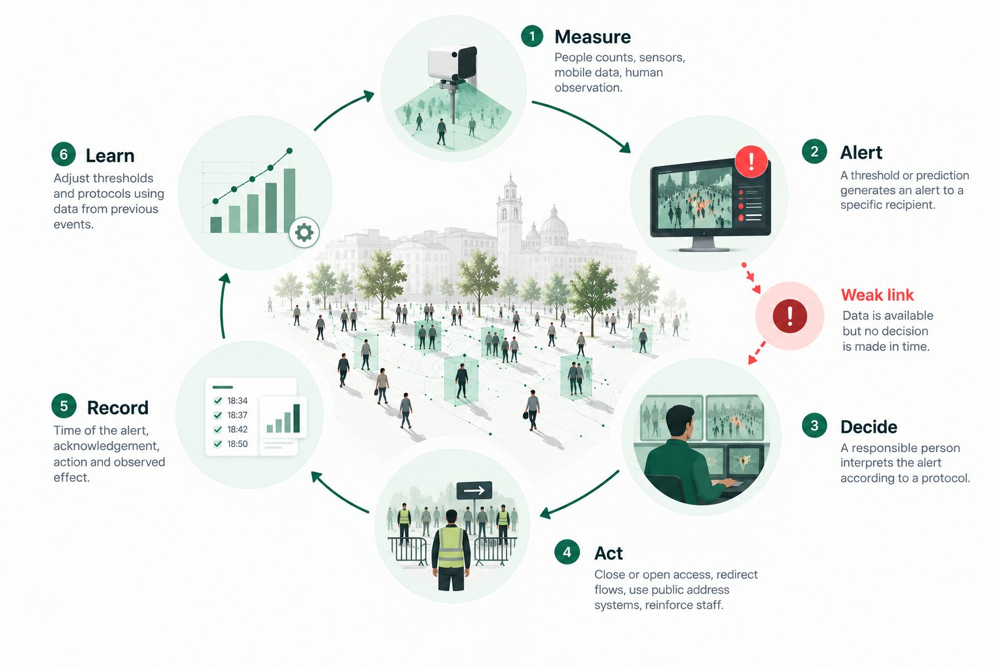

In the major crowd disasters of the last two decades, warning signs appeared minutes or hours in advance. What was missing was not information but a short, clear path from warning to decision. Decision-support systems aim to shorten that path, although evidence of their real-world effect is still limited.

*The decision-support loop. The weak link sits between alerting and deciding: the data exists, but no one decides in time. Original illustration.*

## Why the useful alert is the early one

Once a crowd reaches extreme densities, the ability to intervene collapses: people can no longer move on their own and emergency teams cannot reach them. The value of an alert therefore depends above all on **how much time it leaves to act**. Closing an entrance may take a few minutes; rerouting public transport or bringing in more staff takes much longer. An alert that arrives when density is already critical confirms the problem but does not help prevent it.

## The loop: measure, alert, decide, act, record, learn

A decision-support system is not a screen full of data. It is a loop in which every link can fail:

1. **Measure** occupancy and flows at critical points, across the phases described in UK event-safety guidance: arrival, entry, circulation, exit and dispersal ([HSE](https://www.hse.gov.uk/event-safety/crowd-management-assess.htm)).
2. **Alert** when the current or forecast situation approaches a threshold set for that place, and send the alert to a named recipient.
3. **Decide:** a person with authority interprets the alert according to a protocol agreed in advance.
4. **Act:** open or close entrances, redirect flows, inform the public, pause a performance, add staff.
5. **Record** what was alerted, who saw it, what was done and what effect it had.
6. **Learn:** review thresholds and protocols using those records.

The weakest link is usually between alerting and deciding. The least documented is recording: almost no study publishes which alert was received, who acknowledged it, what was done and what happened next. UK guidance notes that monitoring the crowd makes it possible to detect overcrowding early enough to react, and lists turnstiles, chip tickets or wristbands, counting sensors and mobile phone signals as sources ([HSE](https://www.hse.gov.uk/event-safety/crowd-management-monitoring.htm)).

## What can be predicted, and how

What can be anticipated is not "a crush" but **the conditions that precede it**: an area filling faster than it empties, flow dropping at a bottleneck, density approaching a limit. From simplest to most complex:

- **Simple methods.** Subtract exits from entries and project occupancy a few minutes ahead; extrapolate the trend to the threshold ("at this rate, the north zone reaches its limit in 12 minutes"); moving averages. They are transparent and easy to explain to decision-makers. We found no study showing that complex models beat them at real events 5 to 30 minutes ahead, so they should always be the baseline.
- **Machine learning on time series.** Gradient-boosting models, recurrent networks and spatio-temporal graph networks, developed largely for urban flows and road traffic. A well-known example predicts inflow and outflow across a whole city from taxi and bike data ([Zhang et al., 2017](https://arxiv.org/abs/1610.00081)); that is city scale, not venue scale.
- **Simulation fed with live data.** Agent-based models continuously recalibrated with measurements (live simulation or digital twins) to estimate the next few minutes ([Malleson et al., 2020](https://www.jasss.org/23/3/3.html)). Almost all of this has been validated in synthetic scenarios or controlled experiments.
- **Mobile phone data.** Useful for the trend across a wide area; usually too coarse for a single street or entrance. Seoul publishes real-time population data for more than a hundred locations ([Seoul Metropolitan Government](https://english.seoul.go.kr/real-time-urban-data-service-for-113-major-sites-in-seoul/)).

## What the evidence says, and its limits

- **Precursor signals are well documented.** Video analysis of the Jamarat disaster (Hajj, 2006) showed that flow turned into stop-and-go waves around 11:53, turbulence began around 12:19 and the disaster started about 10 minutes later, more than 30 minutes after flow fell below a critical value ([Helbing et al., 2007](https://arxiv.org/abs/physics/0701203)).
- **Short-term forecasting with real data is starting to be evaluated.** At the SAIL 2025 festival in Amsterdam, a retrospective study with 11 pedestrian counting sensors found stable forecast intervals up to about 30 minutes for almost all sensors ([Li et al., 2026](https://arxiv.org/pdf/2607.17758)). Promising, but measured after the event and without evaluating decisions.
- **Evidence of a safety effect is scarce.** A 2026 systematic review found only 13 eligible studies on stampede prevention and just two that tested early-warning systems, both using SMS; the density reductions it cites come from simulations ([Chowhan et al., 2026](https://www.ssph-journal.org/journals/public-health-reviews/articles/10.3389/phrs.2026.1609310/full)).
- **Commercial figures are not independent evaluations.** At airports, some vendors advertise over 99 % accuracy in forecasting passenger arrivals. These are the vendors' own figures and measure something different from local density a few minutes ahead.
- **Much has only been tested in simulation.** Such results help compare methods; they do not promise performance at a real event.
- **There are almost no studies of how operators use predictive dashboards.** In other sectors the evidence is clear: in hospital monitoring, 74 % to 99 % of alarms required no action, which leads staff to ignore them (Paine et al., *Journal of Hospital Medicine*, 2016). False alarms per shift are a safety metric, not a technical detail.

## Jamarat, Itaewon and the Love Parade: warnings that existed

- **Jamarat (2006).** The signals were visible on video more than half an hour in advance. For the following Hajj, automatic counting from cameras, one-way circulation and scheduled group times were introduced ([Helbing et al., 2007](https://arxiv.org/abs/physics/0701203)).
- **Itaewon (2022).** Police received 11 calls warning of a crush risk, the first at 18:34, almost four hours before the disaster, and dispatched officers only four times ([The Korea Herald](https://www.koreaherald.com/article/2991297)). The figure of 79 that circulates is the total number of emergency calls from the area between 18:00 and 22:00, not crush warnings. According to local media cited by news agencies, the city had real-time population data from mobile phones that no one used for safety that night ([Al Jazeera](https://www.aljazeera.com/news/2022/11/1/s-korea-response-to-crowd-crush-inadequate-says-police-chief)); that data recorded a population increase of over 300 % in the neighbourhood ([analysis in PMC](https://pmc.ncbi.nlm.nih.gov/articles/PMC11244771/)).
- **Love Parade (2010).** Helbing and Mukerji describe a systemic failure, with planning assumptions that did not hold, flows meeting on a ramp without enough guidance and a gradual build-up, not a panic stampede ([Helbing and Mukerji, 2012](https://link.springer.com/content/pdf/10.1140/epjds7.pdf)).

*(a) Population estimated from mobile phone data in three areas of Itaewon-dong on the day of the disaster (green), compared with weekends (red) and weekdays (blue) in October 2022: the increase was visible from mid-afternoon. (b) Location and time of some of the warning calls to police, from 18:34, and of the first report of the crush at 22:15. Source: Liang, H., Lee, S., Sun, J. and Wong, S. C. (2024), ["Unraveling the causes of the Seoul Halloween crowd-crush disaster"](https://doi.org/10.1371/journal.pone.0306764), PLOS ONE 19(7): e0306764, CC BY 4.0.*

**The common lesson:** the information existed; what was missing was a recipient with a mandate, an agreed threshold and a predefined action.

Since Itaewon, Seoul has deployed cameras with crowd detection that automatically alert the city's, police and fire situation rooms when density reaches about 5 to 6 people per m² ([The Korea Times](https://www.koreatimes.co.kr/southkorea/society/20261022/ai-drones-guard-nightlife-districts-as-seoul-ramps-up-halloween-safety-measures)), and has announced a system with LiDAR, cameras and four alert levels for the World Cup Stadium ([The Korea Times](https://www.koreatimes.co.kr/amp/southkorea/20260612/seoul-to-deploy-ai-technology-to-monitor-expressways-crowded-stadiums)). No evaluation of their false-alarm rate or their effect on decisions has been published yet.

## How to design alerts people use

- **Few levels, each with operational meaning.** Every level is tied to an action and a responsible person, not just a colour.
- **Thresholds by context.** A moving crowd and a standing crowd are not managed with the same number: for movement, critical density lies around 2 to 4 people per m²; for standing areas, about 5 people per m² is considered the upper limit ([G. Keith Still](https://www.gkstill.com/Support/crowd-density/CrowdDensity-1.html)). At Jamarat, the most useful signal was not density but falling flow and the variability of speeds.
- **Hysteresis.** One threshold to step up a level and a lower one, sustained for a few minutes, to step down, so the alert does not flicker.
- **Visible confidence.** Show ranges ("between 3.8 and 5.1 people per m² in 15 minutes") and sensor status, not a single number.
- **Explanation.** Say why the alert fired: "more people entering than leaving at the north gate for the last 8 minutes".
- **Few false alarms.** Every unnecessary alert erodes trust.
- **A human in charge.** The system proposes; the decision and its record belong to the person designated in the safety plan.

**Alert levels: an illustrative example.** This is not a standard or a recommendation; values must be set for each venue with its safety plan and a competent adviser.

| Level | Example condition | Example action | Who decides |
| --- | --- | --- | --- |
| 0 · Normal | Occupancy and flows as planned | Routine monitoring | Control-room operator |
| 1 · Watch | More people entering than leaving, sustained, or threshold forecast within 15–30 min | Check with camera or steward; inform sector lead; prepare measures | Operator and sector lead |
| 2 · Alert | Threshold forecast within 10–15 min, or density near the limit for the context | Open alternative exits, regulate entry, public address | Event safety officer |
| 3 · Critical | Threshold exceeded, sharp drop in flow, or stop-and-go waves | Emergency protocol: close entrances, stop the performance, coordinate with emergency services | Emergency command |

To step down a level, the condition must stay below the lower threshold for an agreed time.

## What still needs research

- Studies that measure whether anticipation **changes decisions** and outcomes at real events, with records of alert, acknowledgement, action and effect.
- Fair comparisons of simple and complex methods at 5, 15 and 30 minutes.
- How many minutes of lead time each type of action needs, and how many false alarms operators tolerate.
- How to show uncertainty without overloading decision-makers.
- Standardised metrics and open data from real events, not only from labs or simulations.
- Independent evaluations of systems already deployed in cities, stadiums and airports.

## References

- Health and Safety Executive. [Assess crowd safety risks and identify hazards](https://www.hse.gov.uk/event-safety/crowd-management-assess.htm) and [Monitor the crowd](https://www.hse.gov.uk/event-safety/crowd-management-monitoring.htm).
- Helbing, D., Johansson, A. and Al-Abideen, H. Z. (2007). [Dynamics of crowd disasters: An empirical study](https://arxiv.org/abs/physics/0701203). *Physical Review E* 75, 046109.
- Helbing, D. and Mukerji, P. (2012). [Crowd disasters as systemic failures: analysis of the Love Parade disaster](https://link.springer.com/content/pdf/10.1140/epjds7.pdf). *EPJ Data Science* 1:7.
- Chowhan, R. S., Hudda, R. K., Sharma, A. K. and Bhardwaj, P. (2026). [Preventive Measures and Crowd Management Strategies to Mitigate the Risk of Stampedes in Public Gatherings: A Systematic Review](https://www.ssph-journal.org/journals/public-health-reviews/articles/10.3389/phrs.2026.1609310/full). *Public Health Reviews* 47.
- Li, Z., Xin, Y., Comes, T. and Hoogendoorn, S. (2026). [Towards Reliable Zero-Shot Crowd Forecasting](https://arxiv.org/pdf/2607.17758).
- Zhang, J., Zheng, Y. and Qi, D. (2017). [Deep Spatio-Temporal Residual Networks for Citywide Crowd Flows Prediction](https://arxiv.org/abs/1610.00081). AAAI.
- Malleson, N. et al. (2020). [Simulating Crowds in Real Time with Agent-Based Modelling and a Particle Filter](https://www.jasss.org/23/3/3.html). *JASSS* 23(3).
- Liang, H., Lee, S., Sun, J. and Wong, S. C. (2024). [Unraveling the causes of the Seoul Halloween crowd-crush disaster](https://pmc.ncbi.nlm.nih.gov/articles/PMC11244771/). *PLOS ONE* 19(7).
- The Korea Herald. [11 calls said 'people are being crushed' at Itaewon; 4 dispatches made](https://www.koreaherald.com/article/2991297).
- Al Jazeera (2022). [S Korea response to crowd crush inadequate, says police chief](https://www.aljazeera.com/news/2022/11/1/s-korea-response-to-crowd-crush-inadequate-says-police-chief).
- The Korea Times (2026). [Seoul to deploy AI technology to monitor expressways, crowded stadiums](https://www.koreatimes.co.kr/amp/southkorea/20260612/seoul-to-deploy-ai-technology-to-monitor-expressways-crowded-stadiums) and [AI, drones guard nightlife districts](https://www.koreatimes.co.kr/southkorea/society/20261022/ai-drones-guard-nightlife-districts-as-seoul-ramps-up-halloween-safety-measures).
- Seoul Metropolitan Government. [Real-time urban data service for 113 major sites](https://english.seoul.go.kr/real-time-urban-data-service-for-113-major-sites-in-seoul/).
- G. Keith Still. [Crowd density](https://www.gkstill.com/Support/crowd-density/CrowdDensity-1.html).
- Paine, C. W. et al. (2016). Systematic review of physiologic monitor alarm characteristics and pragmatic interventions to reduce alarm frequency. *Journal of Hospital Medicine* 11(2).
