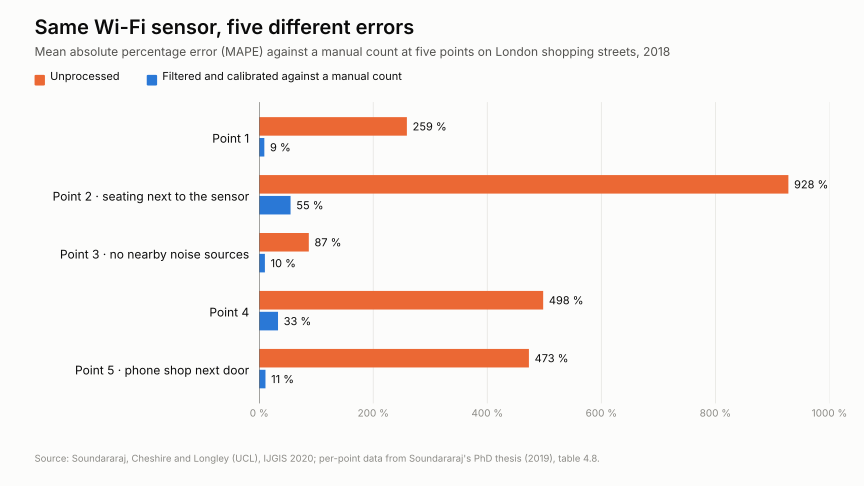

To find out how many people pass through a place and when, event organisers, shopping centres and authorities have for years used sensors that pick up phones' Wi-Fi and Bluetooth signals: small boxes on lampposts, façades or ceilings, with no cameras, that are quick to install and cheap. They sit in shopping streets, stations and airport terminals, and in Spain they have been deployed in tourist destinations such as [Córdoba](https://www.eldebate.com/espana/la-voz-de-cordoba/actualidad/20250219/hacia-nuevo-modelo-gestion-turistica-cordoba_271588_amp.html), [Guardamar del Segura](https://alicanteplaza.es/alicanteplaza/guardamar-adjudicapor-180000-euros-un-sistema-para-contabilizar-y-monitorizar-a-los-turistas) and [Altea](https://alicanteplaza.es/alicanteplaza/altea-implantara-un-sistema-de-control-de-aforo-en-sus-playas-y-el-casco-antiguo).

The principle is simple. A phone with Wi-Fi on sends out messages from time to time to look for known networks, even if it never connects to one; Bluetooth does something similar. The sensor listens for those messages and counts the distinct devices passing nearby. That produces footfall figures, dwell times and routes. The question is how closely those figures match the real number of people.

In December 2017, a sensor next to a shop window on Oxford Street, London, picked up some 60,000 Wi-Fi signals in half an hour. In that time 3,722 people walked past, counted by hand. Unprocessed, the sensor's average error was around 425%; filtering by signal strength brought it down to about 30% ([Soundararaj, Cheshire and Longley, UCL](https://discovery.ucl.ac.uk/id/eprint/10068691/1/Cheshire_Estimating%20real-time%20highstreet%20footfall%20from%20wi-fi%20probe%20requests_AAM.pdf)).

That example sums up the problem. A Wi-Fi or Bluetooth sensor does not see people: it hears phones looking for networks. Turning that into a visitor count is an estimate, and its quality depends on how it is calibrated.

## Why the numbers don't add up

- **There isn't one phone per person.** Some people carry no phone or have Wi-Fi off; others carry a phone, a watch and a tablet. Routers, printers and other fixed devices also transmit.
- **Every phone talks at its own pace.** How often a phone transmits depends on the brand, the OS version and whether the screen is on. At Munich Airport, compared with boarding passes scanned at security, Wi-Fi overcounted and Bluetooth undercounted: it detected only 4% of the devices Wi-Fi saw ([Schauer, Werner and Marcus, 2014](https://www.bgd.ed.tum.de/pdf/2014_CROWDDENSITIES_Werner.pdf)).
- **The signal ignores the street.** It goes through walls and comes from nearby shops, terraces and bus stops. In London, spots with seating next to the sensor overcounted.

On top of that comes MAC address randomisation: to protect privacy, phones change their identifier, by default since iOS 14 and Android 10, so the same phone can be counted several times.

## The error moves

The point is not that there is error, but that it does not stay still.

- **By place.** At five points on London shopping streets, raw error ranged from 87% to 928%. Each point needed its own correction factor, between 0.51 and 1.60, and even then calibrated error stayed between 9% and 55% (UCL).

*Mean error of the same type of sensor at five points in London. Source: Soundararaj, Cheshire and Longley (UCL), IJGIS 2020; per-point data from Soundararaj's PhD thesis (2019), table 4.8.*

- **By hour.** In Gold Coast, Australia, comparing 17 Wi-Fi sensors with cameras, the number of people per detected device mostly ranged from 0.2 to 2 over the day, peaking at 2.8 ([Solmaz et al., 2019](https://arxiv.org/abs/1909.08522)). A single daily factor flattens exactly the peaks you want to see.
- **Over time.** The UCL researchers dropped a fixed factor because the share of phones with random MAC addresses grew year after year. Manufacturers keep changing that behaviour: since iOS 18, users can choose an address that rotates every two weeks ([Apple](https://support.apple.com/en-us/102509)). Spain's data protection authorities note that the way random addresses are generated is not standardised ([AEPD, APDCAT, AVPD and CTPDA guidance, 2024](https://www.aepd.es/guides/wi-fi-tracking-technologies-guidance-for-data-controllers.pdf)). A multi-year series that is never recalibrated may reflect phone updates rather than visitors.

## The best case, and what it took

The most accurate result we found comes from a library at the Université libre de Bruxelles. Over nine weeks in 2019, its Wi-Fi system reached an average error of 12.7% (MAPE: the mean percentage deviation from the reference) ([Determe et al., IEEE Systems Journal, 2022](https://arxiv.org/abs/2010.10370)).

But that was in a building with controlled entrances, before iOS 14, and with an extrapolation factor fitted against a camera system. Even there, the factor changed from week to week, between 4.66 and 5.47. **Wi-Fi got close to reality when another method was telling it how many people there were.**

## What follows

Wi-Fi and Bluetooth have their place: they are cheap, work in any weather and are useful for trends and flows over large areas. But to decide on capacity or safety, a factor computed once is not enough. You need a method that counts bodies, not devices, or at least an independent, permanent reference to recalibrate against.

## Three questions before buying the data

1. What reference was it calibrated against (manual count, camera, turnstile), and for how long?
2. What error was measured afterwards, per point and per time slot?
3. How often is it recalibrated, and who does it after each iOS or Android update?

If the system ends up processing personal data, there is one more reason: the GDPR requires data to be accurate, and the AEPD guidance stresses this for probabilistic estimates.

## Conclusion

Phone signals are a good tool for following trends: how many visitors came this month compared with last, which streets fill up first, how flows spread across a large area. But a footfall figure is only as good as its validation. To interpret it you need to know what the sensor records, how it turns those records into people, what reference it was checked against, for how long and with what error.

That validation has to match the use: what is enough to compare two seasons is not enough to decide on a venue's capacity or how to manage a crowd. That is why the margin of error should be visible to whoever uses the figure and published alongside the method. Until it is, and until there is an independent reference to recalibrate against, Wi-Fi and Bluetooth tell you how many phones there are, not how many people.

*Review carried out on 2 November 2026. The studies with a real reference that we know of predate widespread MAC randomisation.*
