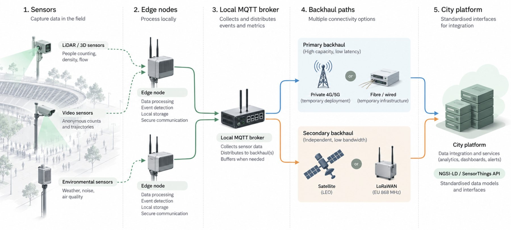
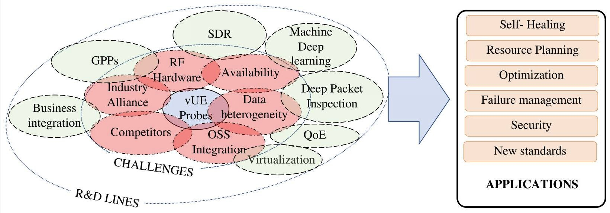
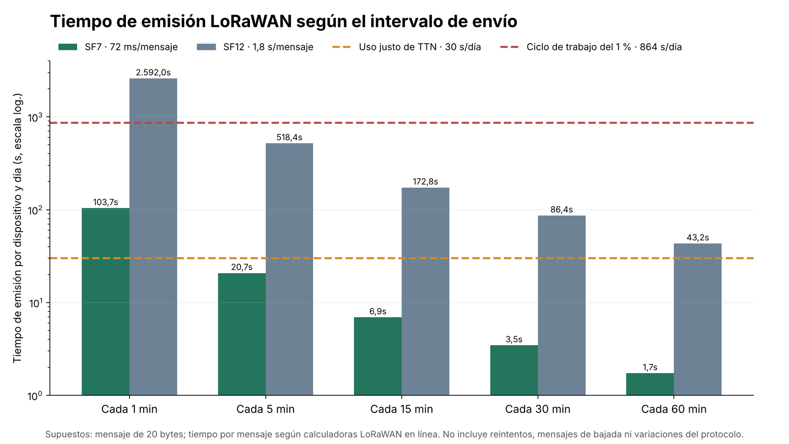

Casi todo lo que se escribe sobre sensores en la ciudad inteligente supone una instalación fija: sensores en edificios, fibra en la calle, corriente de red y meses para ajustar el sistema. Los eventos en la calle, festivales, desfiles y maratones son lo contrario. El equipo llega en un camión, se monta en horas, funciona un día o un fin de semana y se desmonta. Y justo cuando el sistema más importa, en el pico de gente, la red móvil compartida es menos capaz de transportar sus datos. Este artículo analiza qué implica eso para la arquitectura completa: redes, energía, despliegue, fuentes de datos, estándares y seguridad.

*Una arquitectura de referencia para emplazamientos temporales. Los sensores alimentan nodos de borde que procesan los datos en el sitio; un servidor MQTT local recoge sus métricas, las guarda si hace falta y las envía por dos vías independientes, una principal de alta capacidad (4G/5G privado o fibra temporal) y otra secundaria de poco ancho de banda (satélite o LoRaWAN), a una plataforma municipal con interfaces estándar (NGSI-LD o SensorThings API). Diagrama propio, con textos en inglés.*

## Qué hace «dinámico» un entorno

Cuatro rasgos que rara vez coinciden en instalaciones fijas son normales en emplazamientos temporales:

1. **Instalación temporal.** Los sensores se montan en horas en torres de iluminación, vallas, estructuras o remolques, a menudo por equipos que no diseñaron el sistema.
2. **Sin corriente ni red fijas.** La energía viene de generadores, baterías o cuadros eléctricos provisionales; la conexión, de lo que haya: red móvil pública, una tirada temporal de fibra, satélite.
3. **Un espacio que cambia.** Escenarios, vallas, calles cortadas y recorridos de sentido único se mueven durante el día, y las líneas de conteo y las zonas definidas al montar pueden dejar de valer.
4. **El pico de carga en el peor momento.** La llegada, la salida y los incidentes son cuando más importa medir, y también cuando las redes compartidas están saturadas.

Investigadores de la Universidad de Osaka y del NAIST defienden desde hace años que esto exige procesar cerca del origen e intercambiar información elaborada en lugar de datos en bruto. Su marco *Information Flow of Things* reparte el procesamiento entre los propios dispositivos ([Yasumoto et al., 2016](https://www.jstage.jst.go.jp/article/ipsjjip/24/2/24_195/_pdf)), y Higashino y colaboradores lo llevaron a ciudades resistentes a desastres, donde los diseños centrados en la nube limitan la capacidad de comunicación y complican la privacidad ([Higashino et al., ICDCS 2017](https://www.researchgate.net/publication/318476653_Edge_Computing_and_IoT_Based_Research_for_Building_Safe_Smart_Cities_Resistant_to_Disasters)). Lo que ocurre dentro de un nodo de procesamiento lo tratamos en nuestro artículo sobre *edge processing*; aquí vemos cómo trabajan juntos muchos nodos cuando nada a su alrededor es permanente.

## La red es la restricción principal

En un despliegue temporal, lo que limita el sistema casi nunca es el sensor. Es la red.

Los estudios de la última década coinciden en que las redes móviles públicas se degradan en eventos multitudinarios:

- **Registros de un operador de EE. UU., 2012.** Shafiq y colaboradores analizaron los registros de la red de acceso y del núcleo de un gran operador estadounidense durante dos eventos multitudinarios y encontraron una degradación clara del rendimiento (*A First Look at Cellular Network Performance during Crowded Events*, ACM SIGMETRICS).
- **Un festival de música en Alemania.** Un estudio con más de 1.000 participantes, en un festival con más de 110.000 visitantes al día, midió aumentos importantes de fallos DNS y HTTP y de tiempos de carga (PAM 2016).
- **Un estadio de fútbol americano, 2026.** En el estadio de Notre Dame, con 77.622 espectadores, la carga del día de partido provocó lo que los autores llaman una grave «brecha de subida»: hasta el 46 % de las subidas de imágenes fallaron ([arXiv 2607.16008](https://arxiv.org/abs/2607.16008)). Un estudio complementario comparó la subida dentro del estadio con una estación móvil sobre ruedas en el aparcamiento ([arXiv 2604.04371](https://arxiv.org/abs/2604.04371)).
- **Puntos ciegos del operador.** Los registros del operador pueden no detectar incidencias como las «celdas dormidas» durante eventos multitudinarios; por eso Baena y colaboradores propusieron sondas virtuales que miden lo que de verdad experimenta el usuario ([Sensors, 2021](https://pmc.ncbi.nlm.nih.gov/articles/PMC8153328/)).

*Medir lo que una red ofrece de verdad durante un evento multitudinario es un campo de investigación en sí mismo. La figura resume los retos (rojo), las líneas de investigación (verde) y las aplicaciones de las sondas virtuales de usuario, que prueban la red desde el lado del usuario. Fuente: Baena et al., Sensors 21(10):3404, 2021, figura 14, original en inglés ([PMC](https://pmc.ncbi.nlm.nih.gov/articles/PMC8153328/)), CC BY 4.0.*

**Por qué el problema es la subida.** Las redes públicas están pensadas para gente que descarga. Un artículo de la BBC y la Universidad de Strathclyde señala que alrededor del 75 % de los recursos de una red pública se dedican a la bajada, y que en el Reino Unido las redes públicas TDD deben compartir un patrón fijo de 3 a 1 entre bajada y subida para no interferirse ([Yoffe et al., NAB 2024](https://strathprints.strath.ac.uk/88699/1/Yoffe-etal-NAB2024-Using-a-private-5G-network-to-support-the-international-broadcast-of-the-coronation-of-HM-King-Charles-III.pdf)). Las redes de sensores hacen lo contrario: sobre todo envían. Compiten justo por el sentido que antes se agota.

La consecuencia práctica: un sistema de medición de multitudes que dependa de la red pública para dar una alerta debe considerarse no disponible en el pico. La arquitectura tiene que contar en el borde, enviar métricas pequeñas en lugar de datos en bruto y traer su propia conexión, o varias.

## Opciones de comunicación en emplazamientos temporales

| Opción | Cifras | Con multitud | Montaje |
| --- | --- | --- | --- |
| 4G/5G público, compartido | Estadio de Notre Dame: hasta un 46 % de subidas de imágenes fallidas con 77.622 espectadores | La subida se degrada primero | Nada que instalar, nada garantizado |
| 5G privado temporal | Coronación de 2023, Londres: 7 celdas en 4 emplazamientos, unos 160 Mbit/s de subida por celda y más de 1 Gbit/s en total | No se comparte con el público, así que la capacidad se mantiene | Unos tres meses de planificación, licencia de espectro, estudios de radio |
| Porción de red del operador (*slice*) | Parte reservada de una red 5G pública; la usó una televisión en la misma Coronación | El operador afirma que no compite con los abonados (afirmación comercial) | Con tarjetas SIM, sin licencia de espectro para el usuario |
| Fibra o cobre temporal | La red de la Coronación usó fibra entre radios y estaciones base y un enlace de fibra de 10 Gbit/s | No le afecta la congestión de radio | Necesita recorridos de cable, pasos y protección |
| LoRaWAN (868 MHz en la UE) | Límite legal del 1 % de tiempo de emisión en la mayoría de subbandas, es decir, 864 s al día por dispositivo | Banda libre, independiente del tráfico de móviles, pero limitada por colisiones | Pasarelas en horas, nodos con batería |
| Satélite (órbita baja) | Rendimiento comparable al móvil en un estudio global, con caídas breves cada 15 s | Independiente de la congestión en tierra | Minutos, necesita cielo despejado |

Fuentes: [arXiv 2607.16008](https://arxiv.org/abs/2607.16008); [Yoffe et al., NAB 2024](https://strathprints.strath.ac.uk/88699/1/Yoffe-etal-NAB2024-Using-a-private-5G-network-to-support-the-international-broadcast-of-the-coronation-of-HM-King-Charles-III.pdf); [Vodafone UK](https://www.vodafone.co.uk/newscentre/our-network/itn-to-broadcast-king-charles-coronation-using-5g-standalone/); [The Things Network, duty cycle](https://www.thethingsnetwork.org/docs/lorawan/duty-cycle/); Mohan et al., ACM Web Conference 2024.

**5G privado: el caso mejor documentado.** Para la coronación de Carlos III, el 6 de mayo de 2023, la BBC y sus socios montaron una red 5G privada independiente a lo largo de The Mall, en Londres, en espectro compartido con licencia en torno a 3,8–3,9 GHz. Al ser privada, podía usar una trama con más subida en lugar del patrón público de 3 a 1. El artículo recoge un tiempo de ida y vuelta de 37 ms entre Londres y Francia y una capacidad que se mantuvo mientras las redes públicas estaban saturadas. Antes, una sola celda de prueba había transmitido 20 vídeos en alta definición a la vez ([Yoffe et al., NAB 2024](https://strathprints.strath.ac.uk/88699/1/Yoffe-etal-NAB2024-Using-a-private-5G-network-to-support-the-international-broadcast-of-the-coronation-of-HM-King-Charles-III.pdf)). Para medir multitudes la conclusión es sencilla: una celda privada dimensionada para vídeo de televisión puede llevar cientos de sensores que solo envían métricas. Los costes reales son la licencia, la planificación de radio y el acceso a mástiles.

**LoRaWAN: solo para mensajes pequeños y poco frecuentes.** En Europa, la banda de 868 MHz limita a cada dispositivo al 1 % de tiempo de emisión en la mayoría de subbandas (0,1 % o 10 % en otras), una regla que procede de la norma ETSI EN 300 220. Las redes comunitarias pueden ser más estrictas: The Things Network permite 30 segundos de emisión por dispositivo y día ([TTN](https://www.thethingsnetwork.org/docs/lorawan/duty-cycle/)). El tiempo de emisión depende mucho del factor de dispersión: las calculadoras en línea dan unos 72 ms para un mensaje de 20 bytes con SF7 y unos 1,8 s con SF12. Nuestro propio cálculo a partir de esas cifras: un contador que informa cada 5 minutos con SF7 usa unos 21 s al día y cabe en el límite comunitario; si informa cada minuto usa unos 104 s, legal con la regla del 1 % pero por encima de lo que permite la red comunitaria. LoRaWAN sirve para contadores de personas que envían un número agregado cada pocos minutos, no para trayectorias ni imágenes.

*Tiempo de emisión diario de un dispositivo que envía un mensaje de 20 bytes a distintos intervalos, con SF7 (unos 72 ms por mensaje) y SF12 (unos 1,8 s). Líneas discontinuas: el límite de uso justo de The Things Network (30 s/día) y el ciclo de trabajo legal del 1 % (864 s/día). Con SF12, incluso un mensaje por hora supera el límite comunitario, y uno por minuto supera el legal. Cálculo propio; no incluye reintentos ni mensajes de bajada.*

**Satélite: un respaldo de rendimiento variable.** Un análisis global de mediciones de Starlink encontró un rendimiento comparable al móvil, pero la latencia sube de forma notable con carga y las reconfiguraciones periódicas de satélites, cada 15 segundos, provocan caídas breves (Mohan et al., ACM Web Conference 2024). Un estudio más largo con tres terminales en distintos países encontró grandes oscilaciones de caudal en escalas de tiempo cortas (*Vivisecting Starlink Throughput*, ACM CoNEXT 2025). Es una segunda vía sensata para las métricas, no un enlace principal garantizado.

**NB-IoT y LTE-M** funcionan sobre la red del operador público, así que comparten sus problemas de capacidad en el pico. No hemos encontrado mediciones de su comportamiento en eventos multitudinarios.

## Energía y autonomía

En un emplazamiento temporal, cada vatio hay que traerlo, generarlo o pedirlo prestado a la instalación del evento. Algunas cifras de referencia:

| Elemento | Cifra | Fuente |
| --- | --- | --- |
| Alimentación por Ethernet (IEEE 802.3af / at / bt) | Garantizado en el dispositivo: 12,95 / 25,5 / 51 / 71,3 W | Notas técnicas de fabricantes (el texto IEEE es de pago) |
| Ordenador de borde en caja exterior (Jetson AGX Orin con módulo LTE) | 19,1 W de media ejecutando un detector YOLOv8s a 108,8 imágenes/s; 36,5 W en prueba de estrés | [Krišlauks et al., Electronics 2026](https://www.mdpi.com/2079-9292/15/11/2467) |
| Terminal de satélite, tamaño estándar | 75–100 W de media, 20 W en reposo | Especificaciones de Starlink (fabricante) |
| Terminal de satélite, compacto | 20–40 W de media según el centro de ayuda de Starlink, 25–40 W según su propia ficha | Starlink (fabricante; sus dos documentos no coinciden) |
| Terminal de satélite en un vehículo | 113 W de media, entre 48 y 191 W, más por debajo de 0 °C por el calefactor | [Starlink on the Road, arXiv 2403.13497](https://arxiv.org/abs/2403.13497) |
| Celdas de litio-ferrofosfato (LiFePO4) | Carga entre 0 y 55 °C, descarga entre −20 y 55 °C | Ficha del fabricante |

**Un dimensionado aproximado, estimación propia.** La energía necesaria es, a grandes rasgos, la suma de cada consumo por sus horas, dividida por la parte útil de la batería y el rendimiento de conversión. Para 24 horas, un terminal de satélite estándar necesita por sí solo 1,8–2,4 kWh antes de pérdidas, uno compacto 0,5–1 kWh, y un nodo de conteo con un ordenador tipo Jetson a unos 19 W añade unos 0,46 kWh. De ahí salen dos conclusiones. La conexión por satélite debe compartirla un grupo de sensores, no ir una por sensor. Y los contadores de bajo caudal con LoRaWAN y baterías pequeñas cuestan órdenes de magnitud menos de mantener que cualquier equipo con módem y GPU.

**Hay poca guía publicada.** La norma británica BS 7909:2023 regula la seguridad de las instalaciones eléctricas temporales de eventos y añade una sección sobre almacenamiento en baterías, pero no es un método de dimensionado. La guía de la autoridad británica de salud y seguridad (HSE) sobre multitudes pide prever energía de respaldo y un plan de contingencia ante fallos, sin cifras. No hemos encontrado ninguna guía publicada y cuantitativa para dimensionar la energía de un kit de sensores para un evento de 12 a 24 horas.

**El calor es el otro enemigo.** En el estudio de la caja exterior citado arriba, el ordenador redujo su rendimiento a +40 °C de temperatura ambiente con carga de estrés, aunque no con una carga de detección realista ([Krišlauks et al., 2026](https://www.mdpi.com/2079-9292/15/11/2467)). Al sol de verano, una caja se calienta muy por encima del aire, y dentro de una caja oscura se pueden alcanzar los límites de carga de la batería. Sombra, cajas de color claro y separar las baterías del ordenador son las soluciones sencillas.

## Desplegar en horas, no en semanas

El relato público más detallado del montaje de una red temporal es, otra vez, el de la Coronación ([Yoffe et al., NAB 2024](https://strathprints.strath.ac.uk/88699/1/Yoffe-etal-NAB2024-Using-a-private-5G-network-to-support-the-international-broadcast-of-the-coronation-of-HM-King-Charles-III.pdf)). Vale la pena copiar sus pasos:

- **Ensayar fuera.** El equipo probó con los dispositivos reales en un banco de pruebas remoto, incluido un camino arbolado elegido para imitar The Mall.
- **Estudiar el sitio.** Mediciones de espectro, una licencia de pruebas y dos días de pruebas en el lugar con usuarios externos dos meses antes del evento.
- **Aprovechar lo que ya hay.** Las antenas se colocaron en infraestructura del propio evento, como plataformas de cámaras, cabinas de radio y un mástil sobre remolque, teniendo en cuenta el crecimiento de los árboles y que la propia multitud absorbe señal.
- **Modelizar y después medir.** Se modeló la propagación de radio para el regulador y luego se comprobó recorriendo la ruta a pie y en coche con dispositivos de registro; la cobertura medida superó la prevista.
- **Dejar margen.** Cálculo y un canal de más en un emplazamiento, por si algo fallaba.

La planificación empezó en febrero para un evento el 6 de mayo. Un despliegue para medir multitudes suele ser más pequeño, pero la lógica es la misma. A partir de ese relato y de la práctica de los proyectos SAIL y CityFlows (más abajo), una lista de puesta en marcha podría ser esta:

1. **Preparar cada kit fuera del sitio** con el mismo firmware, credenciales y direcciones del servidor de mensajes que usará el día del evento.
2. **Al llegar, comprobar la sincronización de hora, las dos vías de red y el envío de mensajes** antes de montar nada en altura.
3. **Tratar las líneas de conteo y las zonas como configuración con versiones**, no como código, para que un cambio de recorrido sea un envío de configuración registrado.
4. **Comparar cada sensor con un conteo manual** durante unos minutos antes de abrir puertas, y anotar el sesgo.
5. **Ensayar el fallo:** desconectar el enlace principal y comprobar que los datos se guardan y se desvían.

La puesta en marcha incluye también el software. En SAIL Ámsterdam 2025 no había datos históricos del evento, así que el equipo de predicción usó un modelo adaptativo que aprende de los datos en directo de sensores, meteorología y programa del evento ([AiMTT](https://aimtt.nl/use-cases/use-case-1-crowd-management-during-events/)).

## Combinar fuentes de datos

Ninguna fuente ve una multitud entera. Los grandes eventos combinan cada vez más varias, y cada una tiene sus errores:

| Fuente | Puntos fuertes | Errores y sesgos conocidos |
| --- | --- | --- |
| LiDAR, conteo 3D | Geometría anónima, funciona de noche | Oclusiones en multitudes densas; solo ve su campo de visión |
| Cámaras con estimación de densidad por IA | Área amplia, densidad por m² | Los umbrales dependen del contexto; a menudo no está claro cuántas cámaras usan IA de verdad |
| Conteo por sondas wifi | Barato, pasivo, área amplia | Los móviles cambian su dirección MAC al azar e inflan los conteos; no todo el mundo lleva un móvil activo |
| Datos de red móvil | Cobertura de toda la ciudad, sin equipos en la calle | Estimación del operador escalada por cuota de mercado; resolución de celda; minutos de retraso |
| Entradas y tornos | Exactos en los accesos | Solo en accesos controlados; nada en eventos abiertos en la calle |

**El conteo por wifi tras la aleatorización de direcciones.** Desde hacia 2014 los móviles usan direcciones aleatorias al buscar redes, así que contar direcciones distintas sobrecuenta. Los métodos más recientes recuperan parte de la precisión: RateCount cuenta dispositivos por la frecuencia con que sondean y no por sus direcciones, y reduce un 66 % el error respecto a métodos anteriores ([arXiv 2507.03873](https://arxiv.org/abs/2507.03873)). Estudios antiguos que daban un 90–96 % de acierto pueden ser anteriores a la aleatorización y ya no valer ([arXiv 2010.10370](https://arxiv.org/abs/2010.10370)). Los conteos wifi sirven sobre todo para tendencias y flujos, calibrados en el lugar con una referencia, no como cifras absolutas.

**Datos de red móvil: Seúl.** Seúl puso en marcha un servicio de datos urbanos en tiempo real en septiembre de 2022 y en junio de 2023 lo amplió de 50 a 113 puntos, con una API abierta. Su portal en inglés da ahora la población de 116 lugares clave, actualizada cada 5 minutos, y una nota de prensa del ayuntamiento habla de 121 lugares, con la densidad medida frente al máximo diario de los 28 días anteriores. Son estimaciones a partir de datos de telecomunicaciones y el número de puntos cambia con el tiempo, así que cualquier cita necesita fecha. Según la prensa, el sistema de la ciudad basado en datos móviles existía la noche de la avalancha de Itaewon, en octubre de 2022, pero no se usó para dar la alarma. Un flujo de datos no hace más segura a una multitud si nadie lo vigila con umbrales y capacidad para actuar.

**Muchas fuentes, una sola imagen: SAIL Ámsterdam 2025.** Para este festival náutico de cinco días, en agosto de 2025, unos 20 socios dirigidos por la región de seguridad de Ámsterdam-Amstelland construyeron un gemelo digital que combinaba 180 fuentes de datos: posiciones de barcos, cámaras, sensores de multitudes basados en dispositivos móviles, tráfico rodado, sensores de calor y detección de drones, según el clúster neerlandés de seguridad Security Delta (otras fuentes dan un número distinto de socios). Un modelo de la TU Delft predijo los niveles de peatones con hasta unas cuatro horas de antelación. La lección es tan organizativa como técnica: la imagen compartida entre organismos importó tanto como cualquier sensor.

**Cómo evitar contar dos veces.** Algunas reglas, síntesis propia:

1. Tratar los **flujos que cruzan líneas** y la **ocupación de zonas** como magnitudes distintas, y fusionarlas por separado.
2. Dar a cada zona una **fuente de referencia** y usar las demás solo para corregir o rellenar huecos.
3. **No sumar nunca conteos** de sensores con campos de visión solapados; conciliarlos por zona con un mapa de líneas y zonas.
4. Guardar **marcas de tiempo y una incertidumbre por fuente**, para que un estimador de estado (un filtro de tipo Kalman o un modelo peatonal con asimilación de datos) pueda ponderarlas.
5. **Registrar el factor de calibración** de cada fuente en cada evento, para que el siguiente empiece con datos.

## Estándares abiertos: que las fuentes se entiendan

En un emplazamiento temporal, equipos de distintos fabricantes y sistemas municipales tienen que funcionar juntos en horas. Los estándares abiertos lo permiten sin una integración a medida cada vez:

| Estándar | Estado (octubre de 2026) | Para qué sirve |
| --- | --- | --- |
| MQTT | ISO/IEC 20922 | Mensajería ligera de publicación y suscripción desde los nodos |
| Sparkplug | [ISO/IEC 20237:2023](https://www.iso.org/standard/86204.html) | Nombres de temas, contenido y estado de sesión sobre MQTT; sus mensajes de «nacimiento» y «muerte» encajan con nodos que aparecen y desaparecen |
| OGC SensorThings API | [Versión 1.1](https://docs.ogc.org/is/18-088/18-088.html) (2021), con soporte MQTT; versión 2.0 en propuesta | Una API centrada en observaciones con ubicación; encaja bien con contadores |
| ETSI NGSI-LD | GS CIM 009 v1.9.1, julio de 2025 | La API de información de contexto que usan las plataformas FIWARE |
| FIWARE Smart Data Models | [CrowdFlowObserved](https://github.com/smart-data-models/dataModel.Transportation/blob/master/CrowdFlowObserved/README.md), todavía en la versión 0.0.3 | Un esquema de datos listo para observaciones de flujos de personas |
| Mecanismos mínimos de interoperabilidad de OASC | [MIM1 y MIM2](https://oascities.org/wp-content/uploads/2019/06/OASC-MIMs.pdf) adoptados en 2019; aprobados por la UIT-T como [Y.MIM](https://oascities.org/united-nations-approves-y-mim-standard-for-minimal-interoperability/) en julio de 2024 | Lenguaje para la contratación pública de las ciudades |

Una arquitectura mínima que se deriva de esto, como propuesta: los nodos publican mensajes pequeños de métricas por MQTT, opcionalmente con Sparkplug para el estado, en un servidor de mensajes local en el evento. Un puente los expone como entidades NGSI-LD con el modelo de flujo de personas, o como observaciones SensorThings, para que las plataformas municipales y los espacios de datos puedan usarlos. Las ciudades pueden exigir conformidad con MIM1 y MIM2 al contratar.

Los estándares aún tienen huecos. La densidad, la ocupación de zonas y los cambios de recorrido todavía no están bien descritos en los modelos de datos actuales, y CrowdFlowObserved sigue en una versión temprana.

## Seguridad y ciclo de vida

Los kits temporales están expuestos físicamente, pasan de un sitio y un cliente a otro y a menudo los monta gente que no los ha construido. En la UE, además, ya están sujetos a normas de ciberseguridad obligatorias:

- **Directiva de equipos radioeléctricos, acto delegado.** El [Reglamento Delegado (UE) 2022/30](https://eur-lex.europa.eu/eli/reg_del/2022/30/oj) aplica requisitos de ciberseguridad a los equipos de radio conectados a internet: proteger la red, los datos personales y frente al fraude. Se aplica desde el **1 de agosto de 2025**. Las normas armonizadas EN 18031-1/-2/-3 se publicaron en el Diario Oficial en enero de 2025 con restricciones, entre ellas sobre las opciones de contraseña por defecto. Los nodos wifi, LTE, 5G y LoRaWAN que pueden llegar a internet suelen entrar en su ámbito, y los contadores de personas que tratan datos de ubicación quedan bajo el requisito de datos personales.
- **Reglamento de Ciberresiliencia.** Con el [Reglamento (UE) 2024/2847](https://eur-lex.europa.eu/eli/reg/2024/2847/oj), los fabricantes deben notificar desde el **11 de septiembre de 2026** las vulnerabilidades explotadas activamente y los incidentes graves, a través de la plataforma única de ENISA: un aviso temprano en 24 horas y una notificación en 72 horas. Incluye productos que ya están en el mercado. Los requisitos completos y el marcado CE se aplican desde el **11 de diciembre de 2027**.

Buenas prácticas para kits temporales, síntesis propia:

- credenciales únicas por dispositivo, nunca contraseñas compartidas ni por defecto;
- TLS mutuo entre los nodos y el servidor de mensajes;
- actualizaciones remotas firmadas, instaladas antes del despliegue y congeladas durante el evento;
- precintos que delaten manipulaciones y una alerta cuando se abre una caja;
- registros locales guardados para revisar después del evento;
- un paso probado de «borrar y volver a configurar» al desmontar, porque los kits pasan de un evento y un cliente a otro.

## Lecciones de despliegues reales

| Caso | Qué se desplegó | Lección de arquitectura |
| --- | --- | --- |
| SAIL Ámsterdam 2015 | Un sistema de la TU Delft que combinaba cámaras de conteo, sensores wifi y análisis de redes sociales | Fusión temprana de fuentes; la preocupación pública por la vigilancia mostró que explicar la privacidad es parte del trabajo |
| SAIL Ámsterdam 2025 | Un gemelo digital para la región de seguridad con 180 fuentes de datos; predicciones con hasta unas cuatro horas de antelación | Una imagen compartida entre unos 20 organismos importó tanto como los sensores; predecir sin historial exige modelos adaptativos |
| [CityFlows](https://www.eiturbanmobility.eu/projects/cityflows-2/) (EIT Urban Mobility) | Laboratorios urbanos en Ámsterdam, Milán (Milano Centrale, 5G y visión artificial) y Barcelona (Park Güell); el de Ámsterdam se reconvirtió al seguimiento de la COVID-19 al cancelarse SAIL 2020 | Los sistemas de apoyo a decisiones sobre multitudes deben poder reutilizarse con facilidad |
| Coronación, Londres 2023 | 5G privado temporal con enlace de fibra | Una subida dedicada resiste el pico de gente; la planificación llevó unos tres meses |
| Maha Kumbh Mela, Prayagraj 2025 | Centros de mando integrados y miles de cámaras, algunas con IA. Las cifras oficiales, de prensa y de proveedores no coinciden: de unas 300 a más de 2.700 cámaras ([Drishti IAS](https://www.drishtiias.com/state-pcs-current-affairs/ai-in-maha-kumbh-2025), [Gulf News/AFP](https://gulfnews.com/amp/story/world%2Fasia%2Findia%2Findia-uses-ai-to-stop-stampedes-at-kumbh-mela-1.500020756), [L&T](https://www.businesswire.com/news/home/20250306456928/en)) | La avalancha del 29 de enero de 2025 ocurrió pese a la tecnología; la prensa informó de huecos por mala conectividad. Las cifras públicas contradictorias impiden una evaluación independiente |
| Seúl, después de Itaewon | Estimaciones de población en tiempo real a partir de datos de telecomunicaciones en más de 100 lugares | Los datos tienen que estar conectados a umbrales, alertas y un responsable |

## Problemas abiertos

- **No hay una referencia para el despliegue.** No existe ningún estudio revisado por pares sobre cuánto se tarda en poner en marcha un kit temporal de medición de multitudes, qué precisión tiene el primer día o cuánto se desvía.
- **No hay una guía de dimensionado de energía** para kits de sensores de eventos de 12 a 24 horas.
- **No hay una verdad de referencia compartida.** Nadie ha publicado una comparación de conteos por wifi, red móvil, cámaras y LiDAR en un mismo evento frente a un conteo independiente.
- **Los modelos de datos van por detrás.** La densidad, la ocupación y los recorridos que cambian aún no están bien descritos en los modelos de datos abiertos.
- **Gobernanza.** Cómo compartir datos de multitudes en directo entre organismos y espacios de datos cumpliendo la protección de datos y las reglas del Reglamento de IA de la UE sobre análisis de vídeo.
- **Transparencia.** Las cifras públicas contradictorias en grandes eventos, como el número de cámaras del Kumbh Mela, impiden aprender qué funcionó.

## Conclusión

En un entorno dinámico, el sensor es la parte fácil. Un sistema robusto cuenta en el borde, envía solo métricas pequeñas, tiene al menos dos vías independientes para sacarlas, lleva su propio presupuesto de energía, trata cada fuente de datos como una estimación con sesgo que hay que calibrar el mismo día, habla estándares abiertos y se protege y se borra como el equipo itinerante que es. Sobre todo, conecta los datos con personas que pueden actuar: los casos anteriores muestran que unos datos que nadie vigila no protegen a nadie.

## Fuentes

Las fuentes son las mismas que en la versión en inglés; la lista completa con enlaces está en la pestaña *English*, sección *Sources*.

*Revisión hecha el 30 de octubre de 2026. Las cifras marcadas como afirmaciones comerciales o estimaciones propias se indican así en el texto.*
