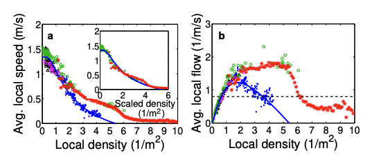
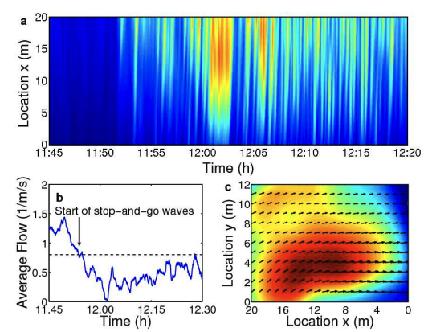
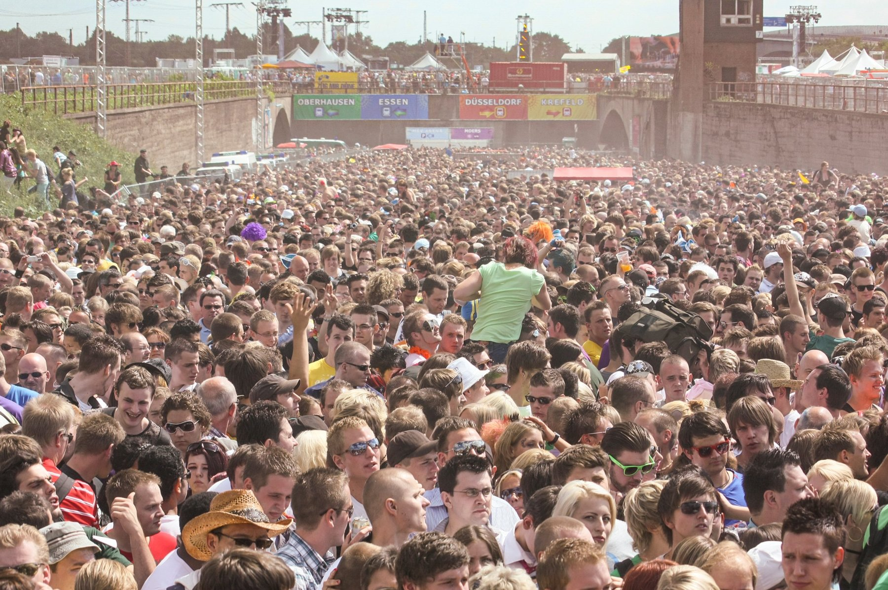

Saber cuántas personas hay en un recinto no basta para anticipar una congestión peligrosa. Lo que la anticipa es medir, zona por zona y minuto a minuto, la densidad local (personas por m²), el flujo por metro de anchura y la variación de las velocidades. Un aforo correcto en el conjunto puede esconder un punto donde ya nadie puede moverse.

## Por qué contar no basta

Un contador de accesos dice cuánta gente ha entrado, no dónde está. Y las multitudes no se reparten de forma uniforme: se concentran ante escenarios, salidas, escaleras y cruces. En el puente de Jamarat (La Meca, 2006), el análisis en vídeo de Helbing y colaboradores mostró que la densidad local máxima duplicaba la media: la media rara vez pasaba de 6 personas/m², pero había puntos con más de 10 ([Helbing et al., 2007](https://arxiv.org/pdf/physics/0701203)).

El caso histórico más claro es Hillsborough (Sheffield, 15 de abril de 1989, 97 muertos). El estadio tenía un sistema informatizado que mostraba en la sala de control el total acumulado de cada sección de tornos, pero no podía avisar de que un corral concreto hubiera superado su capacidad segura. El informe provisional de Lord Justice Taylor atribuyó la causa inmediata a tres fallos: no se fijaron capacidades máximas, no se controló numéricamente la entrada a cada corral y no hubo vigilancia visual eficaz de la densidad ([informe Taylor](https://en.wikisource.org/wiki/Page:Hillsborough_Taylor_Interim_Report_Cm765.pdf/15)).

La lección no es contar mejor, sino medir otras cosas en otros lugares.

## Densidad: los umbrales dependen del contexto

No existe una cifra universal de densidad peligrosa. Los valores de referencia cambian según cuatro factores:

- **Si el público camina o está parado.** Caminar necesita mucho más espacio que estar de pie.
- **El tamaño de las personas.** Helbing y colaboradores tuvieron que corregir sus densidades de Jamarat por 0,7 para compararlas con datos europeos, por las diferencias de superficie corporal ([Helbing et al., 2007](https://arxiv.org/pdf/physics/0701203)).
- **La geometría:** estrechamientos, giros, rampas y escaleras.
- **La dirección de los flujos.** Los flujos opuestos y los cruces reducen la capacidad.

| Contexto | Valor | Qué significa | Fuente |
| --- | --- | --- | --- |
| Pasillo, nivel A de Fruin | ≤ 0,3 pers/m² | Cada uno elige su velocidad y adelanta sin conflictos | [Fruin, 1971](https://onlinepubs.trb.org/Onlinepubs/hrr/1971/355/355-001.pdf) |
| Pasillo, nivel E de Fruin | ≈ 1,1–2,2 pers/m² | Cerca de la capacidad, con paradas frecuentes | [Fruin, 1971](https://onlinepubs.trb.org/Onlinepubs/hrr/1971/355/355-001.pdf) |
| Pasillo, nivel F de Fruin | ≥ 2,2 pers/m² | Se avanza arrastrando los pies; el flujo se rompe | [Fruin, 1971](https://onlinepubs.trb.org/Onlinepubs/hrr/1971/355/355-001.pdf) |
| Flujo que camina en un sentido | < 0,8 libre; 0,8–1,6 riesgo de inestabilidad; > 1,6 congestión casi segura | Transición de flujo estable a congestionado | [Gerlach y Seyfried, Univ. de Wuppertal](https://svpt.uni-wuppertal.de/fileadmin/bauing/svpt/Publikationen/LoPa_EVC_Beitrag_english.pdf) |
| Capacidad máxima de un flujo que camina | ≈ 1,75 pers/m² | Densidad con el mayor caudal | Weidmann (1993), en [Gerlach y Seyfried](https://svpt.uni-wuppertal.de/fileadmin/bauing/svpt/Publikationen/LoPa_EVC_Beitrag_english.pdf) |
| Eventos en general | 2 pers/m² | Límite habitual de evaluación | [G. Keith Still](https://www.gkstill.com/Support/crowd-density/CrowdDensity-1.html) |
| Colas en movimiento | 4 pers/m² | Valor de referencia para colas | [G. Keith Still](https://www.gkstill.com/Support/crowd-density/CrowdDensity-1.html) |
| Público de pie y parado | 5 pers/m² | Límite superior en zonas de visión | [G. Keith Still](https://www.gkstill.com/Support/crowd-density/CrowdDensity-1.html) |
| Gradas de pie en estadios (Reino Unido) | 4,7 pers/m² | Cifra de la Green Guide, criticada por no ajustar por complexión | [G. Keith Still](https://www.gkstill.com/Support/crowd-density/CrowdDensity-1.html) |
| Puente de Jamarat, densidad local | > 6 pers/m² | El flujo local cae a un tercio o menos | [Helbing et al., 2007](https://arxiv.org/pdf/physics/0701203) |
| Itaewon, callejón, 22:25 | 9,07–10,74 pers/m² | Estimación de la investigación policial coreana | [Hankyung](https://www.hankyung.com/article/2023011313587), [Korea Times](https://www.koreatimes.co.kr/southkorea/society/20230113/police-wrap-up-monthslong-probe-into-itaewon-crush-23-officials-referred-to-prosecution) |

Algunas cifras parecen contradecirse: Fruin sitúa la ruptura del flujo hacia 2,2 pers/m² y Still acepta 5 para público de pie. No es una contradicción: la primera cifra es para gente que camina y la segunda para gente parada. Por eso no tiene sentido una única cifra de alarma.

Los niveles de Fruin siguen en uso: el estudio de nivel de servicio peatonal del Departamento de Planificación de Nueva York los aplica a aceras, pasillos y escaleras del metro ([NYC Planning](https://www.nyc.gov/assets/planning/download/pdf/plans/transportation/td_fullpedlosb.pdf)).

## Flujo y diagrama fundamental

El flujo específico es el número de personas que cruzan cada metro de anchura por segundo. Se obtiene multiplicando densidad por velocidad:

**J = ρ × v**

donde *J* es el flujo en personas/(m·s), *ρ* la densidad en personas/m² y *v* la velocidad en m/s. La relación entre las tres se llama **diagrama fundamental**, y su forma básica siempre es la misma:

1. Con poca gente, el flujo crece al aumentar la densidad.
2. Llega un punto crítico en el que el flujo es máximo.
3. A partir de ahí, más densidad significa menos flujo: la gente sigue llegando pero sale menos, y la zona se llena cada vez más deprisa.

Algunas cifras de referencia:

- **Weidmann (ETH Zúrich, 1993)**, que combina 25 conjuntos de datos: capacidad de unas 1,22 personas/(m·s) a 1,75 pers/m² y 0,7 m/s; velocidad libre de 1,34 m/s; el movimiento se detiene hacia 5,4 pers/m² ([resumen en Gerlach y Seyfried](https://svpt.uni-wuppertal.de/fileadmin/bauing/svpt/Publikationen/LoPa_EVC_Beitrag_english.pdf)).
- **Fruin (1971)** midió un flujo máximo de unas 1,4 personas/(m·s) en pasillos de un sentido, y advirtió que diseñar para esa capacidad supone una aglomeración densa y una circulación a tirones ([Fruin, 1971](https://onlinepubs.trb.org/Onlinepubs/hrr/1971/355/355-001.pdf)).
- **Gerlach y Seyfried**, según la guía alemana FGSV EVC: capacidad de 1,3–1,6 personas/(m·s) a unos 1,75 pers/m² ([Universidad de Wuppertal](https://svpt.uni-wuppertal.de/fileadmin/bauing/svpt/Publikationen/LoPa_EVC_Beitrag_english.pdf)).
- **G. Keith Still** observa la densidad crítica en flujos en movimiento entre 2 y 4 pers/m², y avisa de que cambia con el evento y el público ([gkstill.com](https://www.gkstill.com/Support/crowd-flow/MovingDensity.html)).

Los diagramas no coinciden entre sí. Según una revisión de Seyfried y colaboradores, la densidad de flujo máximo varía entre 1,75 y 7 pers/m² según el estudio, y la densidad a la que todo se detiene entre 3,8 y 10 pers/m² ([revisión](https://www.researchgate.net/publication/336286296_An_overview_of_fundamental_diagrams_of_pedestrian_dynamics)). Influyen la población, la cultura, la geometría y la dirección de los flujos.

*a) Velocidad media local y b) flujo local según la densidad local. Los datos de Jamarat (rojo) aparecen junto a mediciones de Fruin (negro), Mori y Tsukaguchi (verde), Polus et al. (morado) y Seyfried et al. (azul); la línea continua es la curva de Weidmann. El flujo sube, llega a un máximo y cae, y en Jamarat aparece un segundo máximo hacia 9 p/m². Figura original en inglés. Fuente: Helbing, Johansson y Al-Abideen, Phys. Rev. E 75, 046109 (2007), figura 1 ([arXiv](https://arxiv.org/abs/physics/0701203)).*

Una consecuencia práctica: en experimentos con cuellos de botella, **la congestión aparece antes de llegar a la capacidad teórica**. Por eso la guía alemana recomienda dimensionar los pasos en el límite del flujo todavía estable, no en el máximo, y evaluar los 2 minutos más cargados en vez de la media horaria ([Gerlach y Seyfried](https://svpt.uni-wuppertal.de/fileadmin/bauing/svpt/Publikationen/LoPa_EVC_Beitrag_english.pdf)).

## Presión de multitud y turbulencia

A densidades muy altas los cuerpos están en contacto y las fuerzas se transmiten y se suman. La densidad deja entonces de describir bien el peligro.

Helbing, Johansson y Al-Abideen propusieron en 2007 un indicador más fino, la **presión de multitud**: la densidad local multiplicada por la varianza local de la velocidad ([Helbing et al., 2007](https://arxiv.org/pdf/physics/0701203)). No es la presión mecánica que sufre cada persona, sino una medida de lo irregular que es el movimiento en un punto denso. Si todos avanzan a la vez y al mismo ritmo, la varianza es baja; si cada uno es empujado en una dirección distinta, se dispara.

Cuando esa presión superó **0,02/s²**, el flujo se volvió turbulento: desplazamientos involuntarios en todas direcciones, tropiezos y caídas que se propagan alrededor. Los autores advierten que el valor depende de cómo se mida la densidad local, en concreto del radio elegido, así que no es una constante universal.

Fruin explicó en 2002 cómo mata una aglomeración: casi todas las muertes se deben a **asfixia por compresión**, no al «pisoteo» del que suelen hablar los medios ([Fruin, 2002](https://www.workingwithcrowds.com/wp-content/uploads/2018/02/THE-CAUSES-AND-PREVENTION-OF-CROWD-DISASTERS-by-John-J.-Fruin-Ph.D.-P.E..pdf)).

## Jamarat, 12 de enero de 2006: señales que se vieron venir

El accidente del puente de Jamarat, en Mina (La Meca), es el caso mejor documentado de señales previas. El ministro de Sanidad saudí habló de 345 muertos el mismo día ([RFE/RL](https://www.rferl.org/a/1064646.html)); otras fuentes posteriores elevan la cifra hasta 363.

Helbing y su equipo analizaron los vídeos de una zona de 27,7 × 22,5 m ante la entrada del puente y obtuvieron más de 30 millones de pares de posición y velocidad entre las 11:45 y las 12:30 ([Helbing et al., 2007](https://arxiv.org/pdf/physics/0701203)). La secuencia fue esta:

1. **Hacia las 11:53**, el flujo pasó de ordenado a **ondas de parada y arranque**, justo cuando el flujo de salida bajó de 0,8 personas/(m·s). Las ondas duraron más de 20 minutos.
2. **A las 12:19**, con densidades aún mayores, apareció la **turbulencia**: la presión de multitud superó 0,02/s².
3. **Unos 10 minutos después** empezó el accidente, más de 30 minutos después de que el flujo bajara del umbral crítico.

*a) Densidad de peregrinos ante la entrada del puente: tras una fase ordenada, hacia las 11:53 aparecen ondas de parada y arranque (azul, densidad baja; amarillo y naranja, alta). b) El flujo medio cae por debajo de 0,8 personas/(m·s) justo cuando empiezan esas ondas. c) Velocidades (flechas) y «presión de multitud» (color) entre las 11:45 y las 12:30: la zona roja oscura es donde la gente tropezó y empezó el accidente. Figura original en inglés. Fuente: Helbing, Johansson y Al-Abideen, Phys. Rev. E 75, 046109 (2007), figura 2 ([arXiv](https://arxiv.org/abs/physics/0701203)).*

Otros hallazgos: las densidades locales superaron 10 pers/m²; por encima de 6, el flujo local cayó a un tercio o menos, de modo que salía mucha menos gente de la que entraba; y el accidente ocurrió en una zona llana y abierta, sin contraflujos importantes.

Los autores concluyen que estas señales pueden detectarse en directo con análisis automático de vídeo. En el Hajj siguiente se introdujeron conteo automático con las cámaras, circulación en un solo sentido, eliminación de puntos de acumulación y horarios por grupos; según los propios autores, fue un Hajj seguro.

## Lo que enseñan los accidentes

En casi todos estos casos había datos o avisos disponibles. Lo que faltó fue convertirlos en decisiones a tiempo.

*Rampa de entrada y salida de la Love Parade en Duisburgo, el 24 de julio de 2010 hacia las 15:30, con los túneles al fondo: el mismo paso servía para entrar y salir del recinto. Foto: Arne Müseler ([arne-mueseler.com](http://www.arne-mueseler.com)), [Wikimedia Commons](https://commons.wikimedia.org/wiki/File:Loveparade_2010_duisburg_tunnel_ramp.jpg).*

| Fecha | Lugar | Qué pasó | Lección para la medición |
| --- | --- | --- | --- |
| 29 ene 2025 | Maha Kumbh Mela, Prayagraj (India) | Al menos 30 muertos y 60 heridos según las autoridades del Kumbh; hacia la 1:00 la multitud rompió las barreras | Había más de 2.700 cámaras, algunas con IA. Instalar cámaras no basta si los datos no llevan a actuar a tiempo; una comisión judicial investiga el caso |
| 29 oct 2022 | Itaewon, Seúl (Corea del Sur) | 159 muertos en un callejón en cuesta de 3,2–4 m de ancho; densidad estimada de 7,72–8,39 pers/m² a las 22:15 y de 9,07–10,74 a las 22:25 ([Hankyung](https://www.hankyung.com/article/2023011313587)) | Hubo 11 llamadas al 112 entre las 18:34 y las 22:11 ([Korea Times](https://www.koreatimes.co.kr/southkorea/society/20230113/police-wrap-up-monthslong-probe-into-itaewon-crush-23-officials-referred-to-prosecution)). Seúl tenía un sistema de población en tiempo real con datos móviles, pero nadie lo vigilaba para la seguridad ([Kyunghyang](https://www.khan.co.kr/article/202210312119015)) |
| 5 nov 2021 | Astroworld, Houston (EE. UU.) | 10 muertos; según la prensa, el informe policial describe un público ya peligrosamente compactado horas antes del concierto principal ([Houston Landing](https://www.houstonlanding.org/houston-police-astroworld-report-contains-1266-pages-but-no-blame-for-tragedy/)) | La compactación fue lenta y visible, y el personal la advirtió |
| 1 nov 2012 | Madrid Arena, Madrid | 5 jóvenes muertas; aforo de 10.620 y al menos 16.605 asistentes; solo 3 de 8 vomitorios abiertos ([sentencia](https://www.icab.es/export/sites/icab/.galleries/documents-noticies/2016/sentencia-488-2016-de-l-audiencia-provincial-de-madrid.-cas-madrid-arena-.pdf), [Público](https://www.publico.es/sociedad/diez-hechos-probados-ocurrio-madrid-arena-sentencia.html)) | El aforo se fijó por plantas, pero las entradas no distinguían planta y no se controló el estado del interior |
| 24 jul 2010 | Love Parade, Duisburgo (Alemania) | 21 muertos y más de 500 heridos; un único túnel de entrada y salida; turbulencia desde las 16:34; móviles sin servicio de 15:30 a 18:00 y sin megafonía en la rampa ([Helbing y Mukerji, 2012](https://arxiv.org/pdf/1206.5856)) | Sin flujos separados ni comunicaciones, la situación no se percibió a tiempo; los intentos de huida se interpretaron como indisciplina |
| 12 ene 2006 | Puente de Jamarat, Mina (Arabia Saudí) | 345–363 muertos según la fuente; ondas de parada y arranque y después turbulencia | Los indicadores de flujo y presión dieron entre 10 y 30 minutos de margen ([Helbing et al., 2007](https://arxiv.org/pdf/physics/0701203)) |
| 15 abr 1989 | Estadio de Hillsborough, Sheffield (Reino Unido) | 97 muertos; los corrales centrales se llenaron en exceso al abrir la puerta C | El conteo por sección de tornos no avisaba de un corral lleno: había que medir por zona ([informe Taylor](https://en.wikisource.org/wiki/Page:Hillsborough_Taylor_Interim_Report_Cm765.pdf/15)) |

Tras Itaewon, Corea obliga desde marzo de 2024 a los gobiernos locales a preparar planes de seguridad para grandes concentraciones aunque no tengan organizador. Para Halloween de 2026, Seúl dedica 361 de sus 1.094 cámaras con detección de aglomeraciones a las zonas de fiesta, con avisos automáticos hacia 5–6 pers/m² ([Aju Press](https://www.ajupress.com/view/20261028164131128)).

## Qué dice la norma en España

La normativa española pide **calcular y planificar el aforo**, no medir la densidad real durante el evento.

- **Real Decreto 393/2007, Norma Básica de Autoprotección.** Obliga a tener plan de autoprotección, entre otras, a las actividades al aire libre con 20.000 o más asistentes y a los espectáculos cerrados de 2.000 o más. El plan debe identificar y cuantificar a las personas que pueden estar presentes ([BOE](https://www.boe.es/buscar/act.php?id=BOE-A-2007-6237)). Algunos ayuntamientos rebajan el umbral; Zaragoza lo fija en 10.000 asistentes ([Ayuntamiento de Zaragoza](https://www.zaragoza.es/sede/servicio/tramite/4032)).
- **Comunitat Valenciana.** Los espectáculos en vía pública con más de 1.000 personas previstas necesitan autorización municipal y deben cumplir los requisitos de aforo y evacuación ([Generalitat Valenciana](https://comunica.gva.es/es/detalle?id=377011872&site=373422856)). La Orden 3/2025 de horarios fija además con cuánta antelación deben abrirse las puertas según el aforo: por ejemplo, 2 horas entre 15.000 y 35.000 personas y 4 horas por encima de 75.000 ([DOGV](https://dogv.gva.es/datos/2025/12/22/pdf/2025_48041_es.pdf)).

En resumen, la norma pregunta cuánta gente cabe y por dónde sale. No pide saber cuánta gente hay en cada zona en este momento ni a qué ritmo se llena. El hueco no es solo español: Gerlach y Seyfried señalan que, en todo el mundo, las normas regulan sobre todo la emergencia y muy poco el funcionamiento ordinario de los flujos ([Universidad de Wuppertal](https://svpt.uni-wuppertal.de/fileadmin/bauing/svpt/Publikationen/LoPa_EVC_Beitrag_english.pdf)).

## Qué indicadores sirven para anticipar

Ningún indicador basta por sí solo. Estos son los más útiles, de más sencillo a más complejo:

1. **Densidad local, no media.** Se mide en celdas pequeñas, del orden de metros, en los puntos críticos: estrechamientos, frentes de escenario, accesos y escaleras.
2. **Caudal por metro de anchura** en cada sección crítica, comparado con un valor estable de diseño y no con la capacidad máxima. Si el caudal baja mientras la densidad sube, el tramo ya ha pasado al lado congestionado del diagrama fundamental.
3. **Acumulación neta por zona:** entradas menos salidas. En la Love Parade, entre las 14:00 y las 15:00 entraban 280–600 personas por minuto en una zona y salían 6–80 ([Helbing y Mukerji, 2012](https://arxiv.org/pdf/1206.5856)).
4. **Tiempo hasta un umbral.** Combina los dos anteriores y convierte el dato en un plazo para decidir. Un ejemplo: una zona de 400 m² con un umbral de 4 pers/m² admite 1.600 personas; si hay 800 y entran netas 100 por minuto, quedan unos 8 minutos.
5. **Ondas de parada y arranque.** Indican que sale menos gente de la que entra. En Jamarat aparecieron más de 30 minutos antes del accidente.
6. **Varianza de la velocidad y presión de multitud.** Detectan el paso a la turbulencia; en Jamarat el accidente llegó unos 10 minutos después.
7. **Contraflujos y cruces.** Reducen la capacidad y desestabilizan el flujo; tras Jamarat y la Love Parade se impuso la circulación en un solo sentido.
8. **Señales humanas:** llamadas de emergencia, gente que trepa por vallas o postes, gritos. En Itaewon y Duisburgo aparecieron antes del desenlace; son datos, no ruido.

La investigación reciente va en esta dirección, aunque con poca evidencia de campo. Una revisión sistemática de 2026 concluye que las avalanchas son en gran medida prevenibles con estrategias integradas, pero solo encuentra dos estudios que probaran sistemas de alerta temprana ([Chowhan et al., *Public Health Reviews*, 2026](https://www.ssph-journal.org/journals/public-health-reviews/articles/10.3389/phrs.2026.1609310/full)).

## Conclusión

El conteo responde a cuánta gente hay. La seguridad necesita saber dónde está, a qué ritmo llega y cómo se mueve. La ciencia de multitudes no ofrece una cifra mágica, sino una lógica: vigilar la densidad local con umbrales adaptados a si el público camina o está parado, medir el flujo por metro frente a un valor estable y tratar las ondas de parada y arranque y la irregularidad de las velocidades como alarmas tempranas.

## Límites de estos datos

- **Los umbrales dependen del método.** Las cifras de Helbing dependen del radio de medición; las de Fruin proceden de viajeros estadounidenses de 1971; las de Weidmann combinan estudios heterogéneos. Ninguna debe aplicarse sin adaptarla al público y al espacio.
- **Algunas cifras solo están en fuentes secundarias:** el número de víctimas de Jamarat, los detalles del informe de Astroworld (conocidos por la prensa) y el número de cámaras del Kumbh Mela.
- **Hay datos que no coinciden entre fuentes:** los heridos de la Love Parade (más de 500 o más de 650), las medidas de su rampa y la anchura del callejón de Itaewon (de unos 3 a unos 4 m).
- **Ningún caso permite afirmar que una tecnología concreta habría evitado el accidente.** Los análisis atribuyen estos desastres a cadenas de fallos de planificación, comunicación y decisión.

## Fuentes

- Helbing, Johansson y Al-Abideen (2007). [Dynamics of crowd disasters: An empirical study](https://arxiv.org/pdf/physics/0701203). *Physical Review E* 75, 046109.
- Helbing y Mukerji (2012). [Crowd disasters as systemic failures: analysis of the Love Parade disaster](https://arxiv.org/pdf/1206.5856).
- Fruin (1971). [Designing for pedestrians: A level-of-service concept](https://onlinepubs.trb.org/Onlinepubs/hrr/1971/355/355-001.pdf). *Highway Research Record* 355.
- Fruin (2002). [The Causes and Prevention of Crowd Disasters](https://www.workingwithcrowds.com/wp-content/uploads/2018/02/THE-CAUSES-AND-PREVENTION-OF-CROWD-DISASTERS-by-John-J.-Fruin-Ph.D.-P.E..pdf).
- Gerlach y Seyfried, Universidad de Wuppertal. [Love Parade y guía FGSV EVC](https://svpt.uni-wuppertal.de/fileadmin/bauing/svpt/Publikationen/LoPa_EVC_Beitrag_english.pdf).
- [An overview of fundamental diagrams of pedestrian dynamics](https://www.researchgate.net/publication/336286296_An_overview_of_fundamental_diagrams_of_pedestrian_dynamics).
- G. Keith Still. [Crowd density](https://www.gkstill.com/Support/crowd-density/CrowdDensity-1.html) y [densidad en movimiento](https://www.gkstill.com/Support/crowd-flow/MovingDensity.html).
- NYC Department of City Planning. [Pedestrian Level of Service Study](https://www.nyc.gov/assets/planning/download/pdf/plans/transportation/td_fullpedlosb.pdf).
- Lord Justice Taylor (1989). [Hillsborough Stadium Disaster, informe provisional](https://en.wikisource.org/wiki/Page:Hillsborough_Taylor_Interim_Report_Cm765.pdf/15).
- RFE/RL (2006). [Cifras del accidente de Jamarat](https://www.rferl.org/a/1064646.html).
- Audiencia Provincial de Madrid. [Sentencia 488/2016, Madrid Arena](https://www.icab.es/export/sites/icab/.galleries/documents-noticies/2016/sentencia-488-2016-de-l-audiencia-provincial-de-madrid.-cas-madrid-arena-.pdf); [hechos probados en Público](https://www.publico.es/sociedad/diez-hechos-probados-ocurrio-madrid-arena-sentencia.html).
- Houston Landing (2023). [Informe policial de Astroworld](https://www.houstonlanding.org/houston-police-astroworld-report-contains-1266-pages-but-no-blame-for-tragedy/).
- Itaewon: [Korea Times, cierre de la investigación policial](https://www.koreatimes.co.kr/southkorea/society/20230113/police-wrap-up-monthslong-probe-into-itaewon-crush-23-officials-referred-to-prosecution); [Hankyung](https://www.hankyung.com/article/2023011313587); [Kyunghyang Shinmun](https://www.khan.co.kr/article/202210312119015); [Aju Press, 2026](https://www.ajupress.com/view/20261028164131128).
- [Real Decreto 393/2007, Norma Básica de Autoprotección](https://www.boe.es/buscar/act.php?id=BOE-A-2007-6237) (BOE).
- Generalitat Valenciana. [Nota sobre la circular de fiestas](https://comunica.gva.es/es/detalle?id=377011872&site=373422856) y [Orden 3/2025 de horarios](https://dogv.gva.es/datos/2025/12/22/pdf/2025_48041_es.pdf).
- Chowhan, Hudda, Sharma y Bhardwaj (2026). [Revisión sistemática sobre prevención de avalanchas](https://www.ssph-journal.org/journals/public-health-reviews/articles/10.3389/phrs.2026.1609310/full). *Public Health Reviews* 47.
