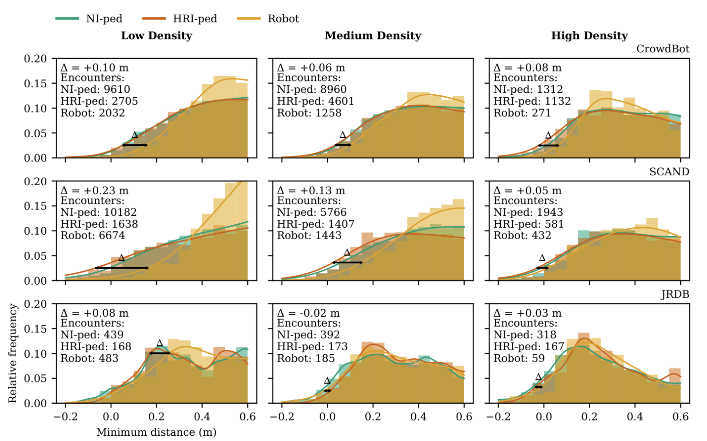

Los algoritmos para detectar personas en nubes de puntos han mejorado mucho, pero casi todos se han entrenado con datos grabados desde coches o robots, en calles con poca gente. Para medir multitudes reales con sensores fijos, los datos abiertos son escasos, y la mayoría no se pueden usar fuera de la investigación. Ese es hoy el principal cuello de botella del campo, y también una oportunidad para quien quiera contribuir.

## Qué hace útil a un dataset para estudiar multitudes

No todos los datos con personas sirven para lo mismo. Para medir y anticipar aglomeraciones importan cinco cosas:

1. **Desde dónde mira el sensor.** Un LiDAR en el techo de un coche ve a los peatones de lado y a poca altura; uno fijo en una farola o un techo los ve desde arriba, donde se tapan menos. Un modelo entrenado con un punto de vista rinde peor con el otro.
2. **Cuánta gente hay.** La mayoría de las escenas de conducción tienen pocas personas por fotograma. Una multitud de pie a 4–5 personas por m² es otro problema: los cuerpos se tocan y los grupos de puntos se fusionan.
3. **Qué está etiquetado.** Para contar basta una caja por persona; para estudiar flujos hacen falta identificadores que sigan a cada persona en el tiempo; para validar densidades, recuentos de referencia por zona.
4. **Cuánto dura.** Las aglomeraciones se forman en minutos u horas. Fragmentos de segundos sirven para detectar, no para estudiar cómo evoluciona una multitud.
5. **Qué licencia tiene.** Una licencia «no comercial» permite investigar, pero no usar los datos en un producto; una licencia abierta como CC BY permite ambas cosas citando a los autores.

## El mapa de lo que hay

No hemos encontrado ningún dataset abierto de LiDAR que llegue a la densidad de una aglomeración seria (4–5 personas por m²). El que más se acerca con una cifra publicada en personas por m² es CrowdBot, grabado en mercados de Lausana, con hasta 1 persona por m². Revisión hecha el 30 de octubre de 2026; las licencias marcadas con «no consta» no aparecen en el artículo ni en la página que pudimos abrir.

*Distancia mínima entre peatones que no interactúan con el robot (verde), peatones que sí lo hacen (naranja) y el propio robot (amarillo), en tres niveles de densidad de CrowdBot, SCAND y JRDB. Es el tipo de análisis de comportamiento que permite un dataset abierto bien documentado. Figura original en inglés. Fuente: [CrowdBot v2, EPFL (Zenodo)](https://zenodo.org/records/17730560), CC BY 4.0.*

| Dataset | Sensor y montaje | Escena | Tamaño | Cuánta gente | Licencia |
| --- | --- | --- | --- | --- | --- |
| [CrowdBot v2](https://zenodo.org/records/17730560) (EPFL, 2025) | 2 Velodyne VLP-16 en un robot | Mercados semanales y navideños de Lausana | Unos 250.000 fotogramas, unos 200 min | 0,1–1,0 pers/m² | CC BY 4.0 |
| [PointCloudPeople](https://huggingface.co/datasets/LukasPro/PointCloudPeople) (2025) | Blickfeld Qb2, fijo | Un punto de medición | Unas 2.000 nubes, 110 GB | Al menos 1 persona por nube | CC BY 4.0 |
| [JRDB](https://jrdb.erc.monash.edu/) (Stanford y Monash) | 2 Velodyne de 16 haces en un robot | 30 lugares de un campus | 64 min, 1,8 millones de cajas 3D | Más de 200 personas a la vista en las escenas más llenas | CC BY-NC-SA 3.0 |
| [STCrowd](https://arxiv.org/pdf/2204.01026) (CVPR 2022) | Ouster de 128 haces en un vehículo | Campus y calles, con lluvia y sol | 10.891 fotogramas, 219.000 peatones | 20 por fotograma de media, más de 30 en lo más denso | No consta |
| [HuCenLife](https://arxiv.org/pdf/2307.14392) (ICCV 2023) | Ouster OS1-128, soporte fijo | Centro comercial, campus, parque, gimnasio | 6.185 fotogramas, 65.265 personas | Unas 11 por escena, picos de 70 | No consta |
| [PCP-MV](https://arxiv.org/abs/2505.16029) (2025) | Livox y cámaras en un vehículo | Calles de China elegidas por su densidad | 10.966 fotogramas | Mide la densidad local: 3,8 frente a 0,7 en nuScenes | No consta; no está claro que se publique |
| [IMPTC](https://arxiv.org/html/2307.06165v1) (2023) | 3 LiDAR en farolas a 5 m | Cruce urbano con semáforos | Unas 8 h, 2.500 trayectorias de peatones y ciclistas | Pocas personas a la vez | Solo investigación no comercial |
| [TUMTraf / A9](https://github.com/tum-traffic-dataset/tum-traffic-dataset-dev-kit) (TU Múnich, 2023) | 2 Ouster OS1-64 en un pórtico a 7 m | Cruce en Garching | 4.800 fotogramas, 38.045 objetos | Solo 2.507 son peatones | CC BY-NC-ND 4.0 |
| [nuScenes](https://arxiv.org/pdf/1903.11027) (referencia de conducción) | LiDAR de 32 haces en un coche | Boston y Singapur | 1.000 escenas, 1,4 millones de cajas | Unos 7 peatones por fotograma clave | CC BY-NC-SA 4.0 |
| [LiDAR-CS](https://arxiv.org/html/2301.12515v2) (2023) | Simulado, 6 patrones de sensor, uno Livox | Fondos reales con objetos CAD | 84.000 fotogramas, 230.000 peatones | Sintético | No consta |

**Los dos datasets de multitudes reales más densos no usan LiDAR.** El de la [Fête des Lumières de Lyon](https://arxiv.org/pdf/2410.05288) (*Scientific Data*, 2025) registra unas 7.000 trayectorias con densidades de hasta 4 personas por m², pero con cámaras cenitales, una cámara en la torre del ayuntamiento y GPS de móviles. El [archivo de dinámica peatonal de Jülich](https://arxiv.org/pdf/2303.02319) reúne experimentos de laboratorio con unos 1.000 participantes, grabados con 21 cámaras cenitales y sensores de movimiento.

**Los sistemas reales con más LiDAR no publican datos.** La estación de Nagoya tiene 20 LiDAR en su vestíbulo y la Universidad de Osaka un banco de pruebas con 70; ninguno comparte sus nubes de puntos. Los autores de Nagoya señalan que no existen datasets públicos de nubes de puntos en estaciones ([Hishida et al.](https://www.its-jp.org/wp-content/uploads/2025/12/2025-1-A-08_paper.pdf)). El conjunto [ATC](https://dil.atr.jp/crest2010_HRI/ATC_dataset) de Osaka cubrió 900 m² de un centro comercial con 49 sensores 3D durante 92 días, pero publica trayectorias, no nubes.

## Lo que falta

**1. Densidad real.** Los datasets abiertos de LiDAR se quedan en torno a 1 persona por m². Las guías de seguridad empiezan a preocuparse a partir de 2 y hablan de riesgo serio entre 4 y 5. Justo la franja que más interesa medir es la que no tiene datos. A esas densidades los cuerpos se tapan entre sí, las nubes de puntos se funden y los detectores entrenados con peatones sueltos fallan; sin datos reales no se puede saber cuánto. Las oclusiones afectan tanto a la cámara como al LiDAR, y ya aparecen con unas 20 personas por fotograma ([Cong et al., STCrowd](https://arxiv.org/pdf/2204.01026)).

**2. Sensores fijos y elevados.** La mayoría de los datos vienen de coches o robots que se mueven a la altura de la cintura. Un sensor fijo en un poste o en un techo ve la escena desde arriba, con menos oclusiones y un fondo que no cambia. Los pocos datasets con sensor fijo (IMPTC, TUMTraf, HuCenLife) miran cruces de tráfico o escenas con pocas decenas de personas.

**3. Peatones en cantidad.** En los datos de conducción las personas son minoría. En TUMTraf, menos del 7 % de los objetos anotados son peatones (2.507 de 38.045, cálculo propio). nuScenes tiene unos 7 peatones por fotograma clave.

**4. Duraciones largas.** Para estudiar cómo se forma una aglomeración hacen falta horas seguidas del mismo lugar: la llegada, el pico y la salida. Casi todos los datasets son fragmentos de segundos o minutos. El ATC de Osaka sí tiene meses, pero solo publica trayectorias.

**5. Licencias para construir cosas.** De los datasets revisados, solo CrowdBot v2 y PointCloudPeople permiten uso comercial (CC BY 4.0). Los demás son no comerciales, sin derivados o se piden por correo. Esto frena la colaboración entre universidades y empresas, que es justo donde se prueba la tecnología en la calle.

**6. Verdad de terreno.** Muchas anotaciones son detecciones automáticas o cajas dibujadas a mano en escenas tranquilas. Faltan datos con un conteo independiente (personas contadas en una puerta, por ejemplo) contra el que comparar.

No es solo nuestra impresión. Una revisión de 2026 sobre LiDAR en gestión de multitudes ([Khanfor et al., *IEEE Internet of Things Magazine*](https://arxiv.org/abs/2603.27663)) señala la falta de datos reales de multitudes como uno de los principales frenos del campo, junto al coste del procesado y del sensor.

## Cómo se suple hoy

Si no hay datos reales, se fabrican. Hay cuatro caminos, cada uno con su trampa.

**Simuladores de conducción.** [CARLA](https://carla.readthedocs.io/en/latest/ref_sensors/), de código abierto, incluye un LiDAR que lanza rayos sobre una escena 3D con peatones animados. Es cómodo para generar miles de fotogramas etiquetados, pero los peatones son modelos genéricos y el sensor no reproduce bien el ruido, los rebotes perdidos ni la reflectividad de la ropa real.

**Simuladores de LiDAR físico.** [HELIOS++](https://github.com/3dgeo-heidelberg/helios), de la Universidad de Heidelberg, simula el haz y la trayectoria del sensor con más realismo físico. Nació para topografía y vegetación, no para multitudes, así que las personas hay que ponerlas a mano.

**Mezclar lo real con lo sintético.** [LiDAR-CS](https://arxiv.org/html/2301.12515v2) coloca objetos sintéticos sobre fondos reales y genera la misma escena con seis patrones de sensor, para estudiar qué pasa al cambiar de LiDAR. Un trabajo de 2026 con un MEMS-LiDAR ([arXiv 2602.01764](https://arxiv.org/abs/2602.01764)) combina unas 2.100 nubes reales con otras tantas sintéticas, precisamente para cumplir el RGPD sin grabar a tanta gente. [Paved2Paradise](https://arxiv.org/abs/2312.01117) propone grabar personas por separado en un aparcamiento vacío y pegarlas en otros fondos; publica el método, no un dataset.

**Experimentos de laboratorio.** Los grupos de dinámica peatonal, como el de [Jülich](https://ped.fz-juelich.de/da/doku.php), llevan años organizando experimentos con cientos de voluntarios en pasillos, cuellos de botella y cruces. Los datos son abiertos y muy valiosos, pero se graban con cámaras y los voluntarios se comportan como voluntarios: no hay prisa, ni alcohol, ni una salida cerrada.

La trampa común es la misma: **un modelo entrenado con datos limpios puede fallar justo cuando la escena se pone difícil**. Lo sintético sirve para empezar, pero no sustituye una validación con gente real y un conteo independiente.

## Cómo debería ser un buen dataset de multitudes con LiDAR fijo

Si alguien quiere llenar el hueco, esta sería una lista razonable:

- **Sensores fijos y elevados**, a la altura de un poste o una farola, con varios puntos de vista que se solapen. Y con los metadatos del montaje: altura, inclinación, posición y calibración entre sensores.
- **Densidades reales**, al menos hasta 3–4 personas por m², grabadas en eventos, estaciones o salidas de recintos, no en experimentos.
- **Un conteo independiente**: personas contadas en un acceso, torniquetes o un conteo manual en vídeo, para poder medir el error.
- **Horas seguidas**, que incluyan la llegada, el pico y la dispersión, con condiciones distintas (noche, lluvia, ropa de invierno).
- **Varios sensores**, porque los LiDAR mecánicos de 16–128 haces y los de patrón no repetitivo (tipo Livox) ven de forma muy distinta a la misma persona.
- **Una licencia abierta**, idealmente CC BY 4.0, que permita a universidades y empresas trabajar con los mismos datos.

### El problema de la privacidad

Durante años se ha dicho que el LiDAR es anónimo porque no ve caras. Ya no se puede decir sin matices. [LidarGait](https://arxiv.org/abs/2211.10598) (CVPR 2023) reconoce a personas por su forma de andar en nubes de puntos, con 1.050 sujetos. [ReID3D](https://arxiv.org/abs/2312.03033) (CVPR 2024) re-identifica a 320 personas grabadas con cuatro LiDAR Livox con un acierto del 94 % en el primer intento. Y un estudio del KIT de 2026 con 199 participantes ([MultiGait](https://arxiv.org/abs/2609.01036)) concluye que el LiDAR no protege más la identidad que el vídeo cuando se analiza la forma de andar.

Publicar nubes de puntos de personas reales es, por tanto, publicar datos que pueden ser personales. Hay salidas intermedias:

- publicar **nubes recortadas o de menor resolución**, solo con la caja de cada persona y sin secuencias largas de un mismo individuo;
- publicar **trayectorias y densidades agregadas**, como hace el ATC de Osaka;
- dar acceso a las nubes completas **bajo acuerdo de uso**, como JRDB o SUSTech1K;
- y hacer una **evaluación de impacto** antes de grabar, con señalización visible en el lugar.

Ninguna es perfecta, pero dejar el campo sin datos tampoco lo es: los sistemas se están instalando igualmente, y sin datos abiertos nadie puede comprobar cuánto aciertan.

### Una oportunidad para colaborar

Un dataset así no lo puede hacer un grupo solo. Necesita organizadores de eventos o gestores de estaciones que den acceso, investigadores en percepción 3D que anoten y comparen métodos, especialistas en dinámica de multitudes que definan qué medir, y juristas que diseñen cómo publicarlo. Si trabajas en alguno de esos campos y te interesa, esta es una de las piezas que más falta hace.

## Fuentes

**Datasets de LiDAR con personas**

- [CrowdBot v2, EPFL (Zenodo)](https://zenodo.org/records/17730560)
- [PointCloudPeople, Hugging Face](https://huggingface.co/datasets/LukasPro/PointCloudPeople) · Haas et al., *Sensors* 25(10):3114, 2025
- [JRDB, Stanford y Monash](https://jrdb.erc.monash.edu/)
- [STCrowd, CVPR 2022](https://arxiv.org/pdf/2204.01026)
- [HuCenLife, ICCV 2023](https://arxiv.org/pdf/2307.14392)
- [PCP-MV, 2025](https://arxiv.org/abs/2505.16029)
- [IMPTC, 2023](https://arxiv.org/html/2307.06165v1)
- [TUMTraf / A9, TU Múnich](https://github.com/tum-traffic-dataset/tum-traffic-dataset-dev-kit)
- [nuScenes, Caesar et al.](https://arxiv.org/pdf/1903.11027)
- [LiDAR-CS, 2023](https://arxiv.org/html/2301.12515v2)
- [ATC, Osaka](https://dil.atr.jp/crest2010_HRI/ATC_dataset)

**Multitudes reales sin LiDAR**

- [Fête des Lumières, Lyon](https://arxiv.org/pdf/2410.05288) (*Scientific Data*, 2025)
- Archivo de dinámica peatonal de Jülich: [web](https://ped.fz-juelich.de/da/doku.php) · [artículo](https://arxiv.org/pdf/2303.02319)

**Sistemas sin datos publicados y revisiones**

- [Hishida et al., estación de Nagoya](https://www.its-jp.org/wp-content/uploads/2025/12/2025-1-A-08_paper.pdf) (ITS Japan, 2025)
- Khanfor et al., [*LiDAR for Crowd Management*](https://arxiv.org/abs/2603.27663), IEEE IoT Magazine, 2026

**Simulación y datos sintéticos**

- [CARLA, sensores](https://carla.readthedocs.io/en/latest/ref_sensors/)
- [HELIOS++](https://github.com/3dgeo-heidelberg/helios)
- [MEMS-LiDAR y datos sintéticos, 2026](https://arxiv.org/abs/2602.01764)
- [Paved2Paradise](https://arxiv.org/abs/2312.01117)

**Privacidad y re-identificación**

- [LidarGait, CVPR 2023](https://arxiv.org/abs/2211.10598)
- [ReID3D, CVPR 2024](https://arxiv.org/abs/2312.03033)
- [MultiGait, KIT 2026](https://arxiv.org/abs/2609.01036)

*Revisión hecha el 30 de octubre de 2026. Las licencias y cifras pueden cambiar; comprueba la página de cada dataset antes de usarlo.*
