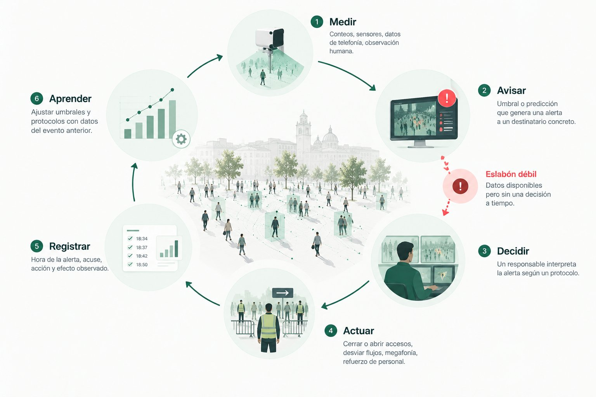
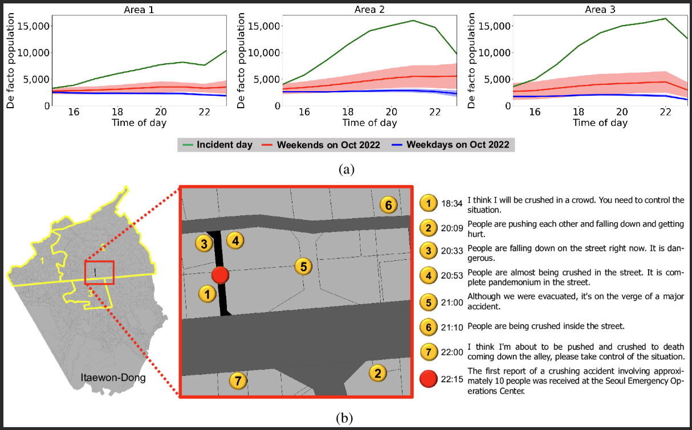

En las grandes catástrofes por aglomeración de las dos últimas décadas, las señales de peligro aparecieron con minutos u horas de antelación. Lo que faltó no fue información, sino un camino corto y claro entre el aviso y la decisión. Los sistemas de apoyo a decisiones buscan acortar ese camino, aunque la evidencia sobre su eficacia real todavía es limitada.

*El ciclo de apoyo a decisiones. El eslabón débil está entre avisar y decidir: los datos existen, pero nadie decide a tiempo. Ilustración propia.*

## Por qué la alerta útil es la temprana

Cuando una multitud alcanza densidades extremas, la capacidad de intervenir se desploma: las personas ya no pueden moverse por sí mismas y los equipos de emergencia no llegan a ellas. Por eso el valor de una alerta depende sobre todo de **cuánto tiempo deja para actuar**. Cerrar un acceso puede requerir pocos minutos; desviar el transporte público o reforzar personal, bastantes más. Una alerta que llega con la densidad ya crítica confirma el problema, pero no ayuda a evitarlo.

## El ciclo medir, avisar, decidir, actuar, registrar y aprender

Un sistema de apoyo a decisiones no es una pantalla con datos. Es un ciclo en el que cada eslabón puede fallar:

1. **Medir** la ocupación y los flujos en los puntos críticos, a lo largo de las fases que describe la guía británica de seguridad en eventos: llegada, entrada, circulación, salida y dispersión ([HSE](https://www.hse.gov.uk/event-safety/crowd-management-assess.htm)).
2. **Avisar** cuando la situación actual, o la prevista, se acerca a un umbral definido para ese lugar, y hacerlo a un destinatario concreto.
3. **Decidir:** una persona con autoridad interpreta el aviso según un protocolo acordado de antemano.
4. **Actuar:** abrir o cerrar accesos, redirigir flujos, informar al público, pausar una actuación, reforzar personal.
5. **Registrar** qué se avisó, quién lo vio, qué se hizo y qué efecto tuvo.
6. **Aprender:** revisar umbrales y protocolos con esos registros.

El eslabón más débil suele estar entre avisar y decidir. El menos documentado es el registro: casi ningún estudio publica qué alerta se recibió, quién la acusó, qué se hizo y qué pasó después. La guía británica señala que vigilar la multitud permite detectar la sobreocupación a tiempo para reaccionar, y cita como fuentes los tornos, las entradas con chip, los sensores de conteo y las señales de teléfonos móviles ([HSE](https://www.hse.gov.uk/event-safety/crowd-management-monitoring.htm)).

## Qué se puede predecir y con qué métodos

Lo que se puede anticipar no es «un aplastamiento», sino **las condiciones que lo preceden**: una zona que se llena más deprisa de lo que se vacía, un caudal que cae en un cuello de botella, una densidad que se acerca a un límite. De lo más simple a lo más complejo:

- **Métodos simples.** Restar salidas a entradas y proyectar la ocupación unos minutos hacia delante; extrapolar la tendencia hasta el umbral («a este ritmo, la zona norte llega al límite en 12 minutos»); medias móviles. Son transparentes y fáciles de explicar a quien decide. No hemos encontrado estudios que demuestren que los modelos complejos los superan en eventos reales a 5–30 minutos, así que deberían ser siempre la referencia.
- **Aprendizaje automático sobre series temporales.** Modelos de gradiente, redes recurrentes y redes sobre grafos espacio-temporales, desarrollados en gran parte para flujos urbanos y tráfico. Un ejemplo conocido predice flujos de entrada y salida en toda una ciudad con datos de taxis y bicicletas ([Zhang et al., 2017](https://arxiv.org/abs/1610.00081)); es escala urbana, no de recinto.
- **Simulación con datos en tiempo real.** Modelos de agentes que se recalibran continuamente con mediciones (simulación en vivo o gemelos digitales) para estimar la evolución de los próximos minutos ([Malleson et al., 2020](https://www.jasss.org/23/3/3.html)). Casi todo se ha validado en escenarios sintéticos o experimentos controlados.
- **Datos de telefonía móvil.** Útiles para ver la tendencia de una zona amplia; normalmente demasiado gruesos para una calle o un acceso concretos. Seúl publica datos de población en tiempo real de más de un centenar de lugares ([Ayuntamiento de Seúl](https://english.seoul.go.kr/real-time-urban-data-service-for-113-major-sites-in-seoul/)).

## Qué dice la evidencia y sus límites

- **Las señales previas están bien documentadas.** El análisis en vídeo del accidente de Jamarat (Hajj, 2006) mostró que el flujo pasó a ondas de parada y arranque hacia las 11:53, que la turbulencia empezó hacia las 12:19 y que el accidente comenzó unos 10 minutos después, más de 30 minutos después de que el flujo cayera por debajo de un valor crítico ([Helbing et al., 2007](https://arxiv.org/abs/physics/0701203)).
- **La predicción a corto plazo con datos reales empieza a evaluarse.** En el festival SAIL 2025 de Ámsterdam, un estudio retrospectivo con 11 sensores de conteo peatonal encontró intervalos de predicción estables hasta unos 30 minutos en casi todos los sensores ([Li et al., 2026](https://arxiv.org/pdf/2607.17758)). Es prometedor, pero se midió a posteriori y no evaluó decisiones.
- **La evidencia sobre el efecto en la seguridad es escasa.** Una revisión sistemática de 2026 solo encontró 13 estudios elegibles sobre prevención de avalanchas y apenas dos que probaran sistemas de alerta temprana, ambos con mensajes SMS; las reducciones de densidad que cita proceden de simulaciones ([Chowhan et al., 2026](https://www.ssph-journal.org/journals/public-health-reviews/articles/10.3389/phrs.2026.1609310/full)).
- **Las cifras comerciales no son evaluaciones independientes.** En aeropuertos, algunos proveedores anuncian precisiones superiores al 99 % en la previsión de llegadas de pasajeros. Son datos del propio proveedor y miden algo distinto de la densidad local a pocos minutos.
- **Mucho se ha probado solo en simulación.** Esos resultados sirven para comparar métodos, no para prometer rendimiento en un evento real.
- **Casi no hay estudios sobre cómo usan los operadores los paneles predictivos.** En otros sectores, la evidencia es clara: en monitorización hospitalaria, entre el 74 % y el 99 % de las alarmas no requerían acción, lo que lleva a ignorarlas (Paine et al., *Journal of Hospital Medicine*, 2016). Las falsas alarmas por turno son una métrica de seguridad, no un detalle técnico.

## Jamarat, Itaewon y la Love Parade: avisos que existían

- **Jamarat (2006).** Las señales eran visibles en el vídeo más de media hora antes. Para el Hajj siguiente se introdujeron el conteo automático con las cámaras, la circulación en un solo sentido y horarios por grupos ([Helbing et al., 2007](https://arxiv.org/abs/physics/0701203)).
- **Itaewon (2022).** La policía recibió 11 llamadas que alertaban del riesgo de aplastamiento, la primera a las 18:34, casi cuatro horas antes del desastre, y solo despachó agentes cuatro veces ([The Korea Herald](https://www.koreaherald.com/article/2991297)). La cifra de 79 que circula es el total de llamadas de emergencia desde la zona entre las 18:00 y las 22:00, no avisos de aplastamiento. Según medios locales recogidos por agencias, la ciudad tenía datos de población en tiempo real basados en móviles que nadie usó esa noche para la seguridad ([Al Jazeera](https://www.aljazeera.com/news/2022/11/1/s-korea-response-to-crowd-crush-inadequate-says-police-chief)); esos datos registraron un aumento de población superior al 300 % en el barrio ([análisis en PMC](https://pmc.ncbi.nlm.nih.gov/articles/PMC11244771/)).
- **Love Parade (2010).** El análisis de Helbing y Mukerji describe un fallo del sistema, con hipótesis de planificación que no se cumplieron, flujos que se encontraron en una rampa sin guiado suficiente y una acumulación progresiva, no una estampida por pánico ([Helbing y Mukerji, 2012](https://link.springer.com/content/pdf/10.1140/epjds7.pdf)).

*(a) Población estimada con datos de telefonía móvil en tres zonas de Itaewon-dong el día del accidente (verde), frente a los fines de semana (rojo) y los días laborables (azul) de octubre de 2022: el aumento era visible desde media tarde. (b) Ubicación y hora de algunas de las llamadas de aviso a la policía, desde las 18:34, y del primer aviso del accidente a las 22:15. Figura original en inglés. Fuente: Liang, H., Lee, S., Sun, J. y Wong, S. C. (2024), [«Unraveling the causes of the Seoul Halloween crowd-crush disaster»](https://doi.org/10.1371/journal.pone.0306764), PLOS ONE 19(7): e0306764, CC BY 4.0.*

**La lección común:** la información existía; faltaba un destinatario con mandato, un umbral acordado y una acción predefinida.

Tras Itaewon, Seúl ha desplegado cámaras con detección de aglomeraciones que avisan automáticamente a las salas de situación de la ciudad, la policía y los bomberos cuando la densidad llega a unas 5–6 personas por m² ([The Korea Times](https://www.koreatimes.co.kr/southkorea/society/20261022/ai-drones-guard-nightlife-districts-as-seoul-ramps-up-halloween-safety-measures)), y anuncia para el estadio Mundialista un sistema con LiDAR, cámaras y cuatro niveles de alerta ([The Korea Times](https://www.koreatimes.co.kr/amp/southkorea/20260612/seoul-to-deploy-ai-technology-to-monitor-expressways-crowded-stadiums)). Todavía no hay evaluaciones publicadas de su tasa de falsas alarmas ni de su efecto en las decisiones.

## Cómo diseñar alertas que se usen

- **Pocos niveles y con significado operativo.** Cada nivel va ligado a una acción y a un responsable, no solo a un color.
- **Umbrales por contexto.** Una multitud en movimiento y otra de pie no se gestionan con el mismo número: en movimiento, la densidad crítica se sitúa en torno a 2–4 personas por m²; para zonas de pie, unas 5 personas por m² se consideran el límite superior ([G. Keith Still](https://www.gkstill.com/Support/crowd-density/CrowdDensity-1.html)). En Jamarat, la señal más útil no fue la densidad sino la caída del flujo y la variabilidad de las velocidades.
- **Histéresis.** Un umbral para subir de nivel y otro, más bajo y sostenido unos minutos, para bajar, de modo que la alerta no parpadee.
- **Confianza visible.** Mostrar rangos («entre 3,8 y 5,1 personas por m² dentro de 15 minutos») y el estado de los sensores, no un número único.
- **Explicación.** Decir por qué salta la alerta: «entran más personas de las que salen desde hace 8 minutos en la puerta norte».
- **Pocas falsas alarmas.** Cada aviso innecesario erosiona la confianza.
- **Responsable humano.** El sistema propone; la decisión y su registro corresponden al responsable designado en el plan de seguridad.

**Niveles de alerta: ejemplo ilustrativo.** No es un estándar ni una recomendación: los valores deben fijarse en cada recinto con su plan de seguridad y su asesor competente.

| Nivel | Condición de ejemplo | Acción de ejemplo | Quién decide |
| --- | --- | --- | --- |
| 0 · Normal | Ocupación y caudales dentro de lo previsto | Vigilancia rutinaria | Operador de sala |
| 1 · Atención | Entran más personas de las que salen de forma sostenida, o se prevé alcanzar el umbral en 15–30 min | Verificar con cámara u observador; avisar al jefe de sector; preparar medidas | Operador y jefe de sector |
| 2 · Alerta | Se prevé superar el umbral en menos de 10–15 min, o la densidad se acerca al límite del contexto | Abrir salidas alternativas, regular accesos, megafonía | Responsable de seguridad del evento |
| 3 · Crítico | Umbral superado, caída brusca del caudal u ondas de parada y arranque | Protocolo de emergencia: cerrar accesos, parar la actuación, coordinar con emergencias | Mando de emergencia |

Para bajar de nivel, la condición debe mantenerse por debajo del umbral inferior durante un tiempo acordado.

## Qué falta por investigar

- Estudios que midan si la anticipación **cambia decisiones** y resultados en eventos reales, con registros de alerta, acuse, acción y efecto.
- Comparaciones honestas entre métodos simples y complejos a 5, 15 y 30 minutos.
- Cuántos minutos de anticipación necesita cada tipo de acción y cuántas falsas alarmas toleran los operadores.
- Cómo mostrar la incertidumbre sin sobrecargar a quien decide.
- Métricas estandarizadas y datos abiertos de eventos reales, no solo de laboratorio o simulación.
- Evaluaciones independientes de los sistemas ya desplegados en ciudades, estadios y aeropuertos.

## Referencias

- Health and Safety Executive. [Assess crowd safety risks and identify hazards](https://www.hse.gov.uk/event-safety/crowd-management-assess.htm) y [Monitor the crowd](https://www.hse.gov.uk/event-safety/crowd-management-monitoring.htm).
- Helbing, D., Johansson, A. y Al-Abideen, H. Z. (2007). [Dynamics of crowd disasters: An empirical study](https://arxiv.org/abs/physics/0701203). *Physical Review E* 75, 046109.
- Helbing, D. y Mukerji, P. (2012). [Crowd disasters as systemic failures: analysis of the Love Parade disaster](https://link.springer.com/content/pdf/10.1140/epjds7.pdf). *EPJ Data Science* 1:7.
- Chowhan, R. S., Hudda, R. K., Sharma, A. K. y Bhardwaj, P. (2026). [Preventive Measures and Crowd Management Strategies to Mitigate the Risk of Stampedes in Public Gatherings: A Systematic Review](https://www.ssph-journal.org/journals/public-health-reviews/articles/10.3389/phrs.2026.1609310/full). *Public Health Reviews* 47.
- Li, Z., Xin, Y., Comes, T. y Hoogendoorn, S. (2026). [Towards Reliable Zero-Shot Crowd Forecasting](https://arxiv.org/pdf/2607.17758).
- Zhang, J., Zheng, Y. y Qi, D. (2017). [Deep Spatio-Temporal Residual Networks for Citywide Crowd Flows Prediction](https://arxiv.org/abs/1610.00081). AAAI.
- Malleson, N. et al. (2020). [Simulating Crowds in Real Time with Agent-Based Modelling and a Particle Filter](https://www.jasss.org/23/3/3.html). *JASSS* 23(3).
- Liang, H., Lee, S., Sun, J. y Wong, S. C. (2024). [Unraveling the causes of the Seoul Halloween crowd-crush disaster](https://pmc.ncbi.nlm.nih.gov/articles/PMC11244771/). *PLOS ONE* 19(7).
- The Korea Herald. [11 calls said 'people are being crushed' at Itaewon; 4 dispatches made](https://www.koreaherald.com/article/2991297).
- Al Jazeera (2022). [S Korea response to crowd crush inadequate, says police chief](https://www.aljazeera.com/news/2022/11/1/s-korea-response-to-crowd-crush-inadequate-says-police-chief).
- The Korea Times (2026). [Seoul to deploy AI technology to monitor expressways, crowded stadiums](https://www.koreatimes.co.kr/amp/southkorea/20260612/seoul-to-deploy-ai-technology-to-monitor-expressways-crowded-stadiums) y [AI, drones guard nightlife districts](https://www.koreatimes.co.kr/southkorea/society/20261022/ai-drones-guard-nightlife-districts-as-seoul-ramps-up-halloween-safety-measures).
- Ayuntamiento de Seúl. [Real-time urban data service for 113 major sites](https://english.seoul.go.kr/real-time-urban-data-service-for-113-major-sites-in-seoul/).
- G. Keith Still. [Crowd density](https://www.gkstill.com/Support/crowd-density/CrowdDensity-1.html).
- Paine, C. W. et al. (2016). Systematic review of physiologic monitor alarm characteristics and pragmatic interventions to reduce alarm frequency. *Journal of Hospital Medicine* 11(2).
