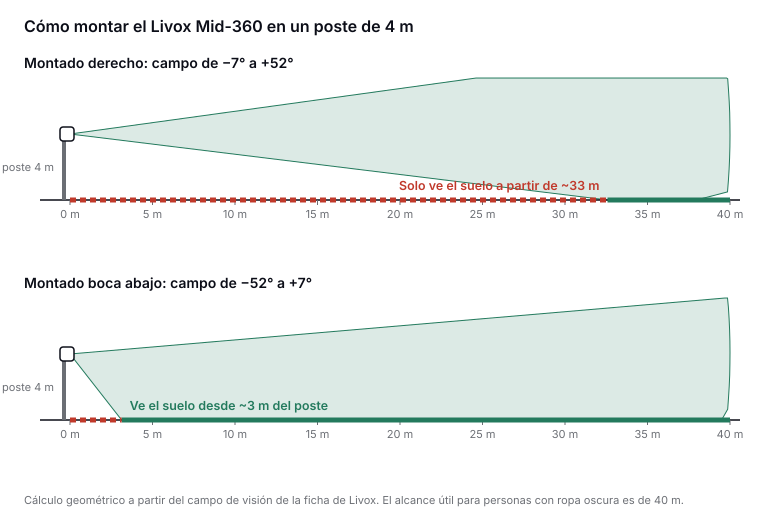

Esta guía es para quien organiza un evento o gestiona un espacio público, no para ingenieros. Respondemos con datos de fabricantes, normas y estudios publicados, y decimos qué no hemos podido comprobar.

## 1. ¿Qué es un LiDAR y qué «ve»?

Un LiDAR emite pulsos de luz infrarroja, invisible para el ojo, y mide cuánto tardan en volver tras rebotar en lo que tiene delante. Repitiendo la medida cientos de miles de veces por segundo construye una **nube de puntos**: un conjunto de coordenadas en 3D, cada una con la intensidad del reflejo. No hay colores ni caras, solo formas y distancias.

Un sensor compacto como el Livox Mid-360 ve 360° a su alrededor en horizontal y de −7° a +52° en vertical ([Livox](https://www.livoxtech.com/mid-360/specs)).

## 2. ¿En qué se diferencia de una cámara o de contar móviles?

**Frente a una cámara**, el LiDAR no capta imágenes de las personas y no depende de la luz, porque lleva la suya propia. Un estudio de reconocimiento por la forma de caminar lo ilustra: de noche, el mejor método con cámara acertó el 25,92 % de las veces y el método con LiDAR, el 90,41 % ([Shen et al., CVPR 2023](https://arxiv.org/pdf/2211.10598)).

**Frente al conteo de móviles o wifi**, el LiDAR cuenta cuerpos, no dispositivos: una persona puede llevar dos teléfonos o ninguno. A cambio, el conteo por móvil sirve para ver de dónde viene y adónde va la gente a escala de ciudad, algo que un LiDAR fijo no hace. Son tecnologías complementarias ([arXiv 2401.09014](https://arxiv.org/pdf/2401.09014)).

## 3. ¿Funciona de noche, con sol de frente o con lluvia?

- **De noche:** sí, igual que de día, porque emite su propia luz.
- **Con sol directo:** los fabricantes miden el alcance con 100 klx de luz ambiente, lo que equivale a pleno sol. En esas condiciones, el Mid-360 llega a 40 m con objetos que reflejan el 10 % de la luz y a 70 m con los que reflejan el 80 % ([Livox](https://www.livoxtech.com/mid-360/specs)).
- **Con lluvia o niebla:** no hemos encontrado mediciones independientes para sensores de este tipo. Por eso cada instalación se debe validar en condiciones reales.

## 4. ¿Ve a una persona vestida de negro?

La ropa oscura refleja menos luz, y por eso las fichas técnicas dan el alcance para objetos que reflejan solo el 10 %: 40 m tanto en el Livox Mid-360 como en el Hesai JT128 ([Livox](https://www.livoxtech.com/mid-360/specs), [Hesai](https://www.hesaitech.com/wp-content/uploads/2025/09/JT128_User_Manual_J01-en-250920.pdf)). En un evento, con el sensor a pocos metros de altura y la gente a menos de 20–25 m, hay margen de sobra.

## 5. ¿Puede reconocer quién es alguien?

No ve caras, pero **no es anónimo por naturaleza**. La investigación ha demostrado que se puede reconocer a una persona por su forma de caminar o su silueta 3D:

- **LidarGait** (CVPR 2023): 1.050 personas, 86,77 % de acierto en el primer intento ([Shen et al.](https://arxiv.org/pdf/2211.10598)).
- **ReID3D** (CVPR 2024): 320 personas grabadas con cuatro LiDAR Livox, 94,0 % ([Guo et al.](https://arxiv.org/abs/2312.03033)).
- **MultiGait** (KIT, 2026): 199 personas. Dentro de una misma sesión el acierto roza el 100 %, pero entre sesiones distintas cae al 74,3–78,4 %, y los autores concluyen que la identificación fiable entre sesiones aún no es posible ([Todt et al.](https://arxiv.org/pdf/2609.01036)).

Por eso, en NODES la nube de puntos se procesa en el propio nodo y solo salen cifras agregadas (ver la pregunta 10).

## 6. ¿Es seguro para los ojos?

**Sí.** Todos los sensores que hemos revisado son **láser de Clase 1** según la norma IEC/EN 60825-1:2014, la que rige la seguridad de los productos láser (en España, UNE-EN 60825-1). Clase 1 significa que el aparato no puede superar los límites de exposición del ojo en ninguna condición de uso prevista ([Kent State University](https://www.kent.edu/compliance/laser-safety-practice-manual-pdf)). En la práctica: **se puede mirar de frente, de cerca y el tiempo que se quiera.** Un niño a hombros junto al poste no corre ningún riesgo.

| Sensor | Clase | Longitud de onda | Fuente |
| --- | --- | --- | --- |
| Livox Mid-360 | Clase 1 | 905 nm | [Manual de Livox](https://terra-1-g.djicdn.com/65c028cd298f4669a7f0e40e50ba1131/Mid360/Livox_Mid-360_User_Manual_EN.pdf) |
| Blickfeld Qb2 | Clase 1 | 905 nm | [Manual de Blickfeld](https://www.blickfeld.com/wp-content/uploads/2023/08/Qb2-Quick-start-manual-and-safety-information.pdf) |
| Ouster OS1 | Clase 1 | 865 nm | [Ficha de Ouster](https://data.ouster.io/downloads/datasheets/datasheet-rev7-v3p1-os1.pdf) |
| Hesai JT128 | Clase 1 | 905 nm | [Manual de Hesai](https://www.hesaitech.com/wp-content/uploads/2025/09/JT128_User_Manual_J01-en-250920.pdf) |
| Hesai OT128 | Clase 1 | 905 nm | [Manual de Hesai](https://www.hesaitech.com/wp-content/uploads/2025/03/OT128_User_Manual_O01-en-250310.pdf) |
| Velodyne VLP-16 | Clase 1 | 903 nm | [Ficha de Velodyne](https://www.hypertech.co.il/wp-content/uploads/2015/12/63-9229_Rev-F_Puck__Spec_Sheet_Web.pdf) |

La clase la declara cada fabricante en su documentación, como exige la normativa para vender en la UE.

**¿Y la Clase 1M?** Es segura a simple vista, pero puede ser peligrosa si se mira con prismáticos, telescopios o lupas ([Universidad de Virginia](https://ehs.virginia.edu/Laser-Safety/Classification)). Ninguno de los sensores de la tabla es 1M.

**Tres precauciones razonables:**

1. **No mirar el sensor con lupas ni prismáticos.** Hesai lo recomienda en su manual aunque el equipo sea de Clase 1 ([Hesai](https://www.hesaitech.com/wp-content/uploads/2025/03/OT128_User_Manual_O01-en-250310.pdf)).
2. **Retirar cualquier nodo con la carcasa dañada.** Dentro hay láseres más potentes que solo son seguros con la carcasa cerrada: Livox indica que el láser interno del Mid-360 puede superar los 70 W de pico, y Blickfeld, que el Qb2 lleva dentro un láser de Clase 3B. Ninguno debe abrirse.
3. **No hacer fotos con zoom pegado al sensor.** Las cámaras son más sensibles que el ojo. El caso conocido es el de un LiDAR de automoción de AEye, de 1550 nm, que dañó el sensor de una cámara en el CES de 2019 ([PetaPixel](https://petapixel.com/2019/01/12/mans-1998-mirrorless-camera-fried-by-self-driving-car-laser/), [Fstoppers](https://fstoppers.com/news/laser-self-driving-car-destroys-photographers-sony-a7r-ii-sensor-328460)). No hemos encontrado casos con sensores compactos de 905 nm como los de la tabla.

**¿Por qué importa la longitud de onda?** A 905 nm la luz llega a la retina, igual que la visible, así que la norma limita mucho la potencia de estos sensores. A 1550 nm el ojo la absorbe antes de llegar a la retina, lo que permite usar más potencia. En ambos casos, lo que garantiza la seguridad es la Clase 1.

**¿Hace falta algún permiso por ser un láser?** Para los trabajadores que lo instalan se aplica el Real Decreto 486/2010 sobre radiaciones ópticas artificiales, que pide evaluar el riesgo según la clase del láser ([BOE](https://www.boe.es/buscar/act.php?id=BOE-A-2010-6485)); en Clase 1 basta con documentarla. En la normativa española que hemos revisado no hemos encontrado ningún permiso específico para usar un láser de Clase 1 en la vía pública. El permiso que sí hace falta es el de ocupación del espacio (pregunta 9).

## 7. ¿Cuánta zona cubre un nodo y cuántos hacen falta?

Depende de la altura y la inclinación. Blickfeld da estas cifras para su Qb2: montado a 3 m e inclinado 30°, cubre unos **15 × 12 m**; a 5 m y 30°, unos **28 × 22 m** ([Blickfeld](https://www.blickfeld.com/wp-content/uploads/2023/11/Blickfeld_Qb2_product_information_sheet.pdf)).

En multitudes densas, lo que limita no es el alcance sino que las personas se tapan entre sí. En el vestíbulo de la estación de Nagoya usaron 20 LiDAR para unos 900 m², y sus autores comprobaron que con un solo sensor el seguimiento se interrumpe a menudo, mientras que con dos o más mejora claramente ([Hishida et al., 2026](https://link.springer.com/article/10.1007/s13177-025-00610-9)). La regla práctica: **cada zona crítica, vista desde al menos dos ángulos.**

## 8. ¿Qué precisión tiene en una multitud densa?

Depende mucho del escenario y de lo que se mida:

- En **Nagoya**, con 20 sensores, el seguimiento superó el 90 % en la métrica HOTA. Los autores advierten que su variante de la métrica no es comparable con otros estudios y que el resultado procede de un procesado a posteriori, no en tiempo real ([Hishida et al.](https://link.springer.com/article/10.1007/s13177-025-00610-9)).
- Con **peatones muy apretados**, un estudio de 2025 con LiDAR y cámaras en un vehículo obtuvo solo 0,17–0,35 en la métrica MOTA ([Li et al.](https://arxiv.org/abs/2505.16029)).

La lectura práctica: **contar personas por zona es mucho más robusto que seguir a cada individuo.** Por eso NODES mide densidad y flujo por zona, y debe validar su margen de error en cada tipo de evento.

## 9. ¿Qué hace falta para montarlo en un evento?

### Un poste

Lo habitual es montar el sensor **entre 3 y 8 m de altura** ([Senstar](https://senstar.com/wp-content/uploads/LiDAR-Datasheet-EN-1.pdf)), en una farola o un mástil temporal, inclinado hacia la zona que se quiere medir. Cuanto más alto e inclinado, más superficie cubre y menos se tapan las personas.

La orientación importa tanto como la altura. El Livox Mid-360 está pensado para robots y mira sobre todo hacia arriba (de −7° a +52°): montado derecho a 4 m, solo vería el suelo a partir de unos 33 m, según nuestro cálculo. Montado boca abajo, ese campo pasa a −52°/+7° y cubre la zona cercana al poste.

*Cálculo geométrico propio a partir del campo de visión de la ficha de Livox. Diagrama propio.*

### Corriente

| Equipo | Consumo | Fuente |
| --- | --- | --- |
| Sensor Livox Mid-360 | 6,5 W (18 W unos segundos al arrancar) | [Manual de Livox](https://terra-1-g.djicdn.com/65c028cd298f4669a7f0e40e50ba1131/Mid360/Livox_Mid-360_User_Manual_EN.pdf) |
| Sensor Blickfeld Qb2 | 10 W típicos, 13 W máximo, por Power over Ethernet | [Blickfeld](https://www.blickfeld.com/wp-content/uploads/2023/11/Blickfeld_Qb2_product_information_sheet.pdf) |
| Ordenador NVIDIA Jetson Orin Nano | De 7 a 25 W según el modo | [NVIDIA](https://docs.nvidia.com/jetson/archives/r36.4.4/DeveloperGuide/SD/PlatformPowerAndPerformance/JetsonOrinNanoSeriesJetsonOrinNxSeriesAndJetsonAgxOrinSeries.html) |

Un Mid-360 con un Jetson Orin Nano a máxima potencia suma unos 31,5 W. Durante un evento de 12 horas son unos **380 Wh**, más lo que consuma el router de datos. Una batería portátil cubre una jornada; la toma de corriente del evento, con un pequeño SAI, también sirve.

### Red

- **Del sensor al ordenador, un cable Ethernet corto.** Los datos en bruto pesan mucho: un Ouster OS1 de 128 canales genera hasta 43 Mbit/s incluso en su modo de menor tasa ([Ouster](https://data.ouster.io/downloads/datasheets/datasheet-rev7-v3p1-os1.pdf)), y un Hesai JT128, 82,3 Mbit/s ([Hesai](https://www.hesaitech.com/wp-content/uploads/2025/09/JT128_User_Manual_J01-en-250920.pdf)).
- **Del nodo hacia fuera, solo cifras agregadas** por 4G o 5G. Es importante porque la red móvil se degrada justo cuando hay más gente: en eventos multitudinarios en EE. UU., los fallos en las celdas cercanas aumentaron entre 100 y 1.000 veces ([Shafiq et al., SIGMETRICS 2013](https://web.cs.ucdavis.edu/~zubair/files/crowded_sigmetrics.pdf)), y en un festival alemán con más de 110.000 visitantes al día se midió una degradación significativa del rendimiento ([Frömmgen et al., PAM 2016](https://www.researchgate.net/publication/312737334_Crowdsourcing_Measurements_of_Mobile_Network_Performance_and_Mobility_During_a_Large_Scale_Event)). El nodo guarda los datos en local y los reenvía cuando hay red.

### Intemperie y sincronización

Los sensores revisados están preparados para exterior: el Mid-360, el Qb2 y el VLP-16 tienen protección IP67, y el Hesai JT128, IP6K7. El punto débil suele ser la caja del ordenador y la batería, que necesita sombra y ventilación. Para combinar varios nodos, sus relojes se sincronizan con el protocolo PTP (IEEE 1588), que admiten el Mid-360 y el JT128.

### Permisos en València

Instalar equipos en la vía pública requiere autorización según la [Ordenanza de Ocupación del Dominio Público Municipal](https://sede.valencia.es/sede/descarga/doc/DOCUMENT_1_ORD0170_C). En los trámites de la sede electrónica:

- Para actividades informativas o solidarias, la solicitud se presenta con al menos **30 días** de antelación, con memoria, horarios de montaje y plano acotado ([VP.OC.75](https://sede.valencia.es/sede/registro/procedimiento/VP.OC.75?lang=1)).
- Para actividades festivas y culturales, el plazo máximo de resolución es de **3 meses** y el silencio es desestimatorio ([VP.OC.85](https://sede.valencia.es/sede/registro/procedimiento/VP.OC.85?lang=1)).
- Para eventos deportivos como el Medio Maratón, el expediente lo lleva el Servicio de Deportes ([FDM València](https://www.fdmvalencia.es/es/solicitud-de-eventos/)).

No hemos encontrado un procedimiento publicado para fijar equipos de terceros en las farolas municipales. Lo más sencillo es que el organizador incluya los nodos en su propia solicitud.

### Protección de datos

Aunque no se capten imágenes, medir personas en la calle es un tratamiento que hay que analizar. El RGPD exige una evaluación de impacto para la «observación sistemática a gran escala de una zona de acceso público» (art. 35.3.c), y la AEPD incluye en su lista la observación sistemática en zonas de acceso público ([AEPD](https://www.aepd.es/documento/listas-dpia-es-35-4.pdf)). Lo recomendable: hacer esa evaluación, informar con carteles en la zona medida, procesar en el nodo y guardar solo cifras agregadas.

## 10. ¿Qué datos se guardan y quién los ve?

En NODES, la nube de puntos se procesa en el ordenador del propio nodo y **no sale de él**. Solo se envían cifras agregadas: personas por zona, densidad en personas por m² y flujo por tramo y minuto. Las ve el centro de control del organizador o del ayuntamiento, en el panel.

La forma honesta de decirlo no es «el LiDAR nunca capta datos personales», sino: **no captamos imágenes ni caras, procesamos en el propio nodo y solo guardamos cifras agregadas.**

## Fuentes

**Sensores y normas**

- Livox: [especificaciones del Mid-360](https://www.livoxtech.com/mid-360/specs) y [manual de usuario](https://terra-1-g.djicdn.com/65c028cd298f4669a7f0e40e50ba1131/Mid360/Livox_Mid-360_User_Manual_EN.pdf)
- Blickfeld: [manual del Qb2](https://www.blickfeld.com/wp-content/uploads/2023/08/Qb2-Quick-start-manual-and-safety-information.pdf) y [ficha de producto](https://www.blickfeld.com/wp-content/uploads/2023/11/Blickfeld_Qb2_product_information_sheet.pdf)
- Ouster: [ficha del OS1](https://data.ouster.io/downloads/datasheets/datasheet-rev7-v3p1-os1.pdf)
- Hesai: [manual del JT128](https://www.hesaitech.com/wp-content/uploads/2025/09/JT128_User_Manual_J01-en-250920.pdf) y [manual del OT128](https://www.hesaitech.com/wp-content/uploads/2025/03/OT128_User_Manual_O01-en-250310.pdf)
- Velodyne: [ficha del VLP-16](https://www.hypertech.co.il/wp-content/uploads/2015/12/63-9229_Rev-F_Puck__Spec_Sheet_Web.pdf)
- Senstar: [ficha de LiDAR](https://senstar.com/wp-content/uploads/LiDAR-Datasheet-EN-1.pdf)
- NVIDIA: [consumo de Jetson Orin](https://docs.nvidia.com/jetson/archives/r36.4.4/DeveloperGuide/SD/PlatformPowerAndPerformance/JetsonOrinNanoSeriesJetsonOrinNxSeriesAndJetsonAgxOrinSeries.html)
- Kent State University: [manual de seguridad láser](https://www.kent.edu/compliance/laser-safety-practice-manual-pdf)
- Universidad de Virginia: [clases de láser](https://ehs.virginia.edu/Laser-Safety/Classification)

**Estudios**

- Shen et al. (2023). [LidarGait](https://arxiv.org/pdf/2211.10598). CVPR.
- Guo et al. (2024). [ReID3D](https://arxiv.org/abs/2312.03033). CVPR.
- Todt et al. (2026). [MultiGait](https://arxiv.org/pdf/2609.01036). KIT.
- Hishida et al. (2026). [Medición y seguimiento de multitudes en la estación de Nagoya](https://link.springer.com/article/10.1007/s13177-025-00610-9). *Int. J. ITS Research*.
- Li et al. (2025). [Peatones muy agrupados con LiDAR y cámaras](https://arxiv.org/abs/2505.16029).
- [Conteo de flujos de personas con distintos sensores](https://arxiv.org/pdf/2401.09014) (arXiv 2401.09014).
- Shafiq et al. (2013). [A First Look at Cellular Network Performance during Crowded Events](https://web.cs.ucdavis.edu/~zubair/files/crowded_sigmetrics.pdf). ACM SIGMETRICS.
- Frömmgen et al. (2016). [Mediciones de la red móvil en un festival](https://www.researchgate.net/publication/312737334_Crowdsourcing_Measurements_of_Mobile_Network_Performance_and_Mobility_During_a_Large_Scale_Event). PAM.
- [PetaPixel](https://petapixel.com/2019/01/12/mans-1998-mirrorless-camera-fried-by-self-driving-car-laser/) y [Fstoppers](https://fstoppers.com/news/laser-self-driving-car-destroys-photographers-sony-a7r-ii-sensor-328460): cámara dañada por un LiDAR en el CES de 2019.

**Normativa**

- [Real Decreto 486/2010](https://www.boe.es/buscar/act.php?id=BOE-A-2010-6485), radiaciones ópticas artificiales (BOE)
- AEPD: [lista de tratamientos que requieren evaluación de impacto](https://www.aepd.es/documento/listas-dpia-es-35-4.pdf)
- Ayuntamiento de València: [Ordenanza de Ocupación del Dominio Público Municipal](https://sede.valencia.es/sede/descarga/doc/DOCUMENT_1_ORD0170_C), trámites [VP.OC.75](https://sede.valencia.es/sede/registro/procedimiento/VP.OC.75?lang=1) y [VP.OC.85](https://sede.valencia.es/sede/registro/procedimiento/VP.OC.85?lang=1)
- Fundación Deportiva Municipal: [solicitud de eventos](https://www.fdmvalencia.es/es/solicitud-de-eventos/)

*Revisión hecha el 30 de octubre de 2026. Las cifras de consumo y de geometría de montaje marcadas como cálculo propio se han obtenido a partir de las fichas citadas.*
