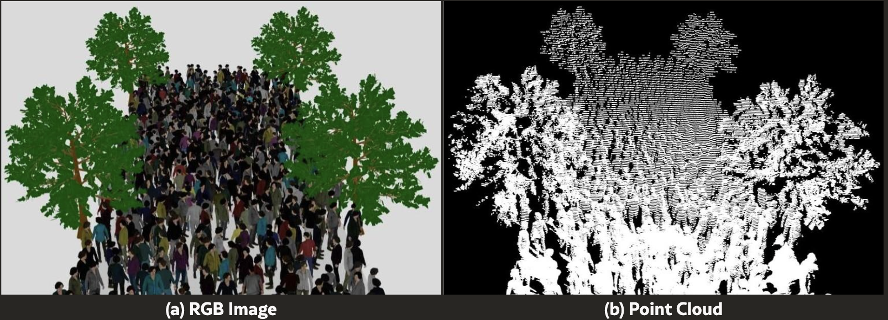
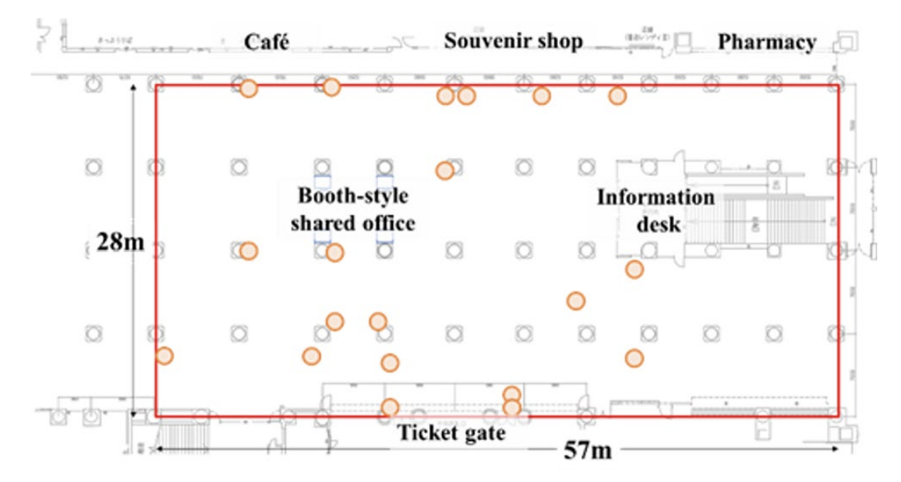
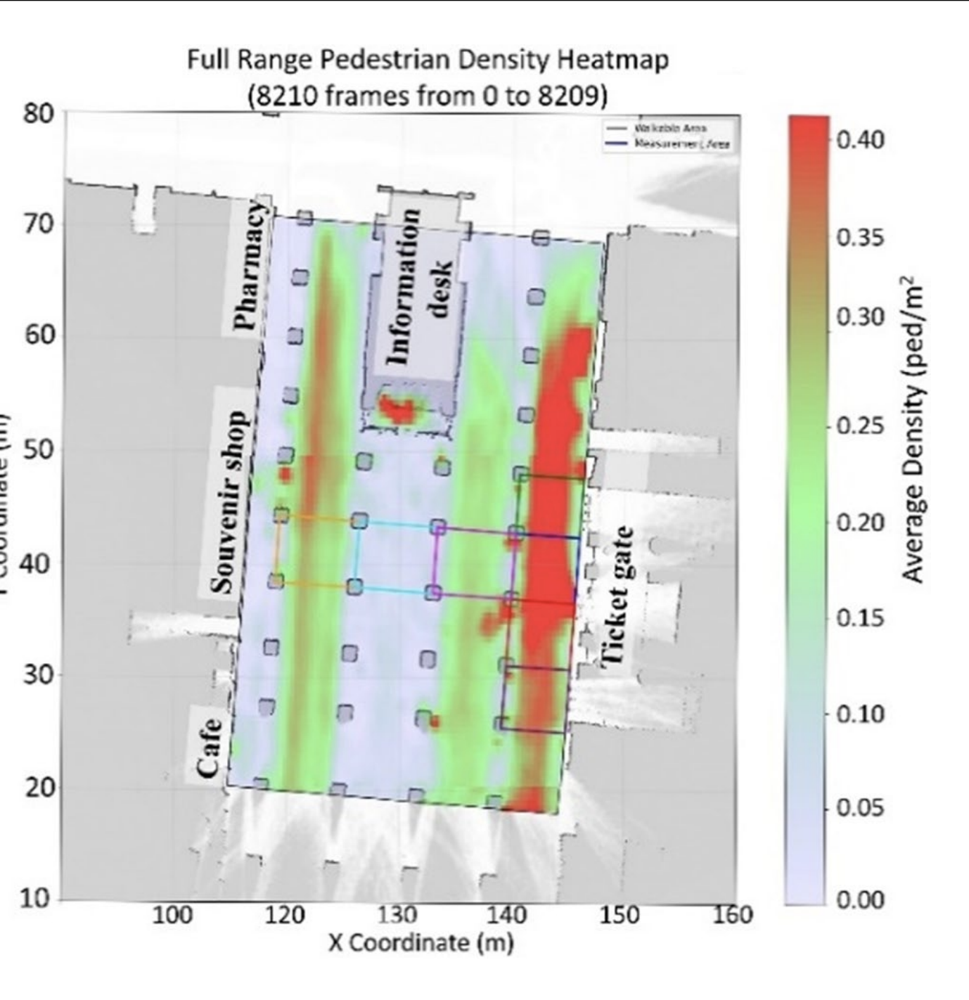
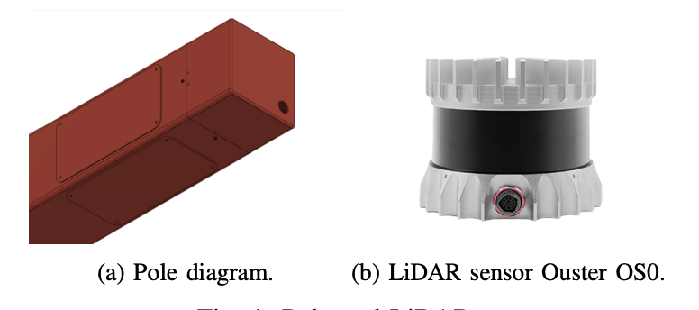
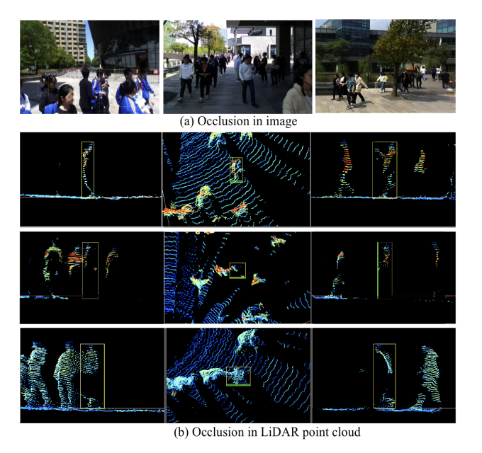
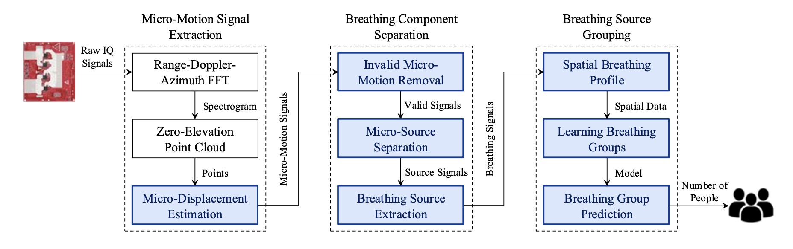

Ciudades y organizadores de eventos quieren saber cada vez más cuánta gente hay en un lugar, dónde está y cómo se mueve, sin grabar caras. Cinco familias de sensores prometen hacerlo: el LiDAR 3D, el infrarrojo térmico, el radar de ondas milimétricas, la escucha de wifi y Bluetooth, y las cámaras que cuentan en el propio dispositivo sin guardar imágenes. Cada una tiene sus puntos fuertes y cada una se ha probado en algún sitio. La sorpresa llega al preguntar *a qué densidad*. En la literatura que hemos revisado, **ningún sensor tiene una cifra de precisión publicada y contrastada con una referencia real a 4–5 personas por m² en exterior**, justo donde una multitud deja de ser solo densa y empieza a ser peligrosa.

*La misma multitud simulada como imagen de cámara (izquierda) y como nube de puntos LiDAR (derecha): formas sin caras. Fuente: Khanfor et al., LiDAR for Crowd Management, IEEE Internet of Things Magazine, 2026, figura 2 ([arXiv 2603.27663](https://arxiv.org/abs/2603.27663)).*

## ¿A qué densidad llegan las multitudes reales?

| Referencia | Densidad | Fuente |
| --- | --- | --- |
| Nivel de servicio de Fruin: umbral de multitud «densa» que usan los autores del dataset de Lyon | más de 1,5–2 p/m² | [Scientific Data, 2025](https://www.nature.com/articles/s41597-025-04732-3) |
| Fête des Lumières, Lyon 2022: unas 7.000 trayectorias grabadas con cámaras | hasta 4 p/m² | [Scientific Data, 2025](https://www.nature.com/articles/s41597-025-04732-3) |
| Love Parade 2010, análisis pericial: la congestión crece rápido | 4–5 p/m² | [Helbing y Mukerji, 2012](https://arxiv.org/abs/1206.5856) |
| Itaewon 2022, lecciones de la respuesta sanitaria coreana: fases de «compactación» y «flotación» de la multitud | 6 y 8 p/m² | [Presentación de WADEM](https://wadem.org/wp-content/uploads/2023/11/Itaewon-Crowd-Crush.pdf) |

La franja en la que más importan las decisiones, de unas 4 a 6 personas por m², cuando una multitud pasa de densa a estar en riesgo, queda por completo por encima de lo que se ha validado con cualquier sensor. Incluso la densidad máxima de Itaewon se cita de forma distinta según la fuente, lo que ya muestra lo poco fiable que es la medición a densidades extremas.

## LiDAR 3D

**Cómo funciona.** Un LiDAR emite pulsos láser y mide cuánto tardan en volver, construyendo una nube de puntos 3D de la escena. Las personas aparecen como grupos de puntos que el software separa, cuenta y sigue. De ahí salen conteos, posiciones, trayectorias, velocidades y densidad. Una revisión en *IEEE Internet of Things Magazine* habla de alcances que a menudo superan los 200 m en sensores de gama alta, pero también de que el LiDAR empeora con lluvia intensa o niebla densa y de que el seguimiento puede degradarse en multitudes densas en las que unas personas tapan a otras ([Khanfor et al., 2026](https://arxiv.org/abs/2603.27663)).

**Lo que se ha medido.**

- **Estación de Nagoya, Japón.** Veinte LiDAR 3D en un vestíbulo interior de unos 57 × 28 m, a 10 imágenes por segundo. Los autores obtienen una precisión de seguimiento (HOTA) superior al 90 % en unos 900 m², pero no dan ninguna cifra de densidad en el texto ([Hishida et al., Int. J. ITS Research, 2026](https://link.springer.com/article/10.1007/s13177-025-00610-9)). Su propio mapa de calor muestra densidades medias por debajo de 0,4 personas por m² en el periodo analizado.
- **Universidad Estatal de Arizona.** Un Ouster OS0-32 en una farola del campus vigilaba un paseo de 5 m. Con datos reales, el error de conteo (MAE) fue de 0,38 personas. El 97,64 % de acierto «en alta densidad» sale de una escena *sintética* de 250 personas, definida como más de 2 personas por m² ([Chen et al.](https://arxiv.org/abs/2311.18077); [artículo ICDCS](https://visa.lab.asu.edu/web/wp-content/uploads/2026/01/ICDCSa.pdf)).
- **Universidad de Osaka.** Setenta LiDAR en un edificio del campus siguieron a peatones entre sensores que no se solapan, con una medida F de 0,98 en el vestíbulo de entrada, a densidad baja o moderada ([arXiv 2303.09915](https://arxiv.org/abs/2303.09915)).

*Vestíbulo de la estación de Nagoya (57 × 28 m) con las posiciones de los LiDAR marcadas en naranja. Fuente: Hishida et al., Int. J. ITS Research, 2026 ([Springer](https://link.springer.com/article/10.1007/s13177-025-00610-9)).*

*Densidad media de peatones en 8.210 imágenes del mismo vestíbulo. La escala llega solo a 0,4 personas por m²: un sistema excelente, medido muy por debajo de los umbrales de seguridad. Fuente: Hishida et al., 2026 ([Springer](https://link.springer.com/article/10.1007/s13177-025-00610-9)).*

*La caja de la farola y el LiDAR Ouster OS0 usados en el estudio de la Universidad Estatal de Arizona. Fuente: Chen et al. ([arXiv 2311.18077](https://arxiv.org/abs/2311.18077)), figura 1.*

**Multitudes densas.** En una multitud, unas personas tapan a otras. El dataset STCrowd, grabado con un LiDAR de 128 haces, muestra cómo los peatones ocultos aparecen como fragmentos o cajas casi vacías, y tiene de media solo unas 20 personas por imagen ([Cong et al., CVPR 2022](https://arxiv.org/abs/2204.01026)). Ningún dataset abierto de LiDAR pasa de 1 persona por m²: CrowdBot v2, grabado en mercados de Lausana, va de 0,1 a 1,0 ([Zenodo](https://zenodo.org/records/17730560)).

*La oclusión afecta igual a la cámara (arriba) y al LiDAR (abajo): la persona del recuadro aparece cortada o casi vacía. Fuente: Cong et al., STCrowd, CVPR 2022 ([arXiv 2204.01026](https://arxiv.org/abs/2204.01026)).*

**Privacidad.** Las nubes de puntos no tienen caras, pero no son automáticamente anónimas. LidarGait identificó a 1.050 personas por su forma de andar con un 86,77 % de acierto al primer intento, mejor que el mejor método con cámara ([Shen et al., CVPR 2023](https://openaccess.thecvf.com/content/CVPR2023/papers/Shen_LidarGait_Benchmarking_3D_Gait_Recognition_With_Point_Clouds_CVPR_2023_paper.pdf)); ReID3D llegó al 94,0 % con 320 personas en exterior ([Guo et al., CVPR 2024](https://openaccess.thecvf.com/content/CVPR2024/html/Guo_LiDAR-based_Person_Re-identification_CVPR_2024_paper.html)). Las nubes de puntos en bruto y las trayectorias largas de personas deben tratarse como posibles datos personales; los conteos agregados, no.

## Infrarrojo térmico

**Cómo funciona.** Los sensores térmicos detectan el calor del cuerpo de forma pasiva. Las matrices de baja resolución, como el Panasonic Grid-EYE (8 × 8 píxeles) o el Melexis MLX90640 (32 × 24), son baratas y en la práctica no permiten identificar a nadie; las cámaras de microbolómetro de más resolución (por ejemplo, 640 × 480) ven siluetas e incluso la estructura de la cara.

**Lo que se ha medido.** Casi toda la validación es en interior y con pocas personas: un «cable trampa térmico» con un MLX90640 cenital que cuenta personas en puertas ([Cokbas et al., CVPRW 2020](https://openaccess.thecvf.com/content_CVPRW_2020/papers/w6/Cokbas_Low-Resolution_Overhead_Thermal_Tripwire_for_Occupancy_Estimation_CVPRW_2020_paper.pdf)), o una tesis con un 47,4 % de precisión de seguimiento múltiple con el mismo sensor ([KTH](https://www.diva-portal.org/smash/get/diva2:1620371/FULLTEXT01.pdf)). El conjunto RGBT-CC reúne 2.030 pares de imágenes en color y térmicas de centros comerciales, calles y estaciones, con unas 68 personas por imagen; sus errores se miden por imagen, no por m² ([Liu et al., CVPR 2021](https://arxiv.org/abs/2012.04529)).

**Límites.** En exterior, las superficies y la ropa calentadas por el sol reducen el contraste, y en una multitud densa los cuerpos calientes se funden en una sola mancha. Las matrices de baja resolución están entre las opciones más respetuosas con la privacidad; las cámaras térmicas de alta resolución deben tratarse como cámaras normales en una evaluación de privacidad.

## Radar de ondas milimétricas

**Cómo funciona.** Los chips de radar de 60 o 77 GHz emiten pulsos modulados en frecuencia y miden distancia, velocidad y ángulo. El resultado es una nube de puntos dispersa que se puede agrupar y seguir. Funciona a oscuras, con humo y con lluvia ligera, e incluso detecta la respiración.

**Lo que se ha medido.** Ingenieros de Texas Instruments explican en el foro de la empresa que, por la baja resolución angular de los radares de un solo chip, es difícil distinguir a personas que están a 1 m o menos unas de otras ([TI E2E](https://e2e.ti.com/support/sensors-group/sensors/f/sensors-forum/829940/iwr6843-people-count-accuracy-improvement-in-iwr6843-radar-sensor)). El mejor resultado en condiciones densas es mmCounter: hasta 3 personas por m², pero quietas y en interior, con un error de conteo de 0,6 personas en salas conocidas y de 1,1 en salas nuevas ([arXiv 2512.10357](https://arxiv.org/abs/2512.10357)). Cuenta a las personas separando su respiración.

*Cómo cuenta mmCounter a personas quietas con radar: extrae movimientos mínimos del pecho, separa la respiración de cada persona y la agrupa en un conteo. Fuente: mmCounter, EWSN 2025, figura 2 ([arXiv 2512.10357](https://arxiv.org/abs/2512.10357)).*

**Privacidad.** El radar tampoco está libre de identidad: la forma de andar permite identificar a personas por su firma micro-Doppler, y MU-ID logra más de un 92 % de acierto con hasta cuatro personas ([MU-ID](https://www.winlab.rutgers.edu/~yychen/papers/MU-ID%20Multi-user%20Identification%20Through%20Gaits%20Using%20Millimeter%20Wave%20Radios.pdf)). La respiración y el ritmo cardíaco, si se procesan, podrían ser datos de salud.

## Wifi y Bluetooth

**Escucha de sondas.** Los sensores escuchan los mensajes que envían los móviles al buscar redes. Desde que los móviles cambian su dirección MAC al azar, contar direcciones distintas ya no funciona; métodos más nuevos como RateCount estiman los dispositivos por la frecuencia con que sondean ([arXiv 2507.03873](https://arxiv.org/abs/2507.03873)). El sesgo de fondo sigue ahí: estos sensores cuentan dispositivos, no personas. En el Hajj, 8 sensores que cubrían a 185.000 peregrinos detectaron 69.467 dispositivos, alrededor del 37,5 % de la multitud (Basalamah, *IJACSA* 7(12), 2016). Es la opción más barata y funciona con cualquier tiempo.

**Detección por el canal.** Los cuerpos alteran la señal wifi, lo que permite detectar presencia, actividad y grupos pequeños sin ningún móvil. La norma IEEE 802.11bf de detección por wifi se publicó en septiembre de 2025, pero contar multitudes así solo se ha validado en interior y con grupos pequeños.

**Una zona gris legal.** La autoridad neerlandesa de protección de datos multó a la ciudad de Enschede con 600.000 € en 2021 por seguir señales wifi en el centro, argumentando que registrar qué móvil pasa por qué sensor convierte el conteo en seguimiento de personas ([Autoriteit Persoonsgegevens](https://www.autoriteitpersoonsgegevens.nl/en/current/dutch-dpa-fines-municipality-for-wi-fi-tracking)). La multa se anuló, de forma definitiva por el Consejo de Estado el 29 de julio de 2026, porque la autoridad no había probado que se trataran datos personales, no porque se declarara legal el seguimiento por wifi ([Raad van State](https://www.raadvanstate.nl/@159747/202401622-1-a3/)).

## Cámaras que cuentan sin guardar imágenes

**Cómo funciona.** La visión artificial estima un mapa de densidad o detecta cabezas en cada imagen, idealmente en el propio dispositivo, para que solo salgan números. Los contadores cenitales estéreo o de tiempo de vuelo miran en vertical, donde las personas se tapan menos.

**Lo que se ha medido.** Las cámaras son los únicos sensores probados con multitudes de verdad extremas: conjuntos como ShanghaiTech y UCF-QNRF tienen de cientos a miles de cabezas por imagen, y los mejores modelos fallan por unas 50–100 personas por imagen en los más difíciles (por ejemplo, P2PNet, MAE de 52,74 en ShanghaiTech Parte A). Pero son fotos de internet sin un área calibrada, así que no hay error por m². La densidad real más alta con referencia comprobada que hemos encontrado, para cualquier sensor, es la de un sistema comercial estéreo cenital en un andén cubierto de la estación de Breukelen, en los Países Bajos: 0,85 personas por m² de media y 1,13 de máximo ([Pouw et al., arXiv 2108.11719](https://arxiv.org/abs/2108.11719)).

**Privacidad.** Las caras tratadas para identificar a alguien son datos biométricos según el RGPD, y las cámaras cargan con el mayor peso legal (ver más abajo), aunque solo cuenten.

## Comparativa

| Sensor | Qué mide | Mejor precisión publicada (y dónde) | Con multitud densa | Tiempo y luz | Privacidad |
| --- | --- | --- | --- | --- | --- |
| LiDAR 3D | Conteos, posiciones, trayectorias, velocidad, densidad | Seguimiento por encima del 90 % HOTA en ~900 m², interior, densidad no indicada (Nagoya); error de conteo de 0,38 personas en un paseo exterior de campus (ASU) | Unas personas tapan a otras; hacen falta sensores solapados | No depende de la luz; la lluvia intensa y la niebla lo empeoran | Sin caras, pero la forma de andar identifica (86,77–94 % en investigación) |
| Térmico, baja resolución | Presencia, conteos al cruzar una línea | Ocupación de salas en puertas, interior | Los cuerpos se funden | El sol y las superficies calientes reducen el contraste | En la práctica no identifica |
| Cámara térmica | Conteos, mapas de densidad | Errores por imagen con ~68 personas por imagen (RGBT-CC), sin densidad por m² | Los cuerpos se funden | Funciona de noche | La alta resolución muestra siluetas; tratarla como cámara |
| Radar mmWave | Conteos, posiciones, velocidad, respiración | MAE de 0,6 personas hasta 3 p/m², personas quietas, interior (mmCounter) | Le cuesta separar a personas a menos de ~1 m | Resiste oscuridad y humo | Identificación por forma de andar del 88–98 % en grupos pequeños |
| Sondas wifi / Bluetooth | Conteo de dispositivos, permanencia, flujos | Estimación de dispositivos con MAC aleatoria (RateCount), sin densidad por m² | Dispositivos no son personas | Cualquier tiempo | Los identificadores de dispositivo son datos personales; legalmente discutido |
| Cámara con IA en el dispositivo | Conteos, mapas de densidad, flujos | MAE de 52,74 por imagen en ShanghaiTech Parte A (P2PNet), sin densidad por m² | El único sensor probado con imágenes extremas | Necesita luz; lluvia y reflejos | Biométrico si se usa para identificar; mayor peso legal |
| Estéreo / ToF cenital | Conteos, trayectorias | 82 % de precisión de seguimiento en bruto (100 % tras quitar dos falsos positivos estáticos) a 0,85 p/m², andén cubierto (Breukelen) | Menos oclusión desde arriba | Interior o zonas cubiertas | Profundidad de baja resolución, pero la reidentificación sigue siendo posible |

## La densidad más alta que alguien ha validado

| Sensor | Densidad más alta con una cifra de precisión | Lugar | Real o simulado |
| --- | --- | --- | --- |
| LiDAR 3D | «Más de 2 p/m²» (97,64 %) | Modelo de escena exterior | **Simulado** (ASU) |
| LiDAR 3D, datos reales | Alrededor de 1 p/m², o no indicada (Nagoya) | Interior | Real |
| Estéreo cenital | 0,85 p/m² de media, 1,13 p/m² de máximo | Andén de estación cubierto | Real |
| Cámara de profundidad (tipo Kinect) | Alrededor de 1 p/m², detección por encima del 94 % ([arXiv 1210.2838](https://arxiv.org/abs/1210.2838)) | Interior | Controlado |
| Radar mmWave | 3 p/m², personas quietas | Salas interiores | Laboratorio |
| Térmico | No indicada en p/m² | Sobre todo interior | Real |
| Wifi / Bluetooth | No indicada en p/m² | Mixto | Real |
| Cámara | No indicada en p/m² (conteos por foto) | Imágenes de internet | Bancos de prueba |
| *Como referencia: seguimiento con cámaras para crear un dataset* | *Hasta 4 p/m²* | *Festival al aire libre, Lyon* | *Real, pero no es una validación de sensor* |

**El resultado:** no hemos encontrado ninguna cifra de precisión de ningún sensor medida a 4–5 personas por m² en exterior. Dos estudios de radio a escala de evento, en el Oktoberfest de Múnich y en Tomorrowland, dan aciertos sobre categorías amplias de densidad y no un error por m², y su referencia no se ha podido comprobar.

## «Respetuoso con la privacidad» es relativo

Un estudio de 2026 del Instituto Tecnológico de Karlsruhe probó ocho sensores con 199 personas y concluyó que los sensores que a menudo se suponen respetuosos con la privacidad siguen conllevando riesgos considerables de inferir la identidad ([MultiGait, arXiv 2609.01036](https://arxiv.org/abs/2609.01036)). De mayor a menor riesgo de reidentificación:

1. **Cámaras:** la cara y la apariencia permiten identificar directamente.
2. **Escucha de wifi y Bluetooth:** los identificadores o huellas del dispositivo pueden seguir a una persona durante días.
3. **LiDAR 3D:** forma de andar y del cuerpo, 86,77–94 % de identificación al primer intento en investigación; el riesgo crece con la duración de la trayectoria y la resolución.
4. **Radar mmWave:** forma de andar por micro-Doppler, 88–98 % en grupos pequeños en interior; respiración y ritmo cardíaco añaden riesgo de datos de salud.
5. **Térmico de alta resolución:** siluetas y patrones de calor de la cara.
6. **Térmico de baja resolución, agregados del canal wifi y salidas que solo dan conteos:** el menor, siempre que solo salgan agregados del dispositivo.

Una salvedad que va en los dos sentidos: todos estos resultados de identificación vienen de pruebas con participantes que colaboran y poca densidad. Nadie ha medido lo bien que se puede reidentificar a alguien dentro de una multitud densa y con oclusiones.

## Qué dice la ley (UE y España)

- **RGPD.** Los datos son personales si una persona es identificable «por cualquier medio que razonablemente pueda utilizarse» (art. 4.1); los datos biométricos usados para identificar son una categoría especial (arts. 4.14 y 9); los sistemas deben proteger la privacidad desde el diseño (art. 25); y la observación sistemática a gran escala de zonas públicas exige una evaluación de impacto (art. 35).
- **¿Anónimo o seudónimo?** Las direcciones MAC cifradas con hash y los identificadores de trayectoria persistentes están seudonimizados, no anonimizados, según el Dictamen 05/2014 del Grupo de Trabajo del Artículo 29 y un documento conjunto de la AEPD y el Supervisor Europeo de Protección de Datos. Los conteos agregados en el propio dispositivo son la salida más segura.
- **Cámaras.** Las Directrices 3/2019 del Comité Europeo de Protección de Datos sobre dispositivos de vídeo se aplican a cualquier sistema de cámaras, incluido el análisis.
- **Wifi y Bluetooth.** El artículo 5.3 de la Directiva sobre privacidad electrónica puede aplicarse cuando se accede a información de los dispositivos de las personas.
- **Reglamento de IA de la UE.** Las prohibiciones del artículo 5 del Reglamento (UE) 2024/1689, entre ellas la identificación biométrica remota en tiempo real en espacios públicos con fines policiales, con excepciones limitadas, se aplican desde el 2 de febrero de 2025. Las obligaciones para sistemas de alto riesgo, como la identificación biométrica remota, se aplazaron al 2 de diciembre de 2027 con el Ómnibus Digital, Reglamento (UE) 2026/1744 ([White & Case](https://www.whitecase.com/insight-alert/eu-ai-omnibus-enters-force-amending-ai-act)). Contar sin identificar a nadie queda en general fuera de la «identificación biométrica».

## Combinar sensores

La fusión ayuda, pero tampoco se ha validado en multitudes densas:

- **Radar y cámara:** añadir cámaras de baja resolución a un radar mmWave en interior subió el acierto de conteo del 83,5 % al 93,1 % ([IFAC 2023](https://www.sciencedirect.com/science/article/pii/S2405896323009448)).
- **Térmico y color:** a oscuras, el error (RMSE) de un modelo solo con color fue de 87,81 personas por imagen, frente a 33,74 solo con térmico y 29,11 con ambos ([Liu et al., CVPR 2021](https://arxiv.org/abs/2012.04529)).
- **LiDAR y cámara:** STCrowd ofrece bancos de prueba combinados, y la revisión sobre LiDAR señala que la apariencia en cámara complementa al LiDAR a larga distancia.

Ningún sistema de fusión se ha comprobado frente a una referencia real por encima de 1–2 personas por m².

## Problemas abiertos

1. **No hay validación a 4–5 p/m² en exterior** para ningún sensor en ninguna fuente que hayamos encontrado.
2. **No hay una forma común de medir.** Los estudios usan métricas distintas (puntuaciones de seguimiento, errores por imagen, F1, precisión de clasificación) y a menudo no indican la densidad.
3. **No hay datos abiertos de LiDAR por encima de 1 p/m².**
4. **Meteorología.** La lluvia, la niebla, el calor y la noche casi nunca se prueban en multitudes densas.
5. **Privacidad en multitudes.** La reidentificación en multitudes densas y con oclusiones está sin medir.
6. **Simulación frente a realidad.** El único resultado de LiDAR a alta densidad es sintético.

## Qué pedir

- **Investigadores:** dar los resultados por densidad, en personas por m² sobre un área calibrada, siguiendo el protocolo de Lyon, y publicar datos a 2 p/m² o más con garantías de privacidad.
- **Ingenieros:** combinar la geometría desde arriba (LiDAR o estéreo cenital) con la estimación de densidad por cámara en el dispositivo en las zonas más densas, y mostrar márgenes de error que crezcan con la densidad.
- **Organizadores y técnicos municipales:** preguntar a cada proveedor a qué densidad, en interior o exterior y frente a qué referencia se midió su precisión; hacer una evaluación de impacto; quedarse solo con agregados; evitar identificadores persistentes de dispositivos.

## Conclusión

Cada sensor ofrece un equilibrio distinto entre lo que ve, lo que cuesta y lo que revela de las personas. Pero a las densidades que importan para la seguridad, ninguno está todavía demostrado. Hasta que alguien mida uno a 4–5 personas por m² en exterior, frente a un conteo independiente, cualquier cifra por encima de 1–2 personas por m² debe leerse como una promesa, no como un resultado.

## Fuentes

Las fuentes son las mismas que en la versión en inglés; la lista completa con enlaces está en la versión en inglés de este artículo.

*Revisión hecha el 1 de noviembre de 2026. Varias cifras proceden de preprints; las afirmaciones comerciales de fabricantes no se incluyen como prueba.*
