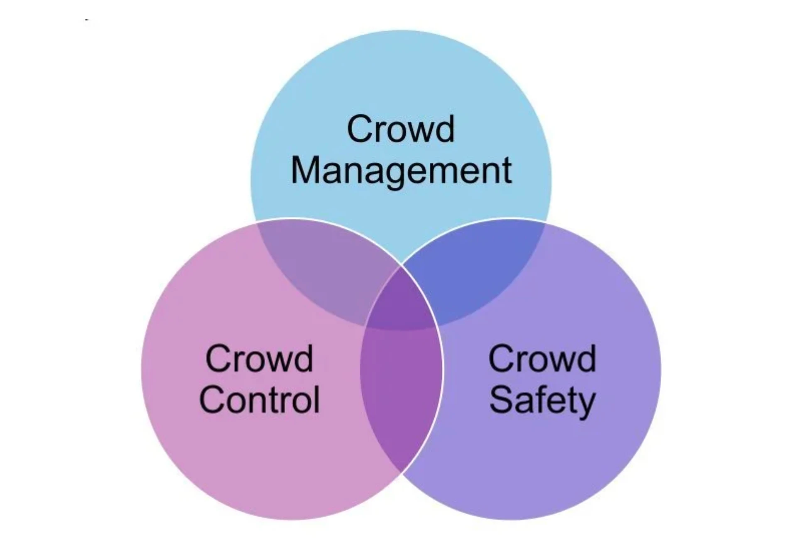

El plan de autoprotección fija cuántas personas caben en un evento y por dónde salen, pero no dice cómo saber, durante el evento, cuántas hay en cada zona. Esta guía explica qué pide la norma, por qué una cifra de aforo para todo el recinto no basta y qué métodos existen para medir la ocupación real, con sus límites. Está pensada para quien organiza eventos o gestiona espacios, no para juristas: no sustituye a la normativa de cada comunidad autónoma ni al criterio del ayuntamiento.

## 1. Qué es un plan de autoprotección y quién debe tenerlo

En España lo regula el **Real Decreto 393/2007, Norma Básica de Autoprotección**. Elaborarlo, implantarlo, mantenerlo y revisarlo es responsabilidad del **titular de la actividad**, que además debe presentarlo a la administración que concede la licencia ([BOE](https://www.boe.es/buscar/act.php?id=BOE-A-2007-6237)).

Para espectáculos públicos y actividades recreativas, el anexo I de la norma lo exige a partir de estos aforos:

| Tipo de espacio | Obligatorio a partir de |
| --- | --- |
| Edificio cerrado | 2.000 personas (o 28 m de altura de evacuación) |
| Instalación cerrada desmontable o de temporada | 2.500 personas |
| Actividad al aire libre | 20.000 personas |

Son mínimos estatales. Las comunidades autónomas y los ayuntamientos pueden pedirlo con aforos menores: Zaragoza, por ejemplo, lo exige a partir de 10.000 asistentes ([Ayuntamiento de Zaragoza](https://www.zaragoza.es/sede/servicio/tramite/4032)). Antes de organizar un evento conviene preguntar en el ayuntamiento qué se aplica allí.

La norma también fija cómo se mantiene vivo el plan: un **simulacro al menos una vez al año** y una **revisión como máximo cada tres años**. Sus datos se inscriben en un registro administrativo, que normalmente gestiona la comunidad autónoma ([BOE](https://www.boe.es/buscar/act.php?id=BOE-A-2007-6237)).

## 2. Qué dice el plan sobre el aforo y la evacuación

El contenido mínimo del plan (anexo II) tiene nueve capítulos. Tres tienen que ver directamente con cuánta gente hay y por dónde sale:

- **Capítulo 3, análisis de riesgos:** hay que identificar, cuantificar y clasificar a las personas que acceden, tanto plantilla como público.
- **Capítulo 4, medidas y medios:** incluye las vías de evacuación y las zonas de confinamiento, con el número de personas que hay que evacuar o confinar en cada zona.
- **Capítulo 6, plan de actuación ante emergencias:** detección y alerta, alarma, evacuación o confinamiento y quién hace qué.

El aforo de un edificio o recinto suele calcularse con el **Código Técnico de la Edificación, documento DB-SI 3**, que asigna una superficie por persona según el uso ([DB-SI 3](https://normatia.com/es/normativa/cte-db-si/2025/seccion-si-3-evacuacion-de-ocupantes)):

| Uso | Superficie por persona | Equivale a |
| --- | --- | --- |
| Espectadores de pie | 0,25 m² | 4 personas/m² |
| Discotecas | 0,5 m² | 2 personas/m² |
| Público de pie en bares y cafeterías | 1 m² | 1 persona/m² |
| Público sentado con asientos definidos | 1 persona por asiento | — |

Con esa ocupación se dimensionan las salidas. Por ejemplo, una puerta debe tener al menos 1 m de anchura por cada 200 personas que evacuen por ella (A ≥ P/200, con un mínimo de 0,80 m) ([DB-SI 3](https://normatia.com/es/normativa/cte-db-si/2025/seccion-si-3-evacuacion-de-ocupantes)). El DB-SI está pensado para edificios; en eventos al aire libre los criterios de aforo los fijan la comunidad autónoma o el ayuntamiento.

## 3. Por qué la cifra del plan no basta

El aforo del plan es una cifra para **todo el recinto** y supone que la gente se reparte por igual. Durante el evento no ocurre: el público se concentra frente al escenario, en los accesos, en las barras y en los estrechamientos.

Un ejemplo ilustrativo: un recinto de 5.000 m² para público de pie tiene, a 4 personas/m², un aforo de 20.000. Si hay 20.000 personas y una cuarta parte se agrupa en los 1.000 m² frente al escenario, allí hay 5 personas/m²; el resto queda a 3,75. El total cumple el aforo, pero la zona del escenario está en el límite superior que se acepta para público parado.

Además, los valores de cálculo son altos si se comparan con los que usa la ciencia de multitudes para el día a día:

- **2 personas/m²** es el límite habitual para evaluar eventos, y **5 personas/m²** el máximo para público parado en zonas de visión ([G. Keith Still](https://www.gkstill.com/Support/crowd-density/CrowdDensity-1.html)).
- Cuando la gente **camina**, el flujo ya se vuelve inestable por encima de unas 0,8 personas/m² y la congestión es casi segura por encima de 1,6 ([Gerlach y Seyfried, Universidad de Wuppertal](https://svpt.uni-wuppertal.de/fileadmin/bauing/svpt/Publikationen/LoPa_EVC_Beitrag_english.pdf)).

Es decir, una cifra pensada para dimensionar salidas no sirve como umbral de alerta. Lo explicamos con más detalle, con casos reales, en [Del conteo a la predicción de congestiones](/es/research/conteo-prediccion-congestiones).

## 4. Cómo medir la ocupación durante el evento

La guía de seguridad en eventos del regulador británico (HSE) propone vigilar tres cosas: el **total** de personas, cómo se **reparten** y cómo **entran y salen** de cada zona, con atención especial a accesos, frentes de escenario, colas, escaleras y estrechamientos ([HSE](https://www.hse.gov.uk/Event-Safety/crowd-management-monitoring.htm)). Ningún método lo cubre todo:

| Método | Qué mide | Funciona mejor en | Límites |
| --- | --- | --- | --- |
| Contadores manuales | Entradas y salidas en un punto | Accesos controlados, eventos pequeños | Depende de la atención de cada persona; no dice cómo se reparte el público dentro |
| Tornos, entradas o pulseras con chip | Total de entradas (y salidas, si se registran) | Recintos cerrados con acceso controlado | No sirve en vía pública; no ve concentraciones dentro del recinto |
| Personal de seguridad observando | Ambiente, empujones, personas con problemas | Todo evento; detecta lo que un sensor no ve | No da cifras; cubre mal zonas grandes o con poca visibilidad |
| Cámaras (CCTV) | Imagen de la zona; con software, conteo y densidad | Puntos críticos con buena luz | Captan imágenes de personas identificables, que son datos personales: cartel informativo, finalidad limitada y borrado al mes como norma ([AEPD](https://www.aepd.es/guias/guia-videovigilancia.pdf)) |
| Señales de móviles o wifi | Dispositivos detectados en una zona | Tendencias y movimientos a escala de ciudad | Cuenta dispositivos, no personas: alguien puede llevar dos o ninguno ([arXiv 2401.09014](https://arxiv.org/pdf/2401.09014)) |
| Sensores de conteo (LiDAR, térmicos) | Personas y densidad por zona, minuto a minuto | Zonas críticas concretas, de día y de noche | Necesitan instalación y validación en cada sitio; el LiDAR no capta caras, pero no es anónimo por naturaleza ([El LiDAR en 10 preguntas](/es/research/lidar-en-10-preguntas)) |

En un evento abierto, sin vallas ni tornos, el HSE recomienda muestrear el caudal en los accesos y hacer conteos aproximados en pequeñas áreas marcadas ([HSE](https://www.hse.gov.uk/Event-Safety/crowd-management-monitoring.htm)). Combinar métodos suele funcionar mejor que confiar en uno solo: el conteo da la cifra, y el personal y las cámaras dan el contexto.

## 5. Qué conviene añadir al plan

La norma no pide medir la ocupación durante el evento, pero el plan es el lugar natural para dejarlo escrito. Una lista de comprobación:

- **Zonas y puntos críticos.** Dividir el recinto en zonas y marcar dónde se concentra la gente: accesos, frente de escenario, barras, escaleras y estrechamientos. El HSE lo propone para recintos al aire libre con límites poco claros ([HSE](https://hse.gov.uk/event-safety/crowd-management-assess.htm)).
- **Umbrales por zona**, distintos para público parado y para público que camina, en lugar de una sola cifra para todo el recinto.
- **Método de medida** para cada zona, con quién lo opera y cada cuánto se revisa.
- **Quién mira los datos y quién decide**, y qué hace en cada umbral: abrir otra salida, cortar un acceso, avisar por megafonía.
- **Probarlo en el simulacro anual** junto con el resto del plan.
- **Qué datos se guardan y cuánto tiempo**, sobre todo si hay cámaras.

Las referencias internacionales van en la misma dirección. La norma **ISO 22353:2026**, publicada en agosto de 2026, da pautas de gestión de multitudes para organizadores, recintos y servicios de emergencia, incluida la evaluación del aforo y la gestión de llegadas, circulación y salidas ([ISO](https://www.iso.org/standard/50259.html)).

## Límites de esta guía

- **No es asesoramiento jurídico.** Resume la norma estatal; las comunidades autónomas y los ayuntamientos añaden requisitos propios, también para eventos en vía pública.
- **El DB-SI se aplica a edificios.** Las densidades de la tabla no tienen por qué ser las que pida un ayuntamiento para un evento al aire libre.
- **El ejemplo del apartado 3 es ilustrativo**, no un cálculo real de ningún recinto.
- **No hemos leído el texto completo de la ISO 22353**, solo su resumen oficial.

## Fuentes

**Normativa**

- [Real Decreto 393/2007, Norma Básica de Autoprotección](https://www.boe.es/buscar/act.php?id=BOE-A-2007-6237) (BOE)
- Código Técnico de la Edificación: [DB-SI 3, Evacuación de ocupantes](https://normatia.com/es/normativa/cte-db-si/2025/seccion-si-3-evacuacion-de-ocupantes)
- Ayuntamiento de Zaragoza: [trámite del plan de autoprotección](https://www.zaragoza.es/sede/servicio/tramite/4032)
- AEPD: [Guía sobre el uso de videocámaras para seguridad y otras finalidades](https://www.aepd.es/guias/guia-videovigilancia.pdf)
- ISO: [ISO 22353:2026, Security and resilience — Guidelines for crowd management](https://www.iso.org/standard/50259.html)

**Guías y estudios**

- HSE: [Monitor the crowd](https://www.hse.gov.uk/Event-Safety/crowd-management-monitoring.htm) y [Assess crowd safety risks and identify hazards](https://hse.gov.uk/event-safety/crowd-management-assess.htm)
- G. Keith Still: [Crowd density](https://www.gkstill.com/Support/crowd-density/CrowdDensity-1.html)
- Gerlach y Seyfried, [Universidad de Wuppertal](https://svpt.uni-wuppertal.de/fileadmin/bauing/svpt/Publikationen/LoPa_EVC_Beitrag_english.pdf): umbrales de densidad en flujos peatonales
- [Conteo de flujos de personas con distintos sensores](https://arxiv.org/pdf/2401.09014) (arXiv 2401.09014)

*Borrador del 1 de noviembre de 2026. Pendiente de fecha de publicación.*
