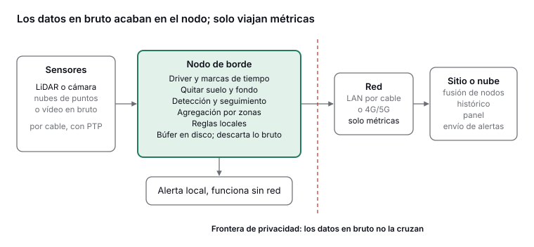

*Nubes de puntos de veinte LiDAR fusionadas en una sola escena del vestíbulo central de la estación de Nagoya, con las personas como columnas de puntos de colores. Fuente: [Hishida et al., 2026](https://link.springer.com/article/10.1007/s13177-025-00610-9), fig. 4, Int. J. ITS Research, CC BY 4.0.*

Procesar los datos del sensor en el mismo dispositivo que los capta, y enviar fuera solo recuentos, densidades y trayectorias, es la opción por defecto correcta para monitorizar multitudes. Es la forma más sencilla de cumplir la protección de datos, saca la red del camino de las alertas, reduce el tráfico de subida en unos tres órdenes de magnitud y mantiene el sistema en marcha cuando las redes móviles se saturan, que es justo cuando hay más gente. Los sistemas LiDAR desplegados en el vestíbulo de una estación de tren japonesa, en farolas de una universidad y en un edificio con 70 sensores demuestran que el hardware embebido actual está a la altura. Los problemas difíciles ahora son la calibración, la sincronización de relojes, el traspaso entre sensores y el funcionamiento seguro de dispositivos en el espacio público.

## Qué significa «borde» en la monitorización de multitudes

El *edge computing* o computación en el borde consiste en procesar los datos en el extremo de la red, cerca de donde se generan, para reducir el tiempo de respuesta y el coste de ancho de banda y para proteger la privacidad ([Shi et al., 2016](https://ui.adsabs.harvard.edu/abs/2016IITJ....3..637S/abstract)). En la monitorización de multitudes ayuda pensar en tres niveles:

- **Nivel del sensor:** LiDAR, cámaras estéreo o RGB, radar. Produce fotogramas o nubes de puntos en bruto.
- **Nivel del nodo (el borde):** un ordenador embebido junto a uno o pocos sensores, o dentro de su misma carcasa. Filtra, detecta, sigue y agrega. Aquí es donde deben acabar los datos en bruto.
- **Nivel del sitio o la nube:** un servidor local, un nodo de borde de un operador de telecomunicaciones o un servicio en la nube que combina las métricas de muchos nodos, guarda el histórico y sirve los paneles.

La pregunta de diseño no es «borde o nube», sino dónde trazar la línea a partir de la cual solo viajan datos anónimos y agregados. Para la seguridad de las multitudes, la línea defendible está en el nodo.

## Cuatro razones para procesar en el nodo

### 1. Privacidad y minimización de datos

El RGPD exige limitar los datos personales a lo necesario (art. 5.1.c) y exige protección de datos desde el diseño, decidida al diseñar el sistema (art. 25) ([art. 5](https://gdprfine.com/articles/article-5-data-minimisation), [art. 25](https://www.dsgvo-portal.de/gdpr_article_25.php), en inglés). Un sistema cuyo fin es medir densidad y flujo no necesita que el vídeo o las nubes de puntos en bruto salgan del dispositivo.

El LiDAR se presenta a menudo como anónimo porque no capta caras ni colores ([Ohno et al.](https://arxiv.org/pdf/2303.09915)). Es cierto, pero incompleto. LidarGait creó un conjunto de datos de 25.239 secuencias de 1.050 personas y demostró que los rasgos 3D de la forma de caminar en nubes de puntos permiten reconocer a individuos, en exterior mejor que las siluetas de cámara ([Shen et al., CVPR 2023](https://arxiv.org/abs/2211.10598)). Por tanto, las secuencias de nubes de puntos pueden ser datos biométricos. La regla práctica: procesar las nubes de puntos en bruto en el nodo y descartarlas allí, de modo que solo salgan métricas agregadas.

### 2. Latencia

A 10 Hz, un fotograma LiDAR llega cada 100 ms. La detección en el nodo usa solo parte de ese margen: 17,42 ms por muestra en el contador montado en farolas de la Universidad Estatal de Arizona ([Chen et al.](https://visa.lab.asu.edu/web/wp-content/uploads/2026/01/ICDCSa.pdf)) y 12 ms por fotograma con un detector Random Forest solo en CPU en NORCE ([Belbachir et al., 2025](https://pmc.ncbi.nlm.nih.gov/articles/PMC12304050/)). Una regla local, como una densidad por encima de cierto nivel en una zona, puede saltar en uno o dos fotogramas, sin ida y vuelta por la red. No se ha encontrado ningún estudio publicado que compare directamente el tiempo desde la captura hasta la alerta en sistemas de multitudes en el borde frente a la nube; el argumento se basa en los márgenes por fotograma y en el comportamiento medido de las redes.

### 3. Ancho de banda

| Flujo de datos | Tasa | Fuente |
| --- | --- | --- |
| Ouster OS0-32, en bruto | 655.360 puntos/s; 66 Mbit/s | Tabla de especificaciones en [Chen et al.](https://arxiv.org/pdf/2311.18077) |
| Livox Mid-360, en bruto | 200.000 puntos/s a 10 Hz | [Manual de usuario de Livox](https://terra-1-g.djicdn.com/65c028cd298f4669a7f0e40e50ba1131/Mid360/Livox_Mid-360_User_Manual_EN.pdf) |
| Livox Mid-360, en bruto | ≈ 22 Mbit/s | Estimación: 200.000 puntos/s × unos 14 bytes por punto |
| Veinte LiDAR en un mismo sitio, en bruto | ≈ 0,4–1,3 Gbit/s | Estimación a partir de las filas anteriores |
| Métricas por zona (40 zonas; recuento, densidad y velocidad una vez por segundo) | ≈ 10–25 kbit/s | Estimación |

La proporción es de unas 1.000 a 5.000 veces por sensor. Incluso dentro de una estación, el LiDAR en bruto a gran escala satura la red: el equipo de Nagoya cuenta que los límites de ancho de banda dificultaron conectar todo el equipo a una sola red, y por eso repartieron el procesamiento entre varios ordenadores ([Hishida et al., 2026](https://link.springer.com/article/10.1007/s13177-025-00610-9)).

### 4. Resiliencia

Las redes fallan justo en las condiciones para las que existe la monitorización de multitudes. Un estudio de medición de 2026 en un estadio con 77.622 espectadores encontró que el 46 % de las subidas de imágenes por la red móvil fallaron el día del partido ([arXiv 2607.16008](https://arxiv.org/pdf/2607.16008)). La capacidad de subida es precisamente lo que necesita un sensor que depende de la nube.

En la Love Parade de Duisburgo de 2010, los móviles no funcionaron aproximadamente entre las 15:30 y las 18:00 por saturación de la red, y el contacto por radio fue deficiente ([Helbing y Mukerji, 2012](https://arxiv.org/pdf/1206.5856)). Esos fallos afectaron a la comunicación entre personas, no a sistemas de sensores, y nada de lo dicho aquí sugiere que alguna tecnología hubiera evitado el desastre. La lección de ingeniería es más acotada: un sistema de monitorización que necesita una red móvil pública para dar una alerta debe considerarse no disponible en el momento de máxima afluencia. Los nodos deben poder calcular, alertar en local y guardar datos por su cuenta.

## Una arquitectura de referencia

*Los sensores envían los datos en bruto por un enlace de cable dedicado al nodo de borde, que detecta, sigue y agrega a las personas por zona y puede dar una alerta local por sí solo. Solo las métricas cruzan la frontera de privacidad hacia la red y de ahí a un servidor del sitio o a la nube, que combina los nodos, guarda el histórico y sirve los paneles. Diagrama propio.*

## Cómo es un nodo de borde

### Hardware

| Componente | Opción habitual | Cifras y notas de diseño |
| --- | --- | --- |
| Sensor | LiDAR 3D, cámara estéreo o de profundidad | Livox Mid-360: campo de visión de 360° × (−7° a 52°), 200.000 puntos/s, 10 Hz, 6,5 W, IP67, Ethernet, sincronización PTPv2 ([especificaciones](https://www.livoxtech.com/mid-360/specs)) |
| Cálculo | NVIDIA Jetson Orin NX u Orin Nano; la Jetson Nano, más antigua; Google Coral | Orin NX: hasta 100 TOPS con 10–25 W ([NVIDIA](https://www.nvidia.com/en-us/autonomous-machines/embedded-systems/jetson-orin/)). Nagoya usó dos Orin NX por cada cinco LiDAR; ASU, una Jetson Nano y una placa Coral |
| Almacenamiento | SSD industrial | Para guardar datos cuando cae la red, y para los registros |
| Conectividad | Ethernet por cable entre sensor y ordenador; 4G/5G o wifi solo para las métricas | El enlace del sensor lleva datos en bruto y debe ser un tramo de cable dedicado |
| Alimentación | Power over Ethernet, red eléctrica o la del evento, con SAI | Unos 6,5 W del sensor, más 10–25 W de cálculo, más la red |
| Carcasa | Estanca, ventilada y antivandálica | ASU metió sus equipos dentro de la farola y vigilaba la temperatura interior |

### El software, paso a paso

1. **Driver y marcas de tiempo:** recibir los paquetes y marcarlos con un reloj sincronizado.
2. **Zona de interés y eliminación del suelo:** quedarse solo con el área transitable y quitar el suelo.
3. **Eliminación del fondo:** quitar la estructura fija usando un mapa guardado del sitio.
4. **Agrupación y detección:** agrupar los puntos cercanos y clasificar qué grupos son personas, con un clasificador sencillo o un detector neuronal 3D.
5. **Seguimiento:** enlazar a cada persona entre fotogramas, normalmente con un filtro de Kalman.
6. **Agregación:** recuentos, densidad por m², velocidad, dirección y cruces de línea por zona.
7. **Reglas locales:** umbrales y alertas por ritmo de cambio, evaluados en el nodo.
8. **Publicar y guardar:** enviar las métricas con número de secuencia; ponerlas en cola en disco cuando cae el enlace.
9. **Descartar lo bruto:** guardar los fotogramas en bruto, si acaso, solo en un búfer breve en memoria.

*Configuración del software del sistema de 20 LiDAR de la estación de Nagoya (diagrama original en inglés): cada Jetson ejecuta el driver, el preprocesado y la detección de personas de sus LiDAR; el seguimiento se hace después con todas las detecciones juntas. Fuente: [Hishida et al., 2026](https://link.springer.com/article/10.1007/s13177-025-00610-9), Int. J. ITS Research, CC BY 4.0.*

Los sistemas de investigación suelen grabar las nubes de puntos en bruto para validar, como hace este: se guardan en el SSD de cada Jetson, después se copian a un disco duro y el seguimiento se hace a posteriori. Un sistema en operación descartaría los datos en bruto en el nodo y guardaría solo las detecciones y las métricas.

## Evidencia de sistemas reales

Todos los sistemas siguientes detectaron personas en hardware embebido o solo con CPU, dentro del margen de 100 ms de un sensor a 10 Hz.

| Estudio | Montaje | Hardware en el borde | Resultado |
| --- | --- | --- | --- |
| [Hishida et al., Universidad de Nagoya y JR Central, 2026](https://link.springer.com/article/10.1007/s13177-025-00610-9) | 20 LiDAR a 10 Hz en el vestíbulo central de la estación de Nagoya | 8 Jetson Orin NX, dos por cada grupo de cinco LiDAR; detector IA-SSD optimizado con TensorRT | HOTA superior al 90 % en una zona de 900 m² cubierta por dos o más LiDAR; seguimiento hecho a posteriori |
| [Chen et al., Universidad Estatal de Arizona](https://visa.lab.asu.edu/web/wp-content/uploads/2026/01/ICDCSa.pdf) | Ouster OS0-32 en farolas de emergencia del campus, sobre un paseo de 5 m | Jetson Nano y placa Coral dentro de la farola; modelo cuantizado a 8 bits | 17,42 ms por muestra; 97,64 % de acierto con alta densidad |
| [Belbachir et al., NORCE, 2025](https://pmc.ncbi.nlm.nih.gov/articles/PMC12304050/) | Ouster OS1-128 en un recinto de congresos | Random Forest solo en CPU con 15 rasgos de geometría e intensidad | 12 ms por fotograma; mismo F1 que PointNet y 2,5 veces más rápido |
| [Ohno et al., Universidad de Osaka](https://arxiv.org/pdf/2303.09915) | 70 LiDAR en seis plantas de un edificio del campus, sin campos de visión solapados | Procesamiento por LiDAR: eliminación del fondo, agrupación, seguimiento con Kalman | F-measure de 0,98 al reconocer a 32 personas de un sensor a otro, sin imágenes |

*Nube de puntos LiDAR de un recinto de congresos, con las personas que encuentra el detector resaltadas en rojo. Fuente: [Belbachir et al., 2025](https://pmc.ncbi.nlm.nih.gov/articles/PMC12304050/), fig. 6, SN Computer Science, CC BY 4.0.*

El resultado de NORCE importa para el diseño en el borde: un clasificador clásico con rasgos elegidos a mano igualó a una red profunda con una fracción del coste. También existen plataformas comerciales con procesador en el borde, pero sus cifras publicadas de precisión y latencia son afirmaciones comerciales sin evaluación independiente.

## Diseñar para el fallo

- **Alertas primero en local.** Evaluar las reglas de seguridad en el nodo o en un servidor del sitio accesible por una red de cable privada, con una salida local (un relé, una pantalla, una señal a la sala de control) que no dependa de la red pública.
- **Guardar y reenviar.** Dar a cada mensaje un identificador de nodo, un número de secuencia y una marca de tiempo sincronizada; ponerlo en cola en disco cuando falla el enlace y reenviarlo al reconectar. A unos 20 kbit/s, guardar 2,5 horas de métricas (lo que duró el corte en la Love Parade) ocupa unos 22 MB.
- **Modos degradados explícitos.** Sin enlace: seguir calculando y alertando en local. Sin un sensor: mostrar sus zonas como «sin datos», no como «cero personas». Sin sincronización de reloj: seguir funcionando pero marcar los datos como no sincronizados. Cálculo saturado: bajar la frecuencia de fotogramas o reducir la zona antes de abandonar zonas.
- **Vigilancia de salud.** Publicar latidos con temperatura, reducción de rendimiento por calor, frecuencia de fotogramas, paquetes perdidos, desfase del reloj, uso de disco y versión del modelo. El calor dentro de carcasas cerradas es un riesgo de primer orden.
- **No confundir silencio con seguridad.** Un panel debe distinguir «0 personas/m²» de «nodo desconectado».

## De un nodo a muchos

### Calibración entre sensores

Para combinar datos hay que conocer la posición y orientación de cada sensor en un sistema de referencia común del sitio. En Nagoya construyeron un mapa 3D del sitio, alinearon cada sensor a mano de forma aproximada y lo afinaron automáticamente con ICP ([Hishida et al., 2026](https://link.springer.com/article/10.1007/s13177-025-00610-9)). Los métodos de calibración sin dianas están mejorando: uno reciente mantuvo errores de 5 cm y 1° en casos difíciles con 16 tipos de LiDAR, pero depende del movimiento de plataformas móviles, así que hay que probarlo antes de usarlo con sensores fijos y muy separados ([Duan et al., 2024](https://arxiv.org/abs/2405.05589)). En instalaciones fijas, un buen mapa del sitio más ICP por sensor sigue siendo la base práctica; hay que repetirlo cada vez que se toca un soporte.

### Sincronización de relojes

A velocidad de paseo (unos 1,3 m/s), un desfase de 100 ms entre los relojes de dos sensores desplaza a una persona unos 13 cm, suficiente para crear trayectorias duplicadas o rotas donde las vistas se solapan. Sensores como el Livox Mid-360 admiten el protocolo PTP (IEEE 1588, PTPv2) y marcan cada punto con precisión de nanosegundos ([manual de Livox](https://terra-1-g.djicdn.com/65c028cd298f4669a7f0e40e50ba1131/Mid360/Livox_Mid-360_User_Manual_EN.pdf)). Hay que usar PTP en la red de sensores; NTP basta para los mensajes de métricas y los registros, no para fusionar puntos.

### Traspaso de trayectorias entre sensores

Donde los campos de visión se solapan, el traspaso es geométrico: las trayectorias se emparejan por posición y velocidad. Donde no, se convierte en reidentificación. El sistema de Osaka empareja tramos de trayectoria entre sensores usando rasgos de forma de la nube de puntos y un modelo de tiempos de recorrido, y alcanza un F-measure de 0,98 ([Ohno et al.](https://arxiv.org/pdf/2303.09915)). Eso crea una tensión con la privacidad: enlazar los movimientos de una persona por todo un sitio es justo lo que advierte LidarGait. Si el objetivo es el flujo, mejor contar pasos entre zonas y usar identificadores de trayectoria de vida corta que se reinicien en los límites de cada zona.

### Flujos a partir de pocos puntos de observación

Cubrirlo todo rara vez es asumible. Investigadores de la Universidad de Osaka estiman los flujos peatonales de un área a partir de recuentos en unos pocos puntos de observación, calculando las rutas que mejor encajan con esos recuentos; frente a la estación JR de Osaka, los errores de estimación se quedaron por debajo de un 8 % ([Higashino et al., 2017](https://ieeexplore.ieee.org/document/7980110/)). Unos pocos nodos bien colocados en accesos, cuellos de botella y cruces, combinados con un modelo de la red de calles, pueden reconstruir los flujos generales; el seguimiento denso solo hace falta donde importa la dinámica local.

## Piezas de código abierto

Casi toda la cadena puede montarse con piezas de código abierto con licencias que permiten uso comercial. Comprueba la licencia de cada repositorio en la versión que despliegues, sobre todo la de los pesos de los modelos.

| Componente | Para qué sirve | Licencia |
| --- | --- | --- |
| [livox_ros_driver2](https://github.com/Livox-SDK/livox_ros_driver2/blob/master/LICENSE.txt) y Livox-SDK2 | Drivers de los sensores Livox; publicación en ROS 2 | MIT |
| Autoware Universe | Segmentación del suelo, agrupación, detección con CenterPoint y seguimiento multiobjeto como nodos de ROS 2; hecho para vehículos, reutilizable con sensores fijos | Apache-2.0 |
| [Autoware lidar_transfusion](https://huggingface.co/AutowareFoundation/lidar_transfusion) | Detector 3D en formato ONNX, que se compila como motor TensorRT en el dispositivo; entrenado con datos de vehículos, así que probablemente habrá que reentrenarlo para vistas cenitales | Apache-2.0 |
| [OpenPCDet](https://github.com/open-mmlab/openPCDet) | Entrenar detectores 3D para LiDAR (PointPillars, PV-RCNN y otros) | Apache-2.0 |
| mmdetection3d | Caja de herramientas de detección 3D de OpenMMLab | Apache-2.0 |
| PCL (Point Cloud Library) | Filtrado, segmentación, registro (ICP) | BSD |
| [Open3D](https://github.com/isl-org/Open3D/blob/main/LICENSE) | Procesado de nubes de puntos, registro, visualización | MIT |
| ROS 2 | Middleware, grabación, herramientas | Apache-2.0 (núcleo) |
| MQTT (por ejemplo, Eclipse Mosquitto) | Publicación/suscripción ligera para las métricas; los mensajes de «última voluntad» ayudan a vigilar la salud de los nodos | Estándar abierto |
| NVIDIA JetPack y TensorRT | Soporte de la placa e inferencia optimizada | Propietario (algunas partes abiertas); crea dependencia del fabricante |

## Límites y compromisos

- **Cálculo, consumo y calor.** Los módulos de tipo Jetson consumen 10–25 W y bajan el rendimiento cuando se calientan; las cajas exteriores cerradas al sol en verano son el punto débil habitual. Las cadenas clásicas cuestan mucho menos que los detectores 3D profundos y pueden bastar para contar.
- **Generalización.** Los detectores profundos son sensibles a la altura del sensor, la densidad y la oclusión. Nagoya entrenó con solo 312 fotogramas etiquetados, lo que demuestra que un etiquetado bien dirigido funciona, pero cada sitio nuevo necesita validación.
- **La alta densidad sigue siendo difícil.** A partir de unas pocas personas por m², los grupos de puntos se fusionan y domina la oclusión. Los sensores solapados son el principal remedio.
- **Seguridad.** Los nodos en el espacio público son físicamente accesibles. Hay que usar arranque seguro, almacenamiento cifrado, actualizaciones firmadas con vuelta atrás, nada de contraseñas por defecto y conexiones solo salientes. Como los datos en bruto nunca salen del nodo, un enlace comprometido expone métricas, no imágenes.
- **Operación de la flota.** Distintas versiones del modelo en distintos nodos rompen las comparaciones sin que se note; hay que registrar la versión del modelo en cada mensaje.
- **Coste.** El borde traslada el coste del ancho de banda y el cálculo en la nube al hardware por sensor y al mantenimiento en campo. NVIDIA da un precio por volumen de 999 dólares para el módulo Jetson Orin NX de 16 GB, sin contar placa base, almacenamiento ni alimentación.
- **A posteriori frente a tiempo real.** Algunos de los mejores resultados, como el seguimiento de Nagoya, usan fotogramas futuros y se calculan a posteriori. Las alertas en tiempo real necesitan algoritmos de seguimiento que solo miren hacia atrás, y suelen aceptar menos precisión.

## Conclusión

El procesamiento en el borde no es una optimización para monitorizar multitudes: es la arquitectura que mejor encaja con la ley de protección de datos, hace que las alertas no dependan de redes saturadas y permite sistemas con muchos sensores sobre infraestructura real. Detectar personas en datos LiDAR a 10 Hz con hardware embebido está, en gran parte, resuelto. Lo que queda es ingeniería de sistemas: calibración, sincronización, traspaso, gestión de fallos y mantener los dispositivos seguros durante toda su vida útil.

## Advertencias

- Las cifras de ancho de banda marcadas como estimación son cálculos, no mediciones.
- Los horarios de las comunicaciones en la Love Parade proceden de la recopilación de fuentes públicas y prensa de Helbing y Mukerji, no de un informe técnico oficial.
- Algunas cifras de los artículos de Nagoya y ASU proceden de las versiones que se pudieron leer en línea; conviene contrastarlas con los artículos publicados definitivos antes de citarlas en otro sitio.
- Las licencias cambian; confirma cada una en la versión que uses.

## Referencias

- Shi, W. et al. (2016). [Edge Computing: Vision and Challenges](https://ui.adsabs.harvard.edu/abs/2016IITJ....3..637S/abstract). *IEEE Internet of Things Journal* 3(5).
- Hishida, R., Iryo, M. et al. (2026). [Development of Methods for High-Density Crowd Measurement and Tracking in Railway Station Concourses](https://link.springer.com/article/10.1007/s13177-025-00610-9). *International Journal of Intelligent Transportation Systems Research*.
- Chen et al., Universidad Estatal de Arizona. [Conteo de personas con LiDAR en farolas](https://arxiv.org/pdf/2311.18077) y [HAWC-CC](https://visa.lab.asu.edu/web/wp-content/uploads/2026/01/ICDCSa.pdf).
- Belbachir et al. (2025). [Detección de personas en nubes de puntos LiDAR](https://pmc.ncbi.nlm.nih.gov/articles/PMC12304050/). *SN Computer Science*.
- Ohno et al. (2023). [Privacy-preserving Pedestrian Tracking using Distributed 3D LiDARs](https://arxiv.org/pdf/2303.09915).
- Higashino, T., Yamaguchi, H., Hiromori, A., Uchiyama, A. y Yasumoto, K. (2017). [Edge Computing and IoT Based Research for Building Safe Smart Cities Resistant to Disasters](https://ieeexplore.ieee.org/document/7980110/). IEEE ICDCS.
- Shen, C. et al. (2023). [LidarGait](https://arxiv.org/abs/2211.10598). CVPR.
- Duan et al. (2024). [Rotation Initialization and Stepwise Refinement for Universal LiDAR Calibration](https://arxiv.org/abs/2405.05589).
- Helbing, D. y Mukerji, P. (2012). [Crowd disasters as systemic failures: analysis of the Love Parade disaster](https://arxiv.org/pdf/1206.5856). *EPJ Data Science*.
- [Rendimiento de la red móvil en un estadio lleno](https://arxiv.org/pdf/2607.16008) (2026).
- RGPD, [artículo 5](https://gdprfine.com/articles/article-5-data-minimisation) y [artículo 25](https://www.dsgvo-portal.de/gdpr_article_25.php).
- [Especificaciones del Livox Mid-360](https://www.livoxtech.com/mid-360/specs) y [manual de usuario](https://terra-1-g.djicdn.com/65c028cd298f4669a7f0e40e50ba1131/Mid360/Livox_Mid-360_User_Manual_EN.pdf); [NVIDIA Jetson Orin](https://www.nvidia.com/en-us/autonomous-machines/embedded-systems/jetson-orin/).
