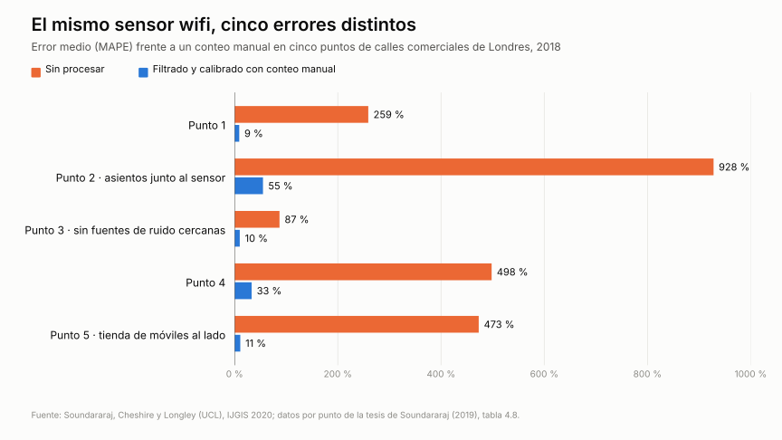

Para saber cuánta gente pasa por un lugar y a qué hora, organizadores de eventos, centros comerciales y autoridades utilizan desde hace años sensores que captan las señales wifi y Bluetooth de los móviles: pequeñas cajas en farolas, fachadas o techos, sin cámaras, que se instalan rápido y cuestan poco. Están en calles comerciales, estaciones y terminales de aeropuerto, y en España se han desplegado por ejemplo en destinos turísticos como [Córdoba](https://www.eldebate.com/espana/la-voz-de-cordoba/actualidad/20250219/hacia-nuevo-modelo-gestion-turistica-cordoba_271588_amp.html), [Guardamar del Segura](https://alicanteplaza.es/alicanteplaza/guardamar-adjudicapor-180000-euros-un-sistema-para-contabilizar-y-monitorizar-a-los-turistas) o [Altea](https://alicanteplaza.es/alicanteplaza/altea-implantara-un-sistema-de-control-de-aforo-en-sus-playas-y-el-casco-antiguo).

Su funcionamiento es sencillo. Un móvil con el wifi activado emite de vez en cuando mensajes para buscar redes conocidas, aunque no se conecte a ninguna; con el Bluetooth ocurre algo parecido. El sensor escucha esos mensajes y cuenta los dispositivos distintos que pasan cerca. De ahí salen cifras de afluencia, tiempos de estancia o recorridos. La pregunta es cuánto se parecen esas cifras al número real de personas.

En diciembre de 2017, un sensor colocado junto a un escaparate de Oxford Street, en Londres, captó unas 60.000 señales wifi en media hora. En ese tiempo pasaron por delante 3.722 personas, contadas a mano. Sin procesar, el error medio del sensor rondaba el 425 %; filtrando por intensidad de señal bajaba a alrededor del 30 % ([Soundararaj, Cheshire y Longley, UCL](https://discovery.ucl.ac.uk/id/eprint/10068691/1/Cheshire_Estimating%20real-time%20highstreet%20footfall%20from%20wi-fi%20probe%20requests_AAM.pdf)).

El ejemplo resume el problema. Un sensor wifi o Bluetooth no ve personas: oye a los móviles buscar redes. Pasar de ahí a una cifra de visitantes es una estimación, y su calidad depende de cómo se calibre.

## Por qué no salen las cuentas

- **No hay un móvil por persona.** Hay quien no lleva móvil o lo lleva con el wifi apagado, y quien lleva móvil, reloj y tableta. Routers, impresoras y otros equipos fijos también emiten.
- **Cada móvil habla a su ritmo.** La frecuencia con que un teléfono emite depende de la marca, de la versión del sistema y de si la pantalla está encendida. En el aeropuerto de Múnich, frente a las tarjetas de embarque escaneadas en el control de seguridad, el wifi contaba de más y el Bluetooth de menos: detectaba solo un 4 % de los dispositivos que veía el wifi ([Schauer, Werner y Marcus, 2014](https://www.bgd.ed.tum.de/pdf/2014_CROWDDENSITIES_Werner.pdf)).
- **La señal no respeta la calle.** Atraviesa paredes y llega de tiendas, terrazas o paradas de autobús cercanas. En Londres, los puntos con asientos junto al sensor contaban de más.

A eso se suma la dirección MAC aleatoria: para proteger la privacidad, los móviles cambian su identificador, por defecto desde iOS 14 y Android 10, así que un mismo teléfono puede contarse varias veces.

## El error se mueve

Lo importante no es que haya error, sino que no se queda quieto.

- **Por sitio.** En cinco puntos de calles comerciales de Londres, el error bruto iba del 87 % al 928 %. Hizo falta un factor de corrección distinto en cada punto, entre 0,51 y 1,60, y aun así el error calibrado quedó entre el 9 % y el 55 % (UCL).

*Error medio del mismo tipo de sensor en cinco puntos de Londres. Fuente: Soundararaj, Cheshire y Longley (UCL), IJGIS 2020; datos por punto de la tesis de Soundararaj (2019), tabla 4.8.*

- **Por hora.** En Gold Coast (Australia), comparando 17 sensores wifi con cámaras, el número de personas por dispositivo detectado osciló sobre todo entre 0,2 y 2 a lo largo del día, con picos de 2,8 ([Solmaz et al., 2019](https://arxiv.org/abs/1909.08522)). Un único coeficiente diario aplana justo los picos que interesa ver.
- **Con el tiempo.** Los investigadores de UCL descartaron un factor fijo porque la proporción de móviles con MAC aleatoria crecía año a año. Los fabricantes siguen cambiando ese comportamiento: desde iOS 18, el usuario puede elegir una dirección que rota cada dos semanas ([Apple](https://support.apple.com/en-us/102509)). Las autoridades españolas de protección de datos recuerdan que la forma de generar direcciones aleatorias no está estandarizada ([guía de AEPD, APDCAT, AVPD y CTPDA, 2024](https://www.aepd.es/guides/wi-fi-tracking-technologies-guidance-for-data-controllers.pdf)). Una serie de varios años sin recalibrar puede reflejar actualizaciones de teléfonos en lugar de visitantes.

## El mejor caso, y qué necesitó

El resultado más preciso que hemos encontrado viene de una biblioteca de la Université libre de Bruxelles. Durante nueve semanas de 2019, su sistema wifi llegó a un error medio del 12,7 % (MAPE: la desviación porcentual media frente a la referencia) ([Determe et al., IEEE Systems Journal, 2022](https://arxiv.org/abs/2010.10370)).

Pero fue en un edificio con accesos controlados, antes de iOS 14, y con un factor de extrapolación ajustado frente a un sistema de cámaras. Incluso ahí, ese factor cambió de una semana a otra, entre 4,66 y 5,47. **El wifi se acercó a la realidad cuando otro método le decía cuánta gente había.**

## Qué se deduce

El wifi y el Bluetooth tienen su sitio: son baratos, funcionan con cualquier tiempo y sirven para ver tendencias y flujos en áreas grandes. Pero para decidir sobre aforo o seguridad no basta con un factor calculado una vez. Hace falta un método que cuente cuerpos, no dispositivos, o al menos una referencia independiente y permanente con la que recalibrar.

## Tres preguntas antes de comprar el dato

1. ¿Frente a qué referencia se calibró (conteo manual, cámara, torniquete) y durante cuánto tiempo?
2. ¿Qué error se midió después, por punto y por franja horaria?
3. ¿Cada cuánto se recalibra, y quién lo hace tras cada actualización de iOS o Android?

Si el sistema llega a tratar datos personales, hay un motivo más: el RGPD exige que los datos sean exactos, y la guía de la AEPD lo recuerda expresamente para las estimaciones probabilísticas.

## Conclusión

Las señales de los móviles son una buena herramienta para seguir tendencias: cuántos visitantes hubo este mes frente al anterior, qué calles se llenan antes, cómo se reparten los flujos en un área grande. Pero una cifra de afluencia vale lo que vale su validación. Para interpretarla hay que saber qué registra el sensor, cómo convierte esos registros en personas, frente a qué referencia se comprobó, durante cuánto tiempo y con qué error.

Esa validación tiene que corresponder al uso: lo que basta para comparar dos temporadas no basta para decidir sobre el aforo de un recinto o la gestión de una multitud. Por eso el margen de error debería ser visible para quien usa el dato y publicarse junto con el método. Mientras no lo sea, y mientras no haya una referencia independiente que lo recalibre, el wifi y el Bluetooth dicen cuántos móviles hay, no cuánta gente.

*Revisión hecha el 2 de noviembre de 2026. Los estudios con referencia real que conocemos son anteriores a la generalización de la MAC aleatoria.*
